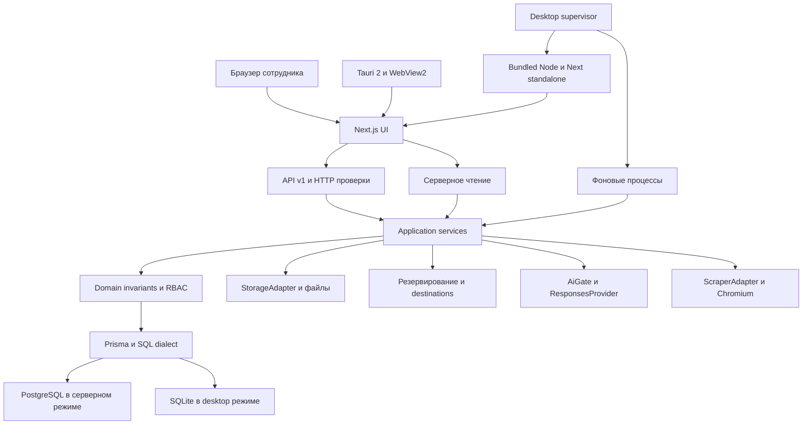
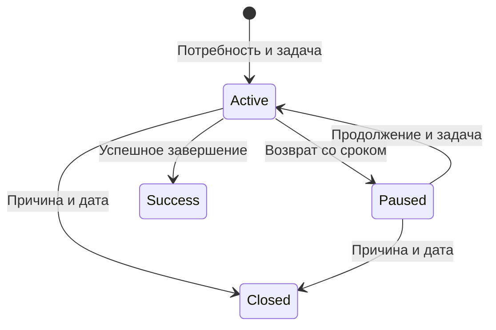
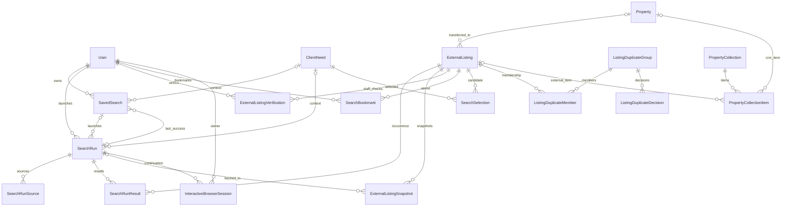
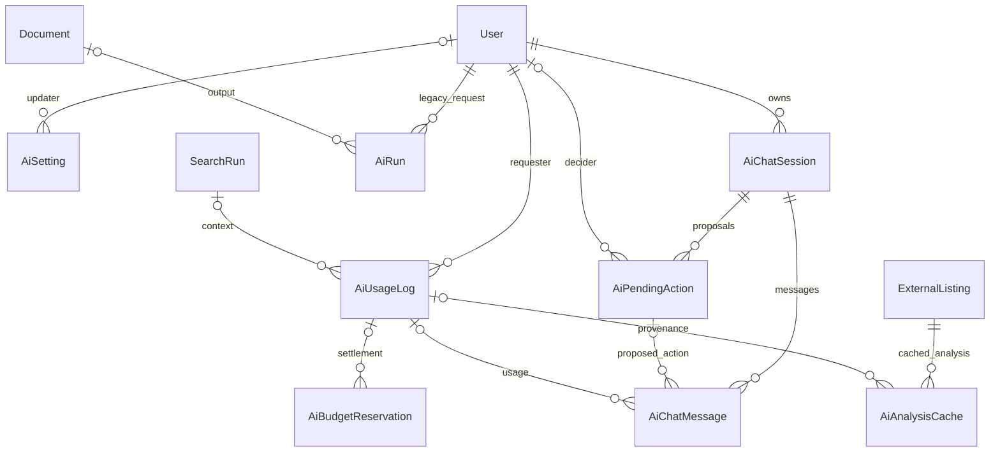
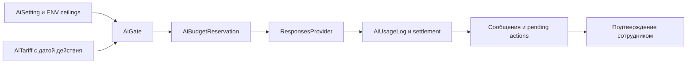

# CRM ООО «Магазин недвижимости»: фактическое описание проекта для магистерской диссертации

Дата среза — 09.11.2026. Ветка — `main`, HEAD — `a0cddf8b320ae9f076d98e22af644ba616558957`. Документ описывает существующий репозиторий, а не проект будущей системы. Новые сборки, тесты приложения, обращения к площадкам, облакам и платному AI при его подготовке не выполнялись. Количественные результаты испытаний заимствованы из указанных протоколов; статистика Git, файлов и схем подсчитана непосредственно в рабочей копии.

Приоритет доказательств: текущие схемы и код — для устройства системы; датированные протоколы — для результатов испытаний; Git — для истории; ТЗ — только для целей и требований. Требование, наличие реализации и подтверждённая эксплуатационная готовность различаются. Отсутствующие измерения обозначены прямо. Ссылки на файлы даны относительно `docs/thesis`.

## 1. Общие сведения

### 1.1. Предметная область, заказчик и проблема

Заказчик и предмет автоматизации — небольшое агентство недвижимости ООО «Магазин недвижимости». Система сопровождает продажу, покупку, аренду и сдачу недвижимости: от первого обращения до документов, комиссионных обязательств и постсделочных действий. Назначение проекта как материала выпускной квалификационной работы зафиксировано в [README](../../README.md).

Исходная проблема сформулирована в [baseline ТЗ v1.6.1](../../tz.md): информация распределена между Excel-файлами, обращения и результаты общения фиксируются несистемно, сроки контролируются вручную, знания о следующих действиях зависят от памяти сотрудников. Это описание постановки задачи; независимое обследование предприятия и хронометраж исходного процесса настоящим документом не подтверждаются. [Модель AS-IS → TO-BE](../vkr/as-is-to-be.md) также прямо отделяет постановку от измерений.

Цель — единый локально управляемый рабочий контур, который связывает клиента, обращения, потребности, объекты, показы, задачи, предложения, договоры, документы и сделки. Для сотрудника он должен снижать повторный ввод и помогать выполнять следующие действия; для руководителя — выявлять исключения и раскрывать первичные записи из отчётов. Экономия времени остаётся гипотезой до апробации, а не доказанным экономическим эффектом.

### 1.2. Пользователи и ответственность

| Роль | Код | Предусмотренная работа | Ограничения |
|---|---|---|---|
| Руководитель / администратор, в постановке также юрист | `manager` | Общие оперативные данные, распределение ответственности, пользователи, справочники, отчёты, исторический архив, импорт и обслуживание | Особые приватные браузерные сессии принадлежат создавшему их пользователю |
| Риелтор | `realtor` | Свои клиенты, доступные потребности, обращения, задачи и сделки; общий каталог недвижимости | Чужие клиентские сведения скрыты; контакты собственников чужих объектов требуют разрешения |

Постановка рассчитана на руководителя и двух риелторов. Это целевой состав предприятия, а не программный лимит числа учётных записей. Отдельная роль бухгалтера в baseline не требуется. Реальные коды ролей определены в [codebook](../../src/shared/codebook.ts), серверные условия — в [scopes](../../src/modules/access/domain/scopes.ts).

### 1.3. Основные принципы

- Клиент — субъект отношений; обращение — отдельное событие; потребность — конкретная задача клиента. Несколько потребностей одного клиента не смешиваются.
- У активной потребности должна оставаться незавершённая задача. На паузе требуется специальная задача `pause_return` со сроком. Закрытие требует причины и даты; успешное завершение сохраняется отдельным состоянием и историей.
- Отсутствие подходящих вариантов `no_match` не разрешает закрыть перспективную потребность: работа продолжается либо назначается возврат.
- Правило «чей объект, того и клиент» применяется к распределению нового обращения с учётом существующей клиентской ответственности; оно не даёт скрыто передать чужого клиента или открыть его карточку.
- Телефон и email нормализуются до проверки дублей. Автоматического объединения клиентов нет.
- Предложение сохраняет исторические условия объектов. Комиссия — самостоятельное обязательство, возможны несколько комиссий одной сделки.
- Основные операции не зависят от AI. Рабочая SQLite-база хранится на локальном диске. Перенос архивом не является синхронизацией одновременно редактируемых баз.

Основание: [сервис потребностей](../../src/modules/needs/application/need-service.ts), [инварианты](../../src/modules/needs/domain/need-invariant.ts), [регистрация обращения](../../src/modules/requests/application/request-service.ts), [сервис клиентов](../../src/modules/clients/application/client-service.ts), [руководство](../user-guide/v3.2.3/guide.md).

## 2. Требования

### 2.1. Источники и развитие требований

| Документ | Роль в постановке |
|---|---|
| [ТЗ v1.6.1](../../tz.md) | Core MVP, роли, физическая модель, инварианты, локальное развёртывание, T01–T10 |
| [ТЗ v2.4.1](../../ТЗ_CRM_итоговое_v2.4.1_проверено.md) | Поиск недвижимости, AI, календарь, уведомления и развитие рабочего контура |
| [ТЗ v3.1](../../ТЗ_CRM_v3.1_завершение_MVP_поиск_планер_AI_шаблоны.md) | Завершение MVP, очередь поиска, планер, подборки, шаблоны и AI-помощник |
| [ТЗ v3.2.1](../../ТЗ_CRM_v3.2.1_standalone_SQLite_облака_импорт_защита.md) | Самостоятельная Windows-установка, SQLite, облачные архивы и защищённый импорт |

Наличие требования в этих файлах само по себе не означает PASS. Фактические расширения v3.2.2–v3.2.3 описываются по коду и протоколам, а не выводятся из названия ТЗ.

### 2.2. Функциональные группы

| Группа | Требуемый результат | Исполняемая область |
|---|---|---|
| Клиентская работа | Карточки, контакты, обращения, история, дедупликация и ответственность | `clients`, `requests`, `communications` |
| Ведение потребности | Параметры, этапы, следующее действие, пауза, результат и история переходов | `needs`, `tasks`, `matching` |
| Объекты и показы | Каталог, собственники, доступ к контактам, фото, подбор и результаты показов | `properties`, `showings`, `documents` |
| Планирование | Сегодня, задачи, календарь, повторения, чек-листы и внутренние уведомления | `tasks`, `calendar`, `notifications` |
| Коммерческий контур | Подборки, КП со снимками, договоры, стороны сделки и комиссии | `collections`, `commercial-offers`, `agreements`, `deals` |
| Документы и реклама | Защищённые файлы, шаблоны, реквизиты юрлица, рекламные тексты и сроки | `documents`, `document-templates`, `legal-entities`, `advertisements` |
| Управление и данные | Отчёты с детализацией, импорт с предварительной проверкой, экспорт, архив и аудит | `reports`, `import`, `export`, `archive`, `audit` |
| Внешний поиск | Площадки, фильтры, очередь, снимки, доказательства соответствия и ручной путь | `property-search`, `listing-duplicates`, `browser-sessions` |
| Необязательный AI | Разбор, анализ, сравнение, ранжирование, помощь в контексте с бюджетом и подтверждением | `ai`, `ai-chat` |
| Эксплуатация | Пользователи, настройки, резервирование, проверка восстановления и перенос | `users`, `operations`, `desktop-setup`, `desktop-backup` |

Состав подтверждается [каталогом модулей](../../src/modules) и [API](../../src/app/api/v1); подробное соответствие приведено в разделе 4.

### 2.3. Нефункциональные требования и границы

| Направление | Требование / реализованный механизм | Граница подтверждения |
|---|---|---|
| Безопасность | Локальные пароли, серверные сессии, RBAC, защита файлов, аудит и проверка входных данных | Матрица авторизации и аудит; абсолютная защищённость не утверждается |
| Минимизация ПДн | Исключение паспортных и регистрационных полей из исторического импорта; фильтрация AI-контекста | Нужны дополнительные отрицательные AI-тесты по аудиту |
| Развёртывание | Серверные зависимости в контейнерах; desktop включает собственные runtime | Потребительские чистые Windows 10/11 VM не проверены |
| Офлайн | Доступ к сохранённым локальным данным без внешних площадок и AI | QA использовал неработающий прокси, а не физическое отключение всех сетей |
| Сохранность | Постоянные каталоги, резерв БД и файлов, manifest, SHA-256, проверяемое восстановление | У каждого протокола свой режим и ревизия |
| Переносимость | Общая модель в PostgreSQL и SQLite, контроль версии и происхождения данных | Не распределённая репликация активных рабочих баз |
| Производительность | Индексы, пагинация, очередь, ограничение глубины, пакетные запросы | Замеры конкретных синтетических стендов; SLA предприятия не установлен |
| Удобство | Ежедневные списки, быстрые действия, явные ошибки, состояния длинных операций | AT-18 с реальными сотрудниками не проведена |

Источники: [трассировка](../requirements-traceability.md), [аудит](../security/v323-security-audit.md), [desktop QA](../qa/v323-desktop-qa.md), [замеры](../operations/desktop-perf-v323.md).

### 2.4. Трассируемость

[Матрица](../requirements-traceability.md) связывает требование с модулем, тестом, сценарием и статусом. Она включает baseline и последующие дополнения, поэтому строка не всегда соответствует одному уникальному требованию. Простой подсчёт строк таблиц с маркером статуса даёт **110 PASS и 36 PARTIAL**. Метод: строки, начинающиеся с `| `; при нескольких словах статуса приоритет имеет PARTIAL, затем BLOCKED, затем PASS. Отдельных строк BLOCKED по этому алгоритму нет, но BLOCKED встречается внутри объяснений PARTIAL. Эти числа не являются процентом готовности продукта.

| Область | Сводное состояние матрицы | Как интерпретировать сейчас |
|---|---|---|
| Базовые клиенты, потребности, объекты, задачи, сделки, документы, RBAC | Большинство FR baseline — PASS | Ссылки ведут к соответствующим тестам и T-сценариям |
| Локальный backup/restore | PASS | T08 фиксирует реальное восстановление отдельного контура |
| Внешние облака и исходный импорт предприятия | В старых строках PARTIAL/BLOCKED | Поздние desktop-протоколы проверяют облачные адаптеры; старые строки не переписаны в единый release gate |
| Производительность, UAT, portable и AI-расширения | Содержат PARTIAL | Нельзя заменить фактическую апробацию наличием кода или fake-тестом |
| Native browser v3.2.3 | Отдельное дополнение PASS с оговорками LIVE/REPLAY/DEMO | Автоматический Циан зависит от дисплея; многостраничный LIVE не заявлен |

Рекомендованный способ цитирования для диссертации — конкретный критерий и его протокол, а не общий счёт PASS. Устаревшие ограничения v3.1 в README не следует переносить на v3.2.3 без сверки итоговой [приёмки](../acceptance/v323/README.md).

## 3. Архитектура

### 3.1. Модульный монолит и слои

Одна кодовая база объединяет Next.js UI, REST/JSON API `/api/v1`, application-сервисы, доменные правила, авторизацию и доступ к данным. Модули разделены по предметным задачам, но не развёртываются как микросервисы. По [ADR-0001](../adr/0001-modular-monolith.md) изменения проходят через API; серверные компоненты страниц могут читать через application-сервисы. Поэтому цепочка `presentation → API → application → domain/policy → data access` — основная граница изменений, а не утверждение, что каждый серверный SELECT выполняется HTTP-запросом.

`src/server` реализует HTTP-связку: actor, проверки Origin, формат ошибок и корреляцию. Application-слой организует транзакции. `domain` и `access` задают правила. Prisma используется как слой доступа непосредственно из сервисов; обязательного repository-класса для каждой модели нет. Импорт БД в UI ограничивается lint-правилами. [ADR-0002](../adr/0002-prisma-data-access.md).

Рисунок 1. Логические зависимости. PostgreSQL и SQLite альтернативны; рисунок не предполагает одновременную запись в обе СУБД.

### 3.2. Два режима развёртывания

| Характеристика | Сервер | Windows desktop |
|---|---|---|
| Оболочка | Браузер и Next.js | Tauri 2, WebView2, локальный Next.js standalone |
| Runtime | Node в Docker | Встроенный Node, пользователю не нужен host Node |
| БД | PostgreSQL 18, отдельный контейнер | SQLite-файл локального профиля |
| Процессы | `app`, `db`, `migrate`, `worker`, `search-worker`; `backup` в ops-профиле | Rust launcher, supervisor, сервер и фоновые runtime |
| Первичная подготовка | Bootstrap, migrate deploy, идемпотентный seed | Мастер `/setup`, миграции и выбор пустых/демоданных |
| Сеть | Опубликован порт приложения, БД во внутренней сети | Сервер слушает `127.0.0.1` на выбранном порту |
| Файлы | Bind mounts `data/files`, staging, backups; named volume БД | Раздельные каталоги данных, файлов, журналов и резервов в профиле |
| Совместная работа | Общий сервер нескольких сотрудников | Локальная база конкретной установки; роли остаются серверными |
| Обновление | Контейнер и миграции | NSIS, раздельные ресурсы программы и данные, защитный snapshot перед обновлением |
| Основной резерв | `pg_dump`, файлы, manifest/checksums | Согласованный snapshot SQLite и файлы в `.crmbackup` |
| Проверенный контур | Серверный QA и исторический clean Docker gate | Supervisor QA; отдельно CI установки Windows Server |

Источник: [compose.yaml](../../compose.yaml), [Dockerfile](../../Dockerfile), [src-tauri](../../src-tauri), [desktop scripts](../../scripts/desktop), [итоговый протокол](../acceptance/v323/README.md).

Supervisor выделяет loopback-порт, запускает миграции/upgrade и сервер, ждёт `/api/health/ready`, запускает фоновые процессы и записывает техническое состояние. Он координирует остановку runtime для восстановления и завершение дочерних процессов. Rust-оболочка обеспечивает окно, трей и single instance. Рабочие данные не должны находиться в каталоге ресурсов установщика. [Supervisor](../../scripts/desktop/runtime/supervisor.mjs), [Rust launcher](../../src-tauri/src/main.rs).

### 3.3. Фоновые процессы и адаптеры

| Контур | Работа | Реализация / граница |
|---|---|---|
| Уведомления | Генерация напоминаний, доставка и дедупликация | `notifications`, серверный `worker`, desktop runtime |
| Поиск | Очередь SearchRun, источники, deadline, отмена и сохранение | `property-search`, `search-worker` |
| Резервирование | Snapshot, очередь назначениям, повтор, проверка и восстановление | `desktop-backup`, supervisor; серверные ops-скрипты |
| Файлы | Чтение/запись вне СУБД с непрозрачным ключом | `StorageAdapter`, `LocalStorageAdapter` в `shared/storage` |
| Удалённый резерв | Отделение упаковки архива от транспорта | Архитектурная роль BackupRemoteAdapter; фактический TS-контракт — `BackupDestination`, а не интерфейс с этим буквальным именем |
| AI | Контракт запроса/ответа, LIVE и fake, единый gate | `ResponsesProvider`, Yandex client и fake provider |
| Сбор объявлений | Контракт источников, HTTP, обычная браузерная навигация | `ScraperAdapter`; интерактивное продолжение имеет отдельный контракт |

Контракты: [StorageAdapter](../../src/shared/storage/storage-adapter.ts), [backup contracts](../../src/modules/desktop-backup/domain/contracts.ts), [AI contracts](../../src/modules/ai/domain/contracts.ts), [scraper](../../src/modules/property-search/infrastructure/scraper-adapter.ts). Общая БД и очереди в ней позволяют обходиться без Redis и отдельного брокера сообщений.

### 3.4. Технологический стек и версии

Версии ниже зафиксированы в [package.json](../../package.json), если не указан другой источник. Номер npm-пакета `1.0.0` не равен названию кандидата v3.2.3-rc1.

| Технология / пакет | Версия | Назначение / источник |
|---|---|---|
| next | `16.4.4` | UI, SSR и API |
| react | `19.3.1` | Интерфейс |
| react-dom | `19.3.1` | React runtime |
| prisma | `7.10.1` | ORM и миграции |
| @prisma/client | `7.10.1` | Генерируемый клиент |
| @prisma/adapter-pg | `7.10.1` | PostgreSQL driver adapter |
| @prisma/adapter-better-sqlite3 | `7.10.1` | SQLite driver adapter |
| better-sqlite3 | `12.6.2` | Нативный SQLite |
| pg | `8.23.1` | PostgreSQL driver |
| @node-rs/argon2 | `2.2.2` | Argon2id |
| zod | `4.6.7` | Runtime validation |
| pino | `10.4.0` | Structured logging |
| exceljs | `4.4.0` | Excel import/export |
| docx | `9.15.1` | Формирование DOCX |
| sharp | `0.35.5` | Изображения |
| @aws-sdk/client-s3 | `3.1163.0` | S3 transport |
| real-estate-scrapper | `file:vendor/real-estate-scrapper-2.1.0.tgz` | Vendored scraper |
| typescript | `5.9.3` | Статическая типизация |
| vitest | `5.1.0` | Unit/integration tests |
| @playwright/test | `1.64.1` | Browser tests |
| @tauri-apps/cli | `2.12.4` | Сборка Tauri |
| tailwindcss | `4.3.4` | Стили |
| @fullcalendar/react | `6.1.22` | Календарный UI |
| esbuild | `0.28.2` | Runtime bundles |
| tsx | `4.23.15` | Выполнение TypeScript |
| Node.js server | `24.22.2` | Dockerfile, образ bookworm-slim; engines в package.json `>=24` |
| Node.js desktop | `24.15.0` | scripts/desktop/desktop-versions.json |
| PostgreSQL | `18.6-bookworm` | compose.yaml |
| Tauri Rust crate | `2.12.5` | src-tauri/Cargo.toml, CLI отдельно указан выше |
| Rust | `1.90` minimum, `1.90.0` CI | Cargo.toml и desktop-windows.yml |
| WebView2 | Точная runtime-версия здесь не установлена | В Tauri NSIS задан offlineInstaller |

### 3.5. Архитектурные решения

| ADR | Суть решения |
|---|---|
| [0001](../adr/0001-modular-monolith.md) | Next.js модульный монолит, versioned API, серверные сервисы чтения |
| [0002](../adr/0002-prisma-data-access.md) | Prisma 7, driver adapter, SQL CHECK/partial indexes, миллисекундные timestamps |
| [0003](../adr/0003-sessions-csrf.md) | Серверные сессии, хэш токена, Argon2id, SameSite и Origin |
| [0004](../adr/0004-login-rate-limit.md) | Ограничение входов в памяти одного процесса, без Redis |
| [0005](../adr/0005-additive-service-fields.md) | Аддитивные служебные поля для авторства, истории и импорта |
| [0006](../adr/0006-containers-and-backup.md) | Контейнеры, постоянные каталоги, формат server backup, изолированный restore |
| [0010](../adr/0010-sqlite-desktop-backend.md) | Генерация альтернативной схемы SQLite, точные числа, Unicode, сериализация |
| [0011](../adr/0011-unknown-listing-price-period.md) | Неизвестный период цены — NULL, безопасная пересборка SQLite и запрет догадок |
| [0034](../adr/0034-source-native-browser-navigation.md) | Обычный persistent Chromium для Циана/Яндекса, ограниченная сеть, ручной путь |

Историческое число 84 модели в начальном тексте ADR-0010 относится к тому этапу. На текущем HEAD в обеих схемах 85 моделей.

## 4. Модули, API и интерфейс

### 4.1. Полный каталог модулей

В `src/modules` фактически 36 каталогов. В таблице перечислены все. API указан относительно `/api/v1`; это основные семейства маршрутов, а не заявление о наличии отдельного endpoint у каждого внутреннего сервиса. `{id}` — параметр маршрута.

| Модуль | Назначение | Ключевые сущности | Основные API |
|---|---|---|---|
| `access` | Общие scopes и очистка вложенных DTO | Actor, права на связанные записи | Внутренний слой всех защищённых маршрутов |
| `advertisements` | Учёт публикаций | Advertisement | `/advertisements`, `/{id}` |
| `agreements` | Договоры и архив | Agreement | `/agreements`, `/{id}`, `/{id}/archive` |
| `ai` | AI gateway, тарифы, расходы, анализ | AiSetting, AiUsageLog, AiTariff, AiBudgetReservation, AiAnalysisCache | `/ai/*`, `/settings/ai`, `/property-search/analysis/*` |
| `ai-chat` | Личные диалоги и подтверждение действий | AiChatSession, AiChatMessage, AiPendingAction | `/ai-chat/sessions`, `/{id}/messages`, `/{id}/actions/{actionId}` |
| `archive` | Отдельный исторический контур | HistoricalDealArchive | `/archive`, `/{id}` |
| `audit` | Журнал значимых событий | AuditLog | Внутренний writeAudit, интерфейс администрирования |
| `auth` | Вход, пароль, сессии | User, UserSession | `/auth/login`, `/logout`, `/me`, `/change-password` |
| `browser-sessions` | Пользовательское продолжение проверки площадки | InteractiveBrowserSession | `/browser-sessions`, `/{id}/frame`, `/input`, `/complete`, `/cancel` |
| `calendar` | Единый планер и встречи | CalendarEvent, PlannerSetting, Task | `/calendar`, `/aggregate`, `/events`, `/move`, `/settings` |
| `clients` | Клиенты, контакты, история и ответственность | Client, ClientContact, ClientContactPerson | `/clients`, `/{id}/contacts`, `/contact-persons`, `/timeline`, `/reassign`, `/archive`, `/restore` |
| `collections` | Независимые подборки | PropertyCollection, PropertyCollectionItem, PropertyCollectionNeed | `/collections`, `/{id}/items`, `/needs`, `/offer`, `/export` |
| `commercial-offers` | Структурированные КП и редакции | CommercialOffer, CommercialOfferItem | `/offers`, `/{id}/revision`, `/status`, `/document`, `/pdf` |
| `communications` | Факты взаимодействия | Communication | `/communications` |
| `deals` | Сделки, стороны, комиссии, комплектность | Deal, DealParty, DealCommission, DealChecklistItem | `/deals`, `/{id}/parties`, `/commissions`, `/checklist`, `/close` |
| `desktop-backup` | Архив, назначения, очередь и handoff | BackupRun, BackupRemote, BackupTargetRun, BackupQueueJournal; manifest | `/settings/backups`, `/control`, `/archives/{backupId}` |
| `desktop-setup` | Первый запуск локальной базы | User, локальная конфигурация | `/desktop/setup` |
| `dictionaries` | Бизнес-справочники | DictionaryItem | `/dictionaries`, `/admin/dictionaries` |
| `document-templates` | Версии шаблонов и генерация | DocumentTemplate, DocumentTemplateVersion | `/templates`, `/{id}/versions`, `/preview`, `/generate`, `/templates/documents` |
| `documents` | Загрузка, metadata, связи и защищённая выдача | Document и document links | `/documents`, `/{id}/download`, `/archive` |
| `export` | Реестры, ZIP, CSV/XLSX, печать | Document, SearchExport, экспортируемые записи | `/export`, `/{kind}`; специализированные exports в модулях |
| `import` | Профили, mapping, dry-run и commit | ImportJob, ImportRowResult | `/import/jobs`, `/{id}/commit`, `/cancel`; `/import/enterprise`, `/{id}/export` |
| `legal-entities` | Выбор ИП/ООО и реквизитов | LegalEntity | `/legal-entities`, `/admin/legal-entities` |
| `listing-duplicates` | Вероятные дубли с объяснением | ListingDuplicateGroup, Member, Decision | `/listing-duplicates`, `/{id}/decisions`, `/explanation` |
| `matching` | Внутренний подбор объекта к потребности | NeedPropertyMatch | `/needs/{id}/candidates`, `/matches`, `/matches/{id}` |
| `needs` | Потребность, этапы и инварианты | ClientNeed, NeedStageHistory | `/needs`, `/{id}`, `/state`, `/reassign` |
| `notifications` | Уведомления и настройки получателя | Notification, NotificationPreference | `/notifications`, `/unread-count`, `/read-all`, `/preferences`, `/{id}/snooze` |
| `operations` | Состояние системы и server backup | BackupRun, состояние инфраструктуры | `/operations`, `/backups`, `/backups/{backupId}/verify` |
| `properties` | Каталог, собственники, разрешения, галерея | Property, PropertyOwner, PropertyContactGrant, DocumentProperty | `/properties`, `/{id}/owners`, `/grants`, `/media`, `/request-access`, `/reassign` |
| `property-search` | Очередь внешнего поиска и выдача | SearchRun, ExternalListing и связанные модели | `/property-search/runs`, `/results`, `/progress`, `/cancel`, `/saved-searches`, `/listings`, `/imports` |
| `reports` | Показатели и первичные записи | Вычисления по оперативным событиям | `/reports/manager`, `/detail`, `/call-sources`, `/call-sources/detail` |
| `requests` | Регистрация обращения и ручного звонка | LeadRequest | `/requests`, `/{id}`, `/form-options`, `/pick-context`, `/responsible-preview` |
| `search` | Общий поиск внутри CRM с RBAC | Доступные CRM-сущности | `/search` |
| `showings` | Планирование и результаты показов | Showing | `/showings`, `/{id}`, `/result` |
| `tasks` | Задачи, повторы, чек-листы и массовое назначение | Task, TaskChecklistItem, BulkTaskBatch, task links | `/tasks`, `/{id}/complete`, `/cancel`, `/checklist`, `/bulk`, `/today` |
| `users` | Учётные записи и временные пароли | User, UserSession | `/users/brief`, `/admin/users`, `/{id}/reset-password` |

Источники: [модули](../../src/modules), [route handlers](../../src/app/api/v1). Сокращённые хвосты в одной ячейке наследуют семейство маршрута, а не являются отдельными URL от корня.

### 4.2. UI-разделы

В [src/app/(crm)](../../src/app/%28crm%29) присутствуют каталоги `today`, `requests`, `clients`, `needs`, `properties`, `showings`, `tasks`, `calendar`, `notifications`, `collections`, `offers`, `deals`, `agreements`, `advertisements`, `property-search`, `browser-sessions`, `reports`, `archive`, `import`, `operations`, `admin`, `settings`, `templates`. Общие layout и error-компоненты не считаются рабочими местами.

Меню скрывает недоступные разделы, но фактический доступ проверяется сервисом и API. В шапке расположен глобальный поиск; отдельной страницы `/search` в CRM не требуется. Таблицы, фильтры, карточки, сворачиваемые дополнительные поля, toast-ответы и быстрые действия ориентированы на ежедневную работу. Состояния ошибок и конфликтов описаны в [руководстве](../user-guide/v3.2.3/guide.md) и проверяются в [QA](../qa/v323-server-qa.md); единообразие каждой формы не следует считать доказанным только наличием общего error-компонента.

В интерфейсе различаются загрузка, пустая выборка, ошибка валидации, серверный отказ, отсутствие прав, конфликт версии и успешное сохранение. Поиск показывает прогресс источников и отмену, загрузка файлов — очередь и повтор. Предупреждение о несохранённых изменениях реализовано общим `beforeunload`-механизмом и явными подтверждениями закрытия формы звонка, календаря, объекта и массовых задач. Это подтверждает наличие механизмов; сплошной аудит каждого пути навигации не выполнялся. [UI hooks](../../src/ui/hooks.ts), [форма объекта](../../src/app/%28crm%29/properties/property-form.tsx), [форма звонка](../../src/app/%28crm%29/requests/call-button.tsx).

## 5. Функциональные возможности

### 5.1. Обращения и ручные звонки

Регистрация фиксирует время, канал, источник, содержание, контакт, объект/рекламу и итог. Поддержаны новая потребность, привязка к существующей, разовая услуга, отсутствие продолжения и спам/ошибка. Перспективный результат требует клиента и следующего действия; для завершающих вариантов требуется пояснение. Поля звонка согласуются с временем и итогом обращения. Автоматическая телефония из наличия ручного журнала не следует.

Ответственный вычисляется сервером. Для нового клиента учитывается ответственный объекта; при существующем клиенте сохраняется его ответственность, а конфликт с объектом отражается явно. Создание связанных записей транзакционно. [request-service](../../src/modules/requests/application/request-service.ts).

### 5.2. Клиенты, контакты, lifecycle и дедупликация

Поддержаны физические лица и организации, несколько контактов, контактные лица, ответственный, история и архив. Нормализованные телефон/email используются для поиска совпадений. Чужой дубль риелтору выдаёт нейтральное сообщение без имени и ID защищённого клиента. Решение о распределении принимает руководитель; auto-merge нет.

Значимая новая работа может реактивировать `inactive`; `archived` требует восстановления руководителем. Аналитика повторной активации связана с первичными событиями и параметром `REACTIVATION_GAP_DAYS` — в Compose его default равен 90, а не универсальному бизнес-стандарту. [clients](../../src/modules/clients/application/client-service.ts), [compose](../../compose.yaml), [reports](../../src/modules/reports/application/report-service.ts).

### 5.3. Потребности и этапы

Потребность хранит операцию, тип недвижимости, бюджет, географию, площадь, комнаты, этаж, финансирование/ипотеку и дополнительные условия. Статус lifecycle отделён от этапа работы. Этапы: `new`, `qualification`, `selection`, `showing`, `negotiation`, `preliminary_agreement`, `documents`, `deal`, `postdeal`. Статусы: `active`, `paused`, `success`, `closed`. История содержит прежний и новый этап/статус, автора, время и причину.

Создание активной потребности и задачи выполняется в одной транзакции. Завершение/отмена задач проверяет, не оставляет ли операция потребность без следующего действия. Пауза требует `pause_return`; закрытие — причину, дату и комментарий для `other`. В `success` сервис сохраняет `closedAt` и историю успешного состояния; не следует утверждать наличие отдельного обязательного поля результата или обязательного FK на Deal у каждой успешной потребности — таких связей схема не задаёт. [need-service](../../src/modules/needs/application/need-service.ts), [need-invariant](../../src/modules/needs/domain/need-invariant.ts), [schema](../../prisma/schema.prisma).

Рисунок 2. Основные пользовательские переходы. Это поясняющая схема, не полный автомат всех допустимых повторных операций сервиса; технические коды приведены в тексте.

### 5.4. Объекты, собственники и фото

Каталог различает объекты агентства и внешний рынок, хранит параметры, условия, статусы и ответственного. `PropertyOwner` связывает объект с клиентом-собственником; доступ к контактам контролируется отдельно через ответственность и `PropertyContactGrant`. Риелтор может запросить доступ, руководитель — выдать/отозвать его.

Галерея использует Document и DocumentProperty: тип связи, порядок, подпись, обложка и архив. Есть очередь загрузки с повтором, миниатюры, обработка изображений и удаление EXIF. SQL обеспечивает единственную активную обложку; архивирование документа учитывает обложку. [properties](../../src/modules/properties), [media mapping](../data-model-mapping.md), [documents](../../src/modules/documents).

### 5.5. Показы

Showing связывает потребность и объект, время, ответственного, статус и результат. Пользователь планирует встречу, отмечает проведение/отказ/неявку и последующее действие. История показа включается в клиентский контекст. [showing-service](../../src/modules/showings/application/showing-service.ts), [QA-04](../qa/v323-server-qa.md).

### 5.6. Задачи, календарь и уведомления

Task содержит исполнителя, автора, тип, срок, приоритет, состояние и результат. Нормализованные link tables позволяют привязать задачу к нескольким типам бизнес-записей. Поддержаны чек-листы, массовые назначения, повторения и обработка границ месяца/года. Планер объединяет задачи, показы и CalendarEvent, имеет периоды день/неделя/месяц/три месяца, серверные агрегаты и перенос срока.

«Сегодня» выделяет просрочки, ближайшую работу и контрольные даты. Worker формирует внутренние уведомления; пользователь может прочитать или отложить их и изменить предпочтения. Уведомления не означают внешнюю SMS/email-рассылку. [tasks](../../src/modules/tasks), [calendar](../../src/modules/calendar), [notifications](../../src/modules/notifications), [приёмка календаря](../acceptance/calendar-ux-p1.md).

### 5.7. Подборки и коммерческие предложения

Подборка существует независимо от клиента; содержит внешние объявления и объекты CRM, порядок, состояния и связи с потребностями. Из неё можно сформировать предложение. КП — отдельная структурированная сущность `ClientNeed → CommercialOffer → CommercialOfferItem → Property`, а не только файл.

Позиция сохраняет `priceSnapshot`, `addressSnapshot`, `areaSnapshot`, `termsSnapshot`. Поддержаны редакции, статусы, реквизиты юрлица и документы DOCX/PDF/печатный вид. Изменение текущего Property не переписывает снимки ранее созданной позиции. [collections](../../src/modules/collections), [offers](../../src/modules/commercial-offers), [QA-06](../qa/v323-server-qa.md).

### 5.8. Сделки и комиссионные обязательства

Deal связан с объектом, ответственным, юридическим субъектом и датами процесса. DealParty хранит участников и их роли; связь участника с Client допускает NULL. DealCommission хранит сумму отдельного обязательства, возможного плательщика, срок, дату получения и состояние. Отдельного поля фактически полученной частичной суммы эта модель не содержит. В QA проверена сделка с двумя сторонами и двумя комиссиями. Единого `Deal.commission_amount` как замены этим обязательствам нет.

Есть чек-лист комплектности с подтверждающими документами, закрытие сделки и постсделочные задачи. Стабильные подтипы: `tax_declaration`, `rent_indexation`, `invoice`, `acceptance_act`, `premises_return`, `followup`, `other`. Конкретные задачи создаются по правилам и выбранным шаблонам операции, а не как произвольные отдельные сущности сопровождения. [deals](../../src/modules/deals), [codebook](../../src/shared/codebook.ts).

### 5.9. Договоры, документы и шаблоны

Agreement фиксирует вид, состояние, срок, эксклюзивность, связи и требуемые действия. При отсутствии договора можно указать причину. PDF/приложение загружается после создания записи с сохранением возможности повтора; поддержаны типы договора, допсоглашения и приложения.

Document хранит тип, непрозрачную ссылку хранения, имя, MIME, размер, SHA-256, загрузившего пользователя, timestamps и архив. Файлы находятся вне БД, связи нормализованы. Скачивание выполняется после авторизации, путь на диске наружу не возвращается. Юридическое лицо может задаваться для сделки, договора, КП и документа.

Версионированные шаблоны поддерживают DOCX/XLSX и Markdown→DOCX, whitelist-подстановки, формирование реестров и snapshots значений. Синтаксис не является произвольным исполнением кода. Формульная инъекция в табличный экспорт контролируется отдельно. Шаблоны работают при отключённом AI. [agreements](../../src/modules/agreements), [documents](../../src/modules/documents), [templates](../../src/modules/document-templates), [приёмка вложений](../acceptance/v322/agreement-documents.md).

### 5.10. Реклама

Advertisement хранит объект, площадку, URL, `adText`/`ad_text`, состояние, даты публикации и окончания, последнюю проверку и ответственного. Сроки участвуют в контроле исключений. Автоматическая публикация рекламы на площадки из этих функций не следует. [advertisement-service](../../src/modules/advertisements/application/advertisement-service.ts), [schema](../../prisma/schema.prisma).

### 5.11. Отчёты и drill-down

Руководитель получает обращения и источники, этапы потребностей, показы, просрочки, сделки, потребности без движения, повторную активацию и активность пользователей. Метрики строятся по оперативным записям, временным событиям и истории этапов, а не по вручную редактируемым KPI-полям. Детализация использует согласованные фильтры периода, сотрудника и источника. Отдельно есть статистика источников ручных звонков с явными знаменателями отношений. [report-service](../../src/modules/reports/application/report-service.ts), [call sources](../../src/app/api/v1/reports/call-sources), [QA-10](../qa/v323-server-qa.md).

### 5.12. Импорт и экспорт Excel

Импорт использует версионированные [профили](../../import-profiles) и обработку секций по marker text и заголовкам: один лист может содержать несколько логических таблиц. Pipeline: `parse → normalize → policy filter → validate → duplicate detection → candidate mapping`. Job проходит загрузку, dry-run, разрешение неоднозначностей и commit. Dry-run не создаёт оперативные записи CRM; технические ImportJob/ImportRowResult для проверки сохраняются.

`validation_status` отделён от `commit_result`. Статусы проверки: `ready`, `warning`, `skipped_policy`, `invalid`, `unrecognized`; результаты применения: `imported`, `skipped`, `error`. Неоднозначный mapping требует решения, а не слияния по одному ФИО. Паспорт, кем выдан, регистрация и дата рождения исключаются по политике исторического импорта до попадания в preview, row payload и логи. Повторный commit/повторная загрузка проверяются на идемпотентность в соответствующем сценарии.

Enterprise-контур поддерживает обнаружение структуры книги, сопоставление секций, контрольные таблицы и нормализованный round-trip с разрешёнными значениями/формулами. Реальный конфиденциальный Excel при подготовке этого описания не открывался; описание основано на коде и безопасных протоколах. Экспорт включает реестры, CSV/XLSX, бизнес-названия и форматы, а также ZIP/документные форматы по назначению. [import](../../src/modules/import), [export](../../src/modules/export), [QA-11](../qa/v323-server-qa.md).

### 5.13. Поиск недвижимости

Внешний поиск отделён от общего поиска CRM. Основные площадки: Циан, Мир Квартир, OnRealt, Домклик, Яндекс Недвижимость, Юла, Авито. Ручное добавление и AI web search имеют отдельные технические source-коды. Настройки определяют разрешённые источники, браузерный режим, глубину и пределы. Задание сохраняется в очереди, показывает прогресс по источникам, поддерживает отмену и восстановление обработки.

Фильтры включают операцию, локации, тип и назначение, бюджет/период цены, площадь, этаж, комнаты, свежесть и дополнительные признаки. В v3.2.3 добавлены несколько локаций Новосибирска и области, пригороды, апартаменты, дома и любое нежилое. География проверяется по фактическому адресу, а не подтверждается названием исходного запроса. Для комнат доступны studio/1/2/3/4+ с логическим ИЛИ. Неподдерживаемая комбинация возвращает `unsupported_filter`.

ExternalListing отделён от ExternalListingSnapshot и проверки сотрудника. Дата публикации отделена от первого обнаружения CRM; неизвестные дата, период цены или назначение не подменяются догадкой. Оценка даёт `confirmed`, `needs_review`, `rejected`, сохраняет критерии, доказательства и score. HTTP success источника не означает совпадение всех условий. Цена с неизвестным периодом не участвует в необоснованном сравнении ставок. Посуточный признак исключает объявление из длительной аренды без искусственного пересчёта в месяц.

Вероятные межплощадочные дубли группируются с причинами. Решение сотрудника сохраняется отдельно; автоматическое объединение клиентов или объектов по одному сходству не подразумевается. Есть закладки, отбор для потребности, явный перенос в Property, подборки, массовые действия, серверная сортировка/пагинация и экспорт. [property-search](../../src/modules/property-search), [listing-duplicates](../../src/modules/listing-duplicates), [ADR-0011](../adr/0011-unknown-listing-price-period.md).

| Площадка | Подтверждение v3.2.3 | Ограничение |
|---|---|---|
| Циан | Ordinary Chromium с видимым окном, LIVE очередь: 5 объявлений примерно за 16 с | Нужен дисплей; Docker без дисплея требует ручного пути |
| Яндекс Недвижимость | Native headless navigation, LIVE: 5 примерно за 23,5 с | Неполные адреса и периоды цены остаются неизвестными |
| Мир Квартир, OnRealt | Ограниченные LIVE-матрицы жилья, коммерции и географии | Не каждое сочетание типа и локации поддерживается |
| Юла | Жилые категории продажи/аренды квартир, комнат, домов | Склады могут корректно дать ноль; часть географии unsupported/partial |
| Авито, Домклик | Явные blocked/needs_user_action и ручные действия | Браузерные пробы 403/401, автоматический доступ не подтверждён |

Обычная навигация использует persistent profile на площадку, JS сайта и прежние парсеры. CAPTCHA автоматически не решается, stealth и proxy обход в этом режиме не реализованы. Интерактивная сессия в окне CRM изолирована и принадлежит пользователю. При отказе доступны «Добавить объявление по ссылке» и «Импорт выгрузки». Ручное продолжение не гарантирует снятия блокировки. [ADR-0034](../adr/0034-source-native-browser-navigation.md), [LIVE browser protocol](../vkr/live-search-v323-captcha.md), [источники](../integrations/property-search-sources-v322.md).

### 5.14. AI

Поддержаны разбор естественного запроса в параметры с просмотром изменений, анализ неизвестных критериев по тексту, пакетная обработка с кэшем, сравнение, ранжирование выбранных объявлений, текст подборки, предложения задач и черновики заметки звонка/КП. AI не превращает неизвестный факт в доказанный; итог должен проверяться сотрудником. Изменения и черновики требуют подтверждения, автоматическая отправка сообщений не реализована этим контуром.

Контекстный помощник v3.2.3 собирает whitelist-факты экранов клиента, потребности, задачи, сделки, договора, Сегодня и отчётов. Проверки доступа выполняются при работе с диалогом, после ответа и при подтверждении. Свободный текст отделяется как недоверенный; документы, пароли, raw tokens и закрытые owner contacts не входят в разрешённый контекст. LIVE покрывает пять экранов, восемь вызовов и 1,42 ₽ по соответствующему протоколу; семь экранов DEMO не следует называть семью LIVE-экранами. [assistant report](../vkr/v323-ai-assistant.md).

AiGate проверяет включение, лимиты и доступный бюджет до внешнего запроса. Бюджет резервируется транзакционно, после ответа учитываются usage/стоимость либо сохраняется консервативное состояние при неизвестном расходе. AiTariff имеет период действия; журнал отделён от настроек и резервов. ENV ceiling и настройки приложения ограничивают эффективные значения. Текущие цены провайдера здесь не утверждаются: сумма испытания — исторический результат ledger, а не тарифное предложение. [ai](../../src/modules/ai), [ai-chat](../../src/modules/ai-chat).

### 5.15. Резервирование, облака и USB

Серверный локальный набор содержит `database.dump`, `files.tar.zst`, `manifest.json`, `checksums.sha256`; формируется через staging с атомарной публикацией. Для раннего off-site контура используются rclone crypt и независимые статусы целей. Подтверждённое восстановление исходного T08 выполнялось в отдельном Compose project с login, контрольным файлом и числом записей. [ADR-0006](../adr/0006-containers-and-backup.md), [T08](../acceptance/T08.md).

Desktop-контур использует согласованный snapshot SQLite и файлы, шифрованный формат `CRMBKP1` и назначения local/USB, Yandex Object Storage S3, Mail.ru WebDAV. Транспорт отделён от упаковки; очередь учитывает каждое назначение независимо. Для архива применены chunked AES-256-GCM, scrypt, отдельный recovery key, manifest и SHA-256 файлов. Verify не равен доказанному restore: оба действия отражаются в протоколах отдельно.

Облачный LIVE smoke на синтетике подтвердил загрузку, скачивание, проверку и восстановление для обоих облаков. Это позднее доказательство адаптеров не следует смешивать с ранним BLOCKED исходного T08 или объявлять все installed/cloud-сценарии автоматически выполненными. [cloud smoke](../acceptance/desktop-v32/cloud-smoke-live.md), [desktop acceptance](../acceptance/desktop-v32/README.md), [desktop QA](../qa/v323-desktop-qa.md).

### 5.16. Перенос между компьютерами и администрирование

Перед переносом архив проверяется, сравнивается происхождение/поколение данных, состояние восстанавливается через staging. При расхождении двух рабочих копий требуется явное решение; обе версии сохраняются. Handoff хранит deployment/instance identity и состояние active/standby. Mutation API на standby блокируется, переход к записи выполняется явно. Это эксплуатационный single-writer contract; невозможность одновременно отключить изолированную офлайн-копию не скрывается.

Руководитель управляет пользователями, активностью, сбросом временного пароля, справочниками, юридическими субъектами, настройками AI/источников/резервов и аудитом. Облачные ключи при смене ПК подключаются заново; переносимый архив не заменяет DPAPI-защиту профиля. [handoff](../../src/modules/desktop-backup/domain/handoff.ts), [restore](../../src/modules/desktop-backup/application/restore.ts), [руководство](../user-guide/v3.2.3/guide.md).

## 6. Сценарии использования

Ниже описаны 18 маршрутов существующего интерфейса и сервисов. Это систематизация поведения для диссертации; PASS конкретного испытания устанавливается только указанным протоколом, а не самой формулировкой сценария.

### UC-01. Начало рабочего дня

**Актор:** риелтор. **Предусловия:** действующая учётная запись, выполнен вход. **Шаги:** открыть Сегодня; просмотреть просрочки и ближайшие дела; перейти в связанную задачу/потребность; выполнить действие и сохранить результат. **Результат:** зафиксировано выполненное действие и дальнейшая работа. **Правила:** только доступные записи; последняя задача активной потребности не исчезает без допустимого продолжения. Источники: [tasks](../../src/modules/tasks), [D-01/D-05](../qa/v323-desktop-qa.md).

### UC-02. Перспективный входящий звонок

**Актор:** риелтор. **Предусловия:** контакт и содержание запроса известны. **Шаги:** нажать «Записать звонок»; выбрать/создать клиента; указать источник и объект; заполнить потребность; назначить следующий контакт со сроком; сохранить. **Результат:** связаны LeadRequest, Client, ClientNeed и Task. **Правила:** серверное назначение ответственности, дедупликация и атомарность. Источник: [QA-02](../qa/v323-server-qa.md).

### UC-03. Спам или разовая консультация

**Актор:** риелтор. **Предусловия:** обращение не требует обычного подбора. **Шаги:** указать канал, время и итог; записать причину; при необходимости добавить задачу; сохранить без искусственной потребности. **Результат:** обращение учтено в истории и источниках. **Правила:** обязательное содержание для завершающего результата; итог звонка согласован с решением обращения. Источник: [request-service](../../src/modules/requests/application/request-service.ts).

### UC-04. Контакт совпал с чужим клиентом

**Актор:** риелтор, затем руководитель. **Предусловия:** нормализованный телефон/email уже имеется у другого ответственного. **Шаги:** создать контакт; получить нейтральное сообщение; передать вопрос руководителю; руководитель рассматривает доступные ему сведения и распределение. **Результат:** дубль не создаётся обходом проверки, чужая карточка не раскрывается. **Правила:** нет auto-merge и утечки идентификатора. Источник: [QA-02/QA-15](../qa/v323-server-qa.md).

### UC-05. Пауза и возврат потребности

**Актор:** ответственный риелтор. **Предусловия:** доступная активная потребность. **Шаги:** открыть изменение состояния; выбрать паузу; задать `pause_return`, исполнителя и срок; сохранить; после возврата возобновить работу с задачей. **Результат:** lifecycle и история переходов согласованы с задачами. **Правила:** обычная задача не заменяет возврат, нельзя закрыть `no_match`. Источник: [need-service](../../src/modules/needs/application/need-service.ts).

### UC-06. Конкурентное редактирование

**Актор:** два разрешённых редактора. **Предусловия:** открыта одна версия карточки. **Шаги:** первый сохраняет изменение; второй отправляет прежний `expectedUpdatedAt`; получает 409; обновляет данные и согласует правки. **Результат:** изменения первого не затёрты. **Правила:** сравнение timestamp выполняет сервер. Источник: [QA-03/D-03](../qa/v323-server-qa.md).

### UC-07. Объект, фото и контакт собственника

**Актор:** риелтор и руководитель. **Предусловия:** объект доступен в каталоге. **Шаги:** заполнить объект; загрузить фото; назначить обложку; для чужого объекта запросить контакты; руководитель выдаёт grant. **Результат:** каталог содержит медиа, доступ к owner contacts открыт только разрешённому пользователю. **Правила:** серверная авторизация скачивания и grant/revoke, единственная активная обложка. Источник: [QA-04](../qa/v323-server-qa.md).

### UC-08. Внешний поиск по нескольким локациям

**Актор:** риелтор. **Предусловия:** разрешён scraper и выбранные площадки. **Шаги:** указать города/районы, операцию, тип и бюджет; запустить; наблюдать источники; отфильтровать verdict; открыть доказательства; сохранить отбор. **Результат:** SearchRun и снимки/результаты доступны для повторного просмотра. **Правила:** unsupported/blocked не означает пустой рынок, неизвестное не подтверждается. Источник: [LIVE e2e](../vkr/live-search-v323-e2e.md).

### UC-09. Площадка требует проверки

**Актор:** риелтор. **Предусловия:** source вернул `needs_user_action` или blocked и разрешён ручной путь. **Шаги:** открыть браузер CRM; пройти проверку самостоятельно; продолжить исходный запуск; при отказе добавить ссылку или импортировать выгрузку. **Результат:** сохранён результат либо понятный ограниченный статус. **Правила:** принадлежность сессии, доменная сеть, deadline, CAPTCHA не решается автоматически. Источник: [browser protocol](../vkr/live-search-v323-captcha.md).

### UC-10. Подборка и коммерческое предложение

**Актор:** риелтор. **Предусловия:** доступные объекты и потребность. **Шаги:** создать подборку; добавить объекты/объявления; упорядочить; связать с потребностью; сформировать КП; проверить снимки и реквизиты; получить документ. **Результат:** структурированное КП и отдельный файл. **Правила:** явный перенос внешней записи, исторические значения, новая редакция вместо переписывания смысла. Источник: [collections](../../src/modules/collections), [QA-06](../qa/v323-server-qa.md).

### UC-11. Показ и результат

**Актор:** риелтор. **Предусловия:** доступные потребность и объект. **Шаги:** назначить Showing; проверить календарь; провести показ; записать результат и следующее действие. **Результат:** встреча и дальнейшая работа отражены в истории. **Правила:** доступ через потребность/ответственность; инварианты задач сохраняются. Источник: [showings](../../src/modules/showings).

### UC-12. Сделка с несколькими комиссиями

**Актор:** риелтор или руководитель с доступом. **Предусловия:** объект и юридический субъект определены. **Шаги:** создать Deal; добавить стороны; завести отдельные обязательства комиссии; пройти чек-лист; закрыть сделку; назначить постсделочные задачи. **Результат:** история сделки и финансовые обязательства сохранены раздельно. **Правила:** комиссии не схлопываются, документы защищены, новые действия — Task. Источник: [QA-07/D-07](../qa/v323-desktop-qa.md).

### UC-13. Договор и повтор загрузки вложения

**Актор:** сотрудник с доступом. **Предусловия:** известны тип и связи договора. **Шаги:** создать Agreement; выбрать PDF/приложение; при ошибке повторить загрузку; проверить вкладку файлов; при необходимости архивировать. **Результат:** договор не теряется при сбое загрузки файла. **Правила:** linkKind и RBAC, отдельные категории допсоглашения/приложения. Источник: [приёмка](../acceptance/v322/agreement-documents.md).

### UC-14. Управленческий контроль

**Актор:** руководитель. **Предусловия:** первичные события имеются. **Шаги:** открыть отчёты; установить период/сотрудника/источник; выбрать показатель; перейти в detail и первичную запись; назначить корректирующее действие. **Результат:** исключение превращено в рабочую задачу. **Правила:** согласованная выборка показателя и детализации, KPI не редактируется вручную. Источник: [QA-10](../qa/v323-server-qa.md).

### UC-15. Предварительная проверка Excel

**Актор:** руководитель. **Предусловия:** разрешённая к обработке книга и профиль. **Шаги:** загрузить; проверить обнаруженные секции; задать mapping; выполнить dry-run; разрешить warnings/неопознанные строки; выполнить commit; выгрузить результат. **Результат:** только разрешённые и согласованные записи попали в CRM. **Правила:** policy filter до preview, статусы проверки отделены от commit, нет merge по одному ФИО. Источник: [QA-11/D-10](../qa/v323-server-qa.md).

### UC-16. AI в контексте задачи

**Актор:** риелтор. **Предусловия:** AI включён, есть бюджет и доступ к контексту. **Шаги:** на карточке задачи нажать «AI-помощник», выбрать быстрый вопрос или ввести свой, проверить ответ и сроки; при предложении новой задачи открыть форму и подтвердить. **Результат:** пользовательский черновик превращён в действие только после проверки. **Правила:** свежий whitelist/RBAC на каждом этапе, privacy, резерв бюджета и журнал. Источник: [assistant](../vkr/v323-ai-assistant.md).

### UC-17. Первый запуск и локальная работа Windows

**Актор:** руководитель, затем риелтор. **Предусловия:** установлен desktop-пакет. **Шаги:** открыть программу; пройти `/setup`; создать руководителя; выбрать пустые/демоданные; войти; работать с локальными карточками; свернуть в трей либо завершить. **Результат:** локальная SQLite и runtime работают без отдельно установленного Docker/Node. **Правила:** локальный каталог, single instance, loopback, обязательная смена временных паролей сотрудников. Источник: [guide](../user-guide/v3.2.3/guide.md), [CI](../../.github/workflows/desktop-windows.yml).

### UC-18. Резерв, USB и перенос desktop

**Актор:** руководитель. **Предусловия:** известна кодовая фраза/recovery key, есть место для архива. **Шаги:** создать архив; verify; сохранить на USB/назначение; на второй установке compare; при конфликте сохранить обе версии и выбрать решение; восстановить; повторно войти и проверить данные/файл. **Результат:** подтверждённый перенос согласованного состояния. **Правила:** snapshot вместо копии открытой SQLite, секреты облаков не переносятся, standby и явное takeover, восстановление через staging и защитную копию. Источник: [OPS-01–03/09](../qa/v323-desktop-qa.md).

## 7. Модель данных

### 7.1. Полный перечень Prisma-моделей

Источник перечня — текущая [PostgreSQL schema](../../prisma/schema.prisma); названия физических таблиц взяты из `@@map`. [SQLite schema](../../prisma/sqlite/schema.prisma) содержит тот же набор имён. Ниже перечислены все **85 моделей** с группировкой по назначению. Ключевые связи — сокращённая карта FK; nullable-связи отмечены `?`. Полные поля, cardinality и unique constraints следует брать из схемы, а не из сокращённой ячейки. Для link tables составной ключ/уникальность задаётся в модели.

#### Идентичность, доступ, аудит и справочники

| Модель | Таблица | Назначение | Ключевые связи |
|---|---|---|---|
| User | `users` | Учётная запись, роль, активность и пароль | 1:N к сессиям и ответственным/созданным записям |
| UserSession | `user_sessions` | Хэш токена, срок и отзыв сессии | user → User |
| PropertyContactGrant | `property_contact_grants` | Выданный доступ к контактам собственника | property → Property; user → User; issuer → User |
| AuditLog | `audit_log` | Аудит значимого действия | actor → User? |
| DictionaryItem | `dictionary_items` | Изменяемый бизнес-справочник | Code/value применяются сервисами, универсального FK нет |
| LegalEntity | `legal_entities` | Юридический субъект ИП/ООО и реквизиты | logoDocument → Document? |

#### Клиенты, обращения и потребности

| Модель | Таблица | Назначение | Ключевые связи |
|---|---|---|---|
| Client | `clients` | Клиент, lifecycle и ответственность | responsible → User; creator → User |
| ClientContactPerson | `client_contact_persons` | Контактное лицо организации | client → Client |
| ClientContact | `client_contacts` | Контакт и нормализованное значение | client → Client; contactPerson → ClientContactPerson? |
| LeadRequest | `lead_requests` | Обращение, источник, итог и ответственность | externalListing → ExternalListing?; client → Client?; need → ClientNeed?; property → Property?; advertisement → Advertisement?; responsible → User; creator → User |
| ClientNeed | `client_needs` | Потребность, параметры, этап и состояние | client → Client; responsible → User; creator → User |
| NeedStageHistory | `need_stage_history` | История этапов и lifecycle | need → ClientNeed; changer → User |
| Communication | `communications` | Факт коммуникации с клиентом | client → Client; need → ClientNeed?; leadRequest → LeadRequest?; author → User |

#### Каталог, подбор и показы

| Модель | Таблица | Назначение | Ключевые связи |
|---|---|---|---|
| Property | `properties` | Объект каталога и условия | responsible → User?; creator → User |
| PropertyOwner | `property_owners` | Связь объекта с клиентом-собственником | property → Property; client → Client |
| NeedPropertyMatch | `need_property_matches` | Внутренний кандидат потребности | need → ClientNeed; property → Property; creator → User |
| Showing | `showings` | Показ объекта по потребности | need → ClientNeed; property → Property; responsible → User; creator → User |
| Advertisement | `advertisements` | Рекламная публикация и сроки | property → Property; responsible → User? |

#### Задачи, планер и уведомления

| Модель | Таблица | Назначение | Ключевые связи |
|---|---|---|---|
| Task | `tasks` | Задача, исполнитель, срок, повтор и результат | bulkBatch → BulkTaskBatch?; responsible → User; creator → User; parent → Task? |
| TaskClient | `task_clients` | Связь задачи с клиентом | task → Task; client → Client |
| TaskNeed | `task_needs` | Связь задачи с потребностью | task → Task; need → ClientNeed |
| TaskProperty | `task_properties` | Связь задачи с объектом | task → Task; property → Property |
| TaskShowing | `task_showings` | Связь задачи с показом | task → Task; showing → Showing |
| TaskDeal | `task_deals` | Связь задачи со сделкой | task → Task; deal → Deal |
| TaskAdvertisement | `task_advertisements` | Связь задачи с рекламой | task → Task; advertisement → Advertisement |
| TaskAgreement | `task_agreements` | Связь задачи с договором | task → Task; agreement → Agreement |
| TaskCommercialOffer | `task_commercial_offers` | Связь задачи с КП | task → Task; offer → CommercialOffer |
| TaskChecklistItem | `task_checklist_items` | Пункт чек-листа задачи | task → Task; responsible → User?; completer → User? |
| BulkTaskBatch | `bulk_task_batches` | Пакет массового создания задач | creator → User |
| CalendarEvent | `calendar_events` | Отдельное событие календаря | owner → User; client → Client?; need → ClientNeed?; property → Property?; deal → Deal? |
| PlannerSetting | `planner_settings` | Общие настройки планера | updater → User? |
| Notification | `notifications` | Уведомление получателя и источник события | recipient → User |
| NotificationPreference | `notification_preferences` | Настройки уведомлений пользователя | user → User |

#### Коммерческий контур

| Модель | Таблица | Назначение | Ключевые связи |
|---|---|---|---|
| Agreement | `agreements` | Договор, сроки, состояние и связи | client → Client?; property → Property?; deal → Deal?; responsible → User; legalEntity → LegalEntity? |
| Deal | `deals` | Сделка, даты и состояние | property → Property; responsible → User; creator → User; legalEntity → LegalEntity |
| DealParty | `deal_parties` | Сторона сделки и роль | deal → Deal; client → Client? |
| DealCommission | `deal_commissions` | Отдельное комиссионное обязательство | deal → Deal; payer → DealParty? |
| DealChecklistItem | `deal_checklist_items` | Комплектность сделки и подтверждающий документ | deal → Deal; responsible → User; document → Document? |
| CommercialOffer | `commercial_offers` | КП, состояние, редакция и реквизиты | need → ClientNeed; responsible → User; creator → User; legalEntity → LegalEntity? |
| CommercialOfferItem | `commercial_offer_items` | Позиция КП со снимками условий объекта | offer → CommercialOffer; property → Property |

#### Документы, шаблоны и подборки

| Модель | Таблица | Назначение | Ключевые связи |
|---|---|---|---|
| Document | `documents` | Метаданные файла, checksum и архив | templateVersion → DocumentTemplateVersion?; uploader → User; legalEntity → LegalEntity? |
| DocumentClient | `document_clients` | Связь документа с клиентом | document → Document; client → Client |
| DocumentNeed | `document_needs` | Связь документа с потребностью | document → Document; need → ClientNeed |
| DocumentProperty | `document_properties` | Связь документа с объектом и metadata галереи | document → Document; property → Property |
| DocumentShowing | `document_showings` | Связь документа с показом | document → Document; showing → Showing |
| DocumentDeal | `document_deals` | Связь документа со сделкой | document → Document; deal → Deal |
| DocumentAdvertisement | `document_advertisements` | Связь документа с рекламой | document → Document; advertisement → Advertisement |
| DocumentAgreement | `document_agreements` | Связь документа с договором | document → Document; agreement → Agreement |
| DocumentCommercialOffer | `document_commercial_offers` | Связь документа с КП | document → Document; offer → CommercialOffer |
| DocumentCollection | `document_collections` | Связь документа с подборкой | document → Document; collection → PropertyCollection |
| DocumentTemplate | `document_templates` | Шаблон и ссылка на текущую версию | currentVersion → DocumentTemplateVersion? |
| DocumentTemplateVersion | `document_template_versions` | Неизменяемая версия шаблона | template → DocumentTemplate; creator → User |
| PropertyCollection | `property_collections` | Независимая именованная подборка | owner → User |
| PropertyCollectionItem | `property_collection_items` | Позиция подборки: CRM или внешнее объявление | collection → PropertyCollection; externalListing → ExternalListing?; property → Property?; creator → User |
| PropertyCollectionNeed | `property_collection_needs` | Связь подборки с потребностью | collection → PropertyCollection; need → ClientNeed; linker → User |

#### Исторический архив и импорт

| Модель | Таблица | Назначение | Ключевые связи |
|---|---|---|---|
| HistoricalDealArchive | `historical_deal_archive` | Ограниченный исторический архив | client → Client?; importJob → ImportJob? |
| ImportJob | `import_jobs` | Задание импорта и сводный результат | starter → User |
| ImportRowResult | `import_row_results` | Безопасный результат проверки/применения строки | job → ImportJob |

#### Резервирование

| Модель | Таблица | Назначение | Ключевые связи |
|---|---|---|---|
| BackupQueueJournal | `backup_queue_journals` | Устойчивый журнал очереди резервирования | Журнал координации; прямые Prisma relations отсутствуют |
| BackupRun | `backup_runs` | Факт и состояние резервного запуска | initiator → User? |
| BackupRemote | `backup_remotes` | Конфигурация удалённого назначения | 1:N BackupTargetRun |
| BackupTargetRun | `backup_target_runs` | Статус отдельного назначения конкретного резерва | backupRun → BackupRun; backupRemote → BackupRemote |

#### Внешний поиск и дубли

| Модель | Таблица | Назначение | Ключевые связи |
|---|---|---|---|
| ExternalListing | `external_listings` | Нормализованное внешнее объявление | property → Property? |
| ExternalListingSnapshot | `external_listing_snapshots` | Снимок источника с датой получения | listing → ExternalListing; searchRun → SearchRun? |
| ExternalListingVerification | `external_listing_verifications` | Проверка объявления сотрудником | listing → ExternalListing; verifier → User |
| SearchBookmark | `search_bookmarks` | Личная закладка объявления | user → User; listing → ExternalListing |
| SearchSelection | `search_selections` | Отбор внешнего объявления для потребности | need → ClientNeed; listing → ExternalListing; creator → User; property → Property?; match → NeedPropertyMatch? |
| SavedSearch | `saved_searches` | Сохранённые условия поиска | owner → User; need → ClientNeed?; lastSuccessfulRun → SearchRun? |
| SearchRun | `search_runs` | Запуск поиска, состояние и параметры очереди | savedSearch → SavedSearch?; need → ClientNeed?; user → User |
| SearchRunSource | `search_run_sources` | Состояние площадки в запуске | run → SearchRun |
| SearchRunResult | `search_run_results` | Появление объявления и оценка критериев запуска | run → SearchRun; listing → ExternalListing |
| InteractiveBrowserSession | `interactive_browser_sessions` | Сессия ручного продолжения поиска | searchRun → SearchRun; owner → User |
| ListingDuplicateGroup | `listing_duplicate_groups` | Группа вероятных дублей объявлений | 1:N Member/Decision |
| ListingDuplicateMember | `listing_duplicate_members` | Членство объявления в группе | group → ListingDuplicateGroup; listing → ExternalListing |
| ListingDuplicateDecision | `listing_duplicate_decisions` | Сохранённое решение о дублях | group → ListingDuplicateGroup; decider → User |
| SearchExport | `search_exports` | Факт экспорта поиска и возможный документ | user → User; document → Document? |

#### AI и диалоги

| Модель | Таблица | Назначение | Ключевые связи |
|---|---|---|---|
| AiRun | `ai_runs` | Прежний AI-контур с возможным выходным документом | requestedBy → User; outputDocument → Document? |
| AiSetting | `ai_settings` | Singleton-настройки AI и источников | updater → User? |
| AiUsageLog | `ai_usage_logs` | Журнал вызовов, usage и расходов | user → User; searchRun → SearchRun? |
| AiTariff | `ai_tariffs` | Тарифы с периодом действия | Выбор по коду и периоду сервисом, FK нет |
| AiBudgetReservation | `ai_budget_reservations` | Резерв и учёт бюджета AI | usageLog → AiUsageLog? |
| AiChatSession | `ai_chat_sessions` | Личный диалог и контекст | owner → User |
| AiChatMessage | `ai_chat_messages` | Сообщение и связь с usage/действием | session → AiChatSession; aiUsageLog → AiUsageLog?; pendingAction → AiPendingAction? |
| AiPendingAction | `ai_pending_actions` | Черновик действия и решение пользователя | session → AiChatSession; decider → User? |
| AiAnalysisCache | `ai_analysis_caches` | Кэш анализа объявления с происхождением | listing → ExternalListing; aiUsageLog → AiUsageLog? |

### 7.2. ER-диаграмма оперативного ядра

```mermaid
erDiagram
  User ||--o{ UserSession : sessions
  User ||--o{ Client : responsible
  User ||--o{ ClientNeed : responsible
  User ||--o{ LeadRequest : responsible
  User ||--o{ Task : responsible
  User ||--o{ Deal : responsible
  User o|--o{ AuditLog : actor
  Client ||--o{ ClientContact : contacts
  Client ||--o{ ClientContactPerson : persons
  ClientContactPerson o|--o{ ClientContact : person_contacts
  Client ||--o{ ClientNeed : needs
  Client o|--o{ LeadRequest : requests
  ClientNeed o|--o{ LeadRequest : context
  Property o|--o{ LeadRequest : context
  Advertisement o|--o{ LeadRequest : context
  ClientNeed ||--o{ NeedStageHistory : history
  Client ||--o{ Communication : history
  ClientNeed o|--o{ Communication : context
  Property ||--o{ PropertyOwner : owners
  Client ||--o{ PropertyOwner : ownership
  Property ||--o{ PropertyContactGrant : grants
  User ||--o{ PropertyContactGrant : recipient
  ClientNeed ||--o{ NeedPropertyMatch : matches
  Property ||--o{ NeedPropertyMatch : candidates
  ClientNeed ||--o{ Showing : showings
  Property ||--o{ Showing : venue
  Task ||--o{ TaskNeed : links
  ClientNeed ||--o{ TaskNeed : actions
  Task ||--o{ TaskClient : links
  Client ||--o{ TaskClient : actions
  Task ||--o{ TaskDeal : links
  Deal ||--o{ TaskDeal : actions
  ClientNeed ||--o{ CommercialOffer : offers
  CommercialOffer ||--o{ CommercialOfferItem : items
  Property ||--o{ CommercialOfferItem : snapshots
  Property ||--o{ Deal : deals
  Deal ||--o{ DealParty : parties
  Client o|--o{ DealParty : client_party
  Deal ||--o{ DealCommission : commissions
  DealParty o|--o{ DealCommission : payer
  Property ||--o{ Advertisement : ads
  Client o|--o{ Agreement : agreements
  Property o|--o{ Agreement : agreements
  Deal o|--o{ Agreement : agreements
  LegalEntity ||--o{ Deal : legal_subject
  LegalEntity o|--o{ Agreement : legal_subject
  LegalEntity o|--o{ CommercialOffer : legal_subject
  LegalEntity o|--o{ Document : legal_subject
  User ||--o{ Document : uploader
  Document ||--o{ DocumentClient : links
  Client ||--o{ DocumentClient : documents
  Document ||--o{ DocumentNeed : links
  ClientNeed ||--o{ DocumentNeed : documents
  Document ||--o{ DocumentProperty : links
  Property ||--o{ DocumentProperty : documents
  Document ||--o{ DocumentShowing : links
  Showing ||--o{ DocumentShowing : documents
  Document ||--o{ DocumentDeal : links
  Deal ||--o{ DocumentDeal : documents
  Document ||--o{ DocumentAgreement : links
  Agreement ||--o{ DocumentAgreement : documents
  Document ||--o{ DocumentAdvertisement : links
  Advertisement ||--o{ DocumentAdvertisement : documents
  Document ||--o{ DocumentCommercialOffer : links
  CommercialOffer ||--o{ DocumentCommercialOffer : documents
  Document ||--o{ DocumentCollection : links
  PropertyCollection ||--o{ DocumentCollection : documents
```

Рисунок 3. FK ядра и все семейства document links. Часть task links и служебных связей авторства опущена для читаемости и перечислена в таблицах. AuditLog связывается с сущностью логическими `entityType/entityId`, а не универсальным FK ко всем таблицам. У Deal нет прямой обязательной связи с ClientNeed: контекст восстанавливается по имеющимся бизнес-связям, дополнительные рёбра не придуманы.

### 7.3. ER-диаграмма внешнего поиска

Рисунок 4. Различаются объявление, его снимок, появление в запуске и результат проверки сотрудника. Источник: [schema](../../prisma/schema.prisma).

### 7.4. AI: данные и бюджетный контур

Рисунок 5. Только реальные связи Prisma. `AiTariff` не имеет FK на журнал/настройки: тариф выбирается application-логикой, поэтому не добавлен вымышленный ER-edge.

Рисунок 6. Логические зависимости AI; стрелки не обозначают дополнительные внешние ключи.

## 8. База данных

### 8.1. PostgreSQL

Основная схема использует UUID, TEXT, Boolean, Integer, массивы, JSONB и Decimal. Деньги, например бюджеты и комиссии, задаются как `numeric(16,2)`, тарифы AI — `numeric(16,6)`, площади — `numeric(12,2)` в соответствующих полях. Моменты событий используют `timestamptz(3)`, календарные даты — `date`. Точность в миллисекундах согласована с JS Date и optimistic concurrency. [schema](../../prisma/schema.prisma), [ADR-0002](../adr/0002-prisma-data-access.md).

Системные статусы — стабильные строковые коды с отдельными русскими названиями. SQL-миграции добавляют CHECK, включая codebook, допустимость значений и сочетаний. Изменяемые бизнес-справочники хранятся в DictionaryItem. Индексы покрывают ответственных, статусы, сроки, FK и сортировку поиска; частичные уникальные индексы обеспечивают, например, правила идентичности внешнего объявления и активной обложки. Singleton-настройки также ограничиваются SQL, а не только интерфейсом. [migrations](../../prisma/migrations), [mapping](../data-model-mapping.md).

`expectedUpdatedAt` сравнивается в UPDATE; ноль обновлённых строк даёт конфликт 409. Проверка выполняется внутри бизнес-операции, включая связанные изменения и историю. Аудит хранит автора, действие, тип/ID и разрешённые изменения; история стадий выделена отдельно. Архивирование сохраняет значимую историю. В FK применяется `onDelete: Restrict`, а не каскадное уничтожение связанных сделок/показов/документов. Срок физического удаления всех архивных файлов нельзя считать полностью установленным: аудит оставляет retention открытой рекомендацией.

### 8.2. SQLite и совместимость диалектов

PostgreSQL schema — редактируемый источник модели, SQLite schema и compatibility mapping генерируются отдельно. Runtime выбирает backend явно, а не угадывает по URL. Сервер не должен загружать нативный SQLite без необходимости. [ADR-0010](../adr/0010-sqlite-desktop-backend.md), [генератор](../../scripts/desktop/gen-sqlite-schema.ts).

| Аспект | PostgreSQL | SQLite |
|---|---|---|
| Деньги и другие Decimal | Native numeric с precision/scale | Масштабированный INTEGER/Prisma BigInt, facade возвращает Decimal |
| Точность | Проверяет СУБД | CHECK диапазона/целого и конверсия без промежуточного float |
| Тарифы | Масштаб 6 в указанных полях | Тот же масштаб 10^-6; не все числа сведены к копейкам |
| Даты/время | timestamptz/date | UTC epoch milliseconds; date-only через согласованные функции |
| Массивы | Native scalar lists | JSON-массивы с проверкой |
| JSON-предикаты | PostgreSQL JSONB | JSON1/совместимый facade с сохранением внешних RBAC-условий |
| Регистронезависимый русский поиск | PostgreSQL операции | Зарегистрированные Unicode lower/LIKE, включая Ё/ё |
| Конкурентная запись | Транзакции, row/advisory locks по операции | Очередь по файлу и BEGIN IMMEDIATE |
| Миграции ограничений | ALTER/SQL constraints | При необходимости пересборка таблицы с копированием и восстановлением индексов |
| Рабочее размещение | Серверный volume | Только локальный диск; не UNC, SMB/NFS или синхронизируемая cloud-папка |

Текущие PRAGMA: `foreign_keys=ON`, `busy_timeout=10000`, `journal_mode=WAL`, `synchronous=NORMAL`, `cache_size=-64000`, `temp_store=MEMORY`, `mmap_size=268435456`. Это настройки [адаптера](../../src/shared/db/sqlite-adapter.ts), а не параметры всех возможных сторонних подключений. WAL не разрешает копировать открытый файл как полноценный backup: нужен согласованный snapshot.

Миграции изменения типов документов, контекстов чата и nullable-периода цены проверяют заполненную базу. Для пересборки учитывается применение внутри внешней транзакции и через Prisma deploy; проверяются `foreign_key_check`, `integrity_check`, дочерняя история и индексы. [ADR-0011](../adr/0011-unknown-listing-price-period.md), [итоговая приёмка](../acceptance/v323/README.md).

### 8.3. Подсчёт моделей, таблиц и миграций

| Показатель текущего HEAD | PostgreSQL | SQLite | Метод |
|---|---:|---:|---|
| Prisma models | 85 | 85 | Объявления `model Name {` |
| Отображённые прикладные таблицы | 85 | 85 | Уникальные `@@map` моделей |
| Каталоги forward migrations | 13 | 7 | Подкаталоги соответствующего migrations |

`_prisma_migrations` не включена в 85: это служебная таблица Prisma, а не модель предметной схемы. Реальная работающая БД в этом аудите не опрашивалась, поэтому 85 — число таблиц по схеме, а не результат `information_schema` production. Повторные `CREATE TABLE` при SQLite rebuild не считаются новыми конечными таблицами.

| СУБД | Каталог миграции |
|---|---|
| PostgreSQL | [20261103120453_baseline_schema](../../prisma/migrations/20261103120453_baseline_schema/migration.sql) |
| PostgreSQL | [20261105120000_v241_extensions](../../prisma/migrations/20261105120000_v241_extensions/migration.sql) |
| PostgreSQL | [20261105210000_p2_ai_call_types](../../prisma/migrations/20261105210000_p2_ai_call_types/migration.sql) |
| PostgreSQL | [20261106010000_v31_extensions](../../prisma/migrations/20261106010000_v31_extensions/migration.sql) |
| PostgreSQL | [20261106020000_ai_chat_call_types](../../prisma/migrations/20261106020000_ai_chat_call_types/migration.sql) |
| PostgreSQL | [20261106030000_document_collection](../../prisma/migrations/20261106030000_document_collection/migration.sql) |
| PostgreSQL | [20261106030000_v31_chat_tariff_codes](../../prisma/migrations/20261106030000_v31_chat_tariff_codes/migration.sql) |
| PostgreSQL | [20261106220000_backup_queue_journal](../../prisma/migrations/20261106220000_backup_queue_journal/migration.sql) |
| PostgreSQL | [20261108190000_agreement_document_types](../../prisma/migrations/20261108190000_agreement_document_types/migration.sql) |
| PostgreSQL | [20261108210000_unknown_listing_price_period](../../prisma/migrations/20261108210000_unknown_listing_price_period/migration.sql) |
| PostgreSQL | [20261109003000_ai_screen_context](../../prisma/migrations/20261109003000_ai_screen_context/migration.sql) |
| PostgreSQL | [20261109010000_ai_chat_context_codebook](../../prisma/migrations/20261109010000_ai_chat_context_codebook/migration.sql) |
| PostgreSQL | [20261109190000_source_browser_navigation](../../prisma/migrations/20261109190000_source_browser_navigation/migration.sql) |
| SQLite | [20261106130000_desktop_core](../../prisma/sqlite/migrations/20261106130000_desktop_core/migration.sql) |
| SQLite | [20261106220000_backup_queue_journal](../../prisma/sqlite/migrations/20261106220000_backup_queue_journal/migration.sql) |
| SQLite | [20261108190000_agreement_document_types](../../prisma/sqlite/migrations/20261108190000_agreement_document_types/migration.sql) |
| SQLite | [20261108210000_unknown_listing_price_period](../../prisma/sqlite/migrations/20261108210000_unknown_listing_price_period/migration.sql) |
| SQLite | [20261109003000_ai_screen_context](../../prisma/sqlite/migrations/20261109003000_ai_screen_context/migration.sql) |
| SQLite | [20261109010000_ai_chat_context_codebook](../../prisma/sqlite/migrations/20261109010000_ai_chat_context_codebook/migration.sql) |
| SQLite | [20261109190000_source_browser_navigation](../../prisma/sqlite/migrations/20261109190000_source_browser_navigation/migration.sql) |

### 8.4. Перенос PostgreSQL → SQLite

[migrate-pg-to-sqlite.ts](../../scripts/desktop/migrate-pg-to-sqlite.ts) проверяет хэш схемы и compatibility mapping, неизвестные таблицы/колонки и представимость значений. Источник читается в `REPEATABLE READ READ ONLY`; целевые БД и storage должны быть новыми, каталоги — непересекающимися. Decimal преобразуется в scaled integer, даты — в epoch ms, массивы — в JSON.

Перенос сравнивает число строк каждой модели, точные суммы Decimal, FK, integrity и SHA-256 файлов/размеры документов; запрещает symlink и неподходящие storage paths. Ошибка не превращается в частично успешный перенос: новые целевые данные очищаются согласно реализованному rollback-пути. Это управляемая миграция состояния, а не постоянная двунаправленная синхронизация СУБД. Команда `desktop:transfer` и отдельный `test:desktop:transfer` объявлены в package.json; конкретная готовность установленного workflow отражается в [desktop acceptance](../acceptance/desktop-v32/README.md).

## 9. Безопасность и персональные данные

Сводка основана на [v323-security-audit.md](../security/v323-security-audit.md), текущем коде и позднем статусе рекомендаций. Аудит выполнен на отдельном историческом срезе; это локальное инженерное обследование, не сертификация и не юридическое заключение о полном соответствии законодательству.

| Область | Фактический механизм | Ограничение / остаточный риск |
|---|---|---|
| Пароли | Argon2id: memoryCost 19456 KiB, timeCost 2, parallelism 1, dummy hash | Параметры зафиксированы кодом, не означают отсутствие всех атак |
| Сессии | 32 случайных байта raw token, в БД SHA-256, отзыв/expiry/deactivated user | Raw token только в cookie; смена пароля отзывает другие сессии |
| Cookie и CSRF | HttpOnly, SameSite=Lax, Secure по HTTPS/конфигурации, same-origin и JSON Content-Type | HTTPS deployment требует корректной настройки, Lax сам по себе недостаточен |
| RBAC/IDOR | Actor-aware scopes для карточек, смешанных связей, документов, поиска и AI | UI hiding — только UX; полный формальный proof всех маршрутов отсутствует |
| Desktop loopback | Host/Origin/Sec-Fetch-Site checks для `127.0.0.1:<port>`, ограниченные forwarded headers | Не защита от любого вредоносного кода того же Windows-пользователя |
| Файлы | Allowlist, MIME/signature, размер, безопасное имя, непрозрачный key, авторизация download | Retention физических архивных файлов требует отдельной политики |
| Архивы | CRMBKP1, chunked AES-256-GCM, аутентифицированный header/final sentinel, SHA-256, path/size guards | Нужна сохранённая passphrase или recovery key; добавлен maxChunks |
| KDF резервов | scrypt N=32768, r=8, p=1; соль 16 байт, ключ 32 байта | Аудит предлагает оценить усиление с учётом задержки |
| Облачные/AI секреты | DPAPI CurrentUser desktop; server AES protector; secret blobs | DPAPI не защищает от вредоносного процесса того же профиля |
| Импорт ПДн | Policy filter до сохранения/preview, безопасные коды ошибок без содержимого строк | Реальную конфиденциальную книгу этот документ не исследует |
| Защита конфиденциального Excel | Guard имён/путей/fingerprints, pre-commit/CI и безопасный profiler | Это дополнительные инженерные барьеры, не доказательство невозможности утечки |
| AI privacy | Whitelist context, redaction, изоляция untrusted text, server-side provider, `store:false` | Prompt injection остаётся риском; нужны общие negative tests паспорт/регистрация |
| Scraper и HITL | HTTPS allowlist, проверка redirects/DNS, запреты опасных направлений и изоляция сессии | В native Chromium IP не закрепляется Node transport; граница описана ADR-0034 |
| Логи | Pino redact, безопасные коды provider/import ошибок | Не следует включать секреты в произвольные диагностические сообщения |
| Зависимости | Аудит сообщил 2 moderate в цепочке exceljs→uuid | Исправление требует контролируемого обновления, не слепого downgrade |

В позднем дополнении аудита зафиксированы устранение двойной loopback-проверки, лимит блоков архива и понятная 400 при неверном recovery key. Открыты обновление exceljs/uuid, унификация отрицательных AI privacy-тестов, документирование threat model DPAPI и retention. Хранение обычной рабочей SQLite не следует описывать как SQLCipher/full-database encryption: подтверждено шифрование резервов и credential store, а не всей БД.

## 10. Тестирование и качество

### 10.1. Уровни и итоговая регрессия

Unit проверяет правила/нормализацию/контракты; integration — реальные БД, FK, транзакции и миграции; authorization — чужие ID и составные связи; browser/E2E — формы и пользовательские маршруты. Для SQLite, transfer и desktop-backup существуют отдельные проекты/наборы. Используются синтетические данные. [package.json](../../package.json), [tests](../../tests).

| Итоговая проверка | Результат | Источник и срез |
|---|---:|---|
| TypeScript и ESLint | PASS | Итоговый протокол, `3d10a17` |
| Unit | 2161 PASS, 5 skip | Итоговый протокол, `3d10a17` |
| PostgreSQL integration + authorization | 447/447 | Итоговый протокол, `3d10a17` |
| SQLite integration | 477 PASS, 2 skip | Итоговый протокол, `3d10a17` |
| Desktop-backup | 49 PASS, 2 skip | Итоговый протокол, `3d10a17` |
| Серверный комплексный QA | 16/16 PASS | Отдельный production-like PostgreSQL стенд |
| Desktop комплексный QA | 13/13 PASS и OPS-01–09 | Изолированный профиль, supervisor без окна Tauri |

Источник итоговых чисел — [приёмка v3.2.3](../acceptance/v323/README.md). Это документированные результаты указанной ревизии, не новый запуск на HEAD `a0cddf8`. Пропущенные тесты не названы пройденными. Наборы не суммируются в единую метрику покрытия требований.

Ранний [комплексный отчёт](v323-comprehensive-report.md) сохранил 446/447 до исправления тарифа и целевой ретест; [server QA](../qa/v323-server-qa.md) приводит 2167 пройденных тестов unit + browser-cycle и старое падение SQLite, [desktop QA](../qa/v323-desktop-qa.md) — 476 SQLite. Эти значения относятся к другим моментам. Финальная приёмка даёт более поздний согласованный срез; исторические результаты не переписываются задним числом.

### 10.2. LIVE, REPLAY и DEMO

| Режим | Что доказывает | Чего не доказывает |
|---|---|---|
| LIVE | Ответ реального внешнего источника/модели в момент испытания | Будущую доступность и полноту рынка |
| REPLAY | Воспроизводимую обработку сохранённого корпуса | Новый сбор и актуальность объявления сегодня |
| DEMO / fake | Управляемые статусы, ошибки, privacy и пользовательскую реакцию | Работу реальной площадки или качество платной модели |

Серверный и desktop QA внешнего поиска нельзя использовать вместо LIVE-матрицы: часть прогонов работала с fixtures и пустой управляемой выдачей. Offline QA означал неисправный proxy: локальные login/data — 200, AI — 422 без утечек. [desktop QA](../qa/v323-desktop-qa.md).

### 10.3. Комплексные стенды и восстановление

Серверный сид: 120 клиентов, 130 потребностей, 150 объектов, 140 обращений, 60 показов, около 270 задач; QA использовал трёх пользователей. Desktop подробный протокол: 100 клиентов, 110 потребностей, **120 объектов**, 240 фото, 110 обращений, 50 показов, около 150 задач. В итоговой сводке desktop указано **110 объектов**; это расхождение документов. Здесь для состава сида используется подробный протокол, ошибка сводки не маскируется. [server QA](../qa/v323-server-qa.md), [desktop QA](../qa/v323-desktop-qa.md), [сводка](../acceptance/v323/README.md).

Серверный QA восстановил dump и 827 файлов в изолированную `crm_qa_restore`, сверил counts/control. Это не отдельный Compose project данного прогона. Исходный [T08](../acceptance/T08.md) подтверждает иной, более ранний restore в отдельном Compose project с readiness/login/контрольным файлом. Desktop проверил создание/verify/restore, USB SHA-256, профили A/B, divergence conflict и повторный вход после замены сессий.

### 10.4. CI и Windows

[Desktop Windows workflow](../../.github/workflows/desktop-windows.yml) выполняет npm ci, guard, генерацию клиентов, runtime checks, unit/SQLite, сборку bundled runtime, Rust checks и NSIS. Установочный matrix проверяет Windows Server 2022 и 2025. Включены SBOM, SHA-256 и контроль состава артефакта; кеш и повтор загрузки NSIS добавлены после сетевых HTTP 504. [Backup regression workflow](../../.github/workflows/desktop-backup-regression.yml) отдельно запускает desktop-backup без новой сборки EXE.

По [финальному протоколу](../acceptance/v323/README.md) [CI run 42581822602](https://github.com/SergeyTverye/CRM-for-Real-Estate-Agencies/actions/runs/42581822602) для `a07b9d3` завершил build и install SUCCESS. Проверены установка, готовность, создание данных, удаление, переустановка и полное удаление. Ссылка и результат взяты из репозитория, удалённый CI при подготовке текста не запрашивался. Windows Server matrix не заменяет чистые Windows 10/11 и native пользовательскую апробацию.

### 10.5. Метрики поиска

| Эксперимент | Результат | Ограничение интерпретации |
|---|---|---|
| Корпус качества v3.2.2 | 49 объявлений × 4 запроса = 196 оценок; ложные включения 1/150, исключения 0/46, 5 ошибок точного verdict | Один фиксированный корпус, не recall всего рынка |
| Размеченные пары дублей | TP=3, FP=0, FN=0, TN=2 | Только 5 пар, недостаточно для общего обещания точности |
| LIVE v3.2.3, 7 сценариев | confirmed/review/rejected: 15/60/54 → 20/70/39 | Разные LIVE-срезы, по 129 появлений; состав не полностью одинаков |
| REPLAY тех же 129 старых снимков | Неизвестный период 57 → 56; одна посуточная карточка распознана | Не добавляет отсутствующие в snapshot факты |
| Geo2 | 45 ячеек: 39 success, 3 partial, 2 unsupported_filter, 1 error | Не полное произведение всех городов, типов и источников |
| Нежилое, LIVE до/после | 124,1 → 74,5 с | Ограниченный запрос и меняющиеся внешние данные |

Источники: [комплексный отчёт, §6](v323-comprehensive-report.md), [e2e](../vkr/live-search-v323-e2e.md), [география](../vkr/live-search-v323-geo.md), [quality JSON](../vkr/live-search-v323-quality.json), [REPLAY JSON](../vkr/replay-search-v323-quality.json). Независимая оценка сотрудниками и полнота охвата рынка не установлены.

### 10.6. Производительность

| Метрика | Наблюдение | Источник / граница |
|---|---|---|
| SQLite микробенч, 2000 вставок | 110–114 → 57–63 мс, снижение 45–48% | PRAGMA-эксперимент, не ускорение всех UI-операций |
| SQLite, 2000 чтений | 72–73 → 67–77 мс | Измеримого устойчивого выигрыша нет |
| Проверка доступа календаря | До 4 запросов на событие → до 4 на период | Устранение N+1 при сохранении RBAC |
| FullCalendar | Около 1,8 МБ исходного JS вынесено в динамический чанк | Не размер gzip и не измеренный LCP |
| Desktop cold supervisor→ready | 3,6 с | Supervisor-only QA, не полное время установки/старта Tauri |
| Перенос задачи server/desktop | 31 / 27 мс | Разные стенды, отдельные наблюдения, не p95 |
| Создание КП server/desktop | 98 / 38 мс | Не контролируемое сравнение двух СУБД |
| Отчёты manager/detail server | 146 / 152 мс | Синтетический QA |
| Отчёты manager/detail desktop | 71 / 58 мс | Синтетический QA |
| PostgreSQL поиск 10 000 объявлений v3.2.2 | p95 сортировок примерно 135–249 мс; CSV 2441 мс; XLSX 2641 мс | Исторический benchmark, 20 выборок на сортировку |
| Планер, 3000 задач | p95 14,52 мс при primaryRowsReturned=0 | Не время заполненного календаря или его рендера |

Источники: [desktop performance](../operations/desktop-perf-v323.md), [QA server](../qa/v323-server-qa.md), [QA desktop](../qa/v323-desktop-qa.md), [benchmark JSON](../operations/perf-v322-results.json). Полный повтор одинакового benchmark v3.2.3 для обеих СУБД, p95 всех бизнес-операций, потребление памяти и SLA оборудования заказчика отсутствуют.

## 11. Ход разработки и статистика репозитория

### 11.1. Хронология

Даты ниже — даты коммитов (`git log --date=short`), а не доказательство фактических трудозатрат или даты внедрения у заказчика. История содержит последовательные commits и merge; отдельного merge у каждого раннего этапа нет.

| Период | Итерация | Основное развитие | Опорные коммиты / merge |
|---|---|---|---|
| 03.11.2026 | v1.6.1, I0–I5 | Инфраструктура, auth, ядро, UI, импорт, отчёты и локальное восстановление | `3cd2124`, `eede259`, `806cfaf` |
| 05.11.2026 | v2.4.1 | Внешние объявления, scraper, AI budget, календарь, галерея, snapshots и рабочий контур | `622c0ae`, `4867e98`, `1c450ef` |
| 05–06.11.2026 | v3.1 | Очередь, HITL, планер, звонки, подборки, шаблоны, AI chat, quality и release gate | `8f3cdf8`, `c812d18`, `9adc8ff` |
| 06–08.11.2026 | v3.2/3.2.1 desktop | SQLite, encrypted backup/cloud, Tauri, supervisor, import round-trip и installed проверки | `422af8c`, `9b6ae88`; merge `84854e9` 08.11 |
| 08.11.2026 | v3.2.2 | UX, вложения договоров, карточки/таблица поиска, nullable price period и AI ranking | merge `d881253`, `45e291f`, `5ed5fe4`, `0b8edb4`, `92a6df8` |
| 09.11.2026 | v3.2.3 | Жилая Юла, география/комнаты, native Chromium, контекст AI, performance, комплексный QA | merge `645984d`, `67b8a58`, `3a85784`, `b70bbcc`, `6624c76`, `792473f`, `8aa63c0` |

Изначальный commit `ad7ac37` — 03.11.2026. Текущий последний `a0cddf8` — 09.11.2026. Нельзя вывести из этого периода длительность обследования предприятия, личные человеко-часы, стоимость или долю ручной разработки: таких данных Git не даёт.

### 11.2. Коммиты по типам

Всего достижимых из HEAD коммитов: **253** (`git rev-list --count HEAD`). Классификация по началу subject: `type(scope):` или `type:`; merge и остальные нестандартные сообщения отнесены к «прочие». Метрика не измеряет сложность и полезность изменений.

| Тип | Число |
|---|---:|
| feat | 57 |
| fix | 66 |
| test | 31 |
| docs | 37 |
| chore | 15 |
| ci | 6 |
| perf | 3 |
| ops | 1 |
| Прочие, включая merge | 37 |
| Всего | 253 |

### 11.3. Файлы и строки по каталогам

Метод: только `git ls-files src tests scripts`, чтение перечисленных файлов текущей рабочей копии; бинарные определяются наличием NUL и в строки не входят. Строки считаются по LF, последняя непустая строка без LF учитывается. Это физические строки, включая комментарии, пустые строки и fixtures; это не число логических операторов и не чистый handwritten LOC. Неотслеживаемые runtime/generated outputs не включены. Запрещённые файлы исключены до чтения.

| Каталог | Отслеживаемых файлов | Текстовых без NUL | Строк текста | Строк программных исходников по расширениям |
|---|---:|---:|---:|---:|
| `src` | 668 | 668 | 46 107 | 45 776: `.ts`, `.tsx`, `.css` |
| `tests` | 368 | 368 | 33 786 | 22 036: `.ts`, `.tsx`, `.mts`, `.mjs`, `.cjs` |
| `scripts` | 342 | 203 | 21 743 | 21 493: `.ts`, `.mjs`, `.ps1`, `.sh`, `.mts`, `.cjs`, `.py` |

Например, в tests отдельно 11 557 строк JSON fixtures; они входят в текстовый объём, но не в приведённую колонку программных исходников. Разница числа tracked и текстовых файлов scripts обусловлена бинарными файлами. Сгенерированный код, если он уже отслеживается Git и имеет выбранное расширение, автоматически не вычитается.

### 11.4. Теги

| Тег | Целевой commit | Интерпретация |
|---|---|---|
| `v3.2.2-rc1` | `70b3fe7215ed4689cc1010d531aa71d843dc4021` | Кандидат v3.2.2 |
| `v3.2.3-rc1` | `b8fd00ac4b836223992f03515375eb5cf70e05d3` | Фиксация проверенного установщика v3.2.3 |

Это полный список `git tag --list` на срезе. HEAD `a0cddf8` следует за тегом v3.2.3-rc1; тег не указывает на HEAD.

### 11.5. Ключевые коммиты

Таблица содержит 30 вех, выбранных по изменению возможностей и доказательств; перевод subject не добавляет неподтверждённых результатов испытаний.

| Хэш | Дата | Суть |
|---|---|---|
| `3cd2124` | 2026-11-03 | Фундамент I0/I1: инфраструктура и аутентификация |
| `eede259` | 2026-11-03 | Backend ядра и операций I2–I5 |
| `806cfaf` | 2026-11-03 | Рабочие места, проверенное восстановление и исходная приёмка |
| `622c0ae` | 2026-11-05 | Модель v2.4.1: внешний поиск, AI, календарь и уведомления |
| `4867e98` | 2026-11-05 | Домен поиска и scraper семи источников |
| `1c450ef` | 2026-11-05 | Перспективные обращения, контроль контактов, пауза, редакции КП |
| `8f3cdf8` | 2026-11-05 | Модель v3.1: очередь, дубли, подборки, шаблоны, чат |
| `8056695` | 2026-11-05 | Планер, агрегаты, повторы, массовые задачи и напоминания |
| `66214c9` | 2026-11-05 | Контекстный AI-чат с RBAC и подтверждением |
| `97ee958` | 2026-11-05 | Версионированные DOCX/XLSX-шаблоны |
| `c812d18` | 2026-11-06 | Публикационные даты и ограниченные LIVE/AI-доказательства |
| `9adc8ff` | 2026-11-06 | Нагрузочная проверка 10 000 объявлений и ускорение экспорта |
| `422af8c` | 2026-11-06 | SQLite prototype, зашифрованный архив и назначения облаков |
| `9b6ae88` | 2026-11-06 | Tauri, supervisor, NSIS, SQLite stage 2 и Windows CI |
| `31a5834` | 2026-11-07 | Контрольные enterprise-таблицы и нормализованный round-trip |
| `84854e9` | 2026-11-08 | Merge проверок установленного desktop |
| `d881253` | 2026-11-08 | Merge UX-аудита и упрощения повседневных форм |
| `45e291f` | 2026-11-08 | Merge вложений договоров |
| `5ed5fe4` | 2026-11-08 | Merge качества и представления результатов поиска |
| `0b8edb4` | 2026-11-08 | Merge AI-исправлений и ранжирования |
| `92a6df8` | 2026-11-08 | Merge изоляции ranking cache и защиты несохранённых изменений |
| `645984d` | 2026-11-09 | Merge нескольких локаций, пресетов и типов |
| `3a85784` | 2026-11-09 | Merge контекстного AI-помощника |
| `67b8a58` | 2026-11-09 | Merge ordinary Chromium для Циана/Яндекса и HITL |
| `b70bbcc` | 2026-11-09 | Merge комнат, периодов цены и качества типов |
| `6624c76` | 2026-11-09 | Merge desktop performance |
| `792473f` | 2026-11-09 | Merge серверного QA и исправления имени книги |
| `8aa63c0` | 2026-11-09 | Merge desktop QA и обработки recovery key |
| `b8fd00a` | 2026-11-09 | Документирование проверенного установщика v3.2.3 |
| `a0cddf8` | 2026-11-09 | Перевод оставшихся комментариев и удаление cleanup-скрипта |

## 12. Текущее состояние и ограничения

### 12.1. Идентификация выпуска

Текущая рабочая ветка — `main a0cddf8`, кандидат именуется **v3.2.3-rc1**. Версии metadata отличаются: npm package — `1.0.0`, Cargo/Tauri config — `3.2.1`; эти значения нельзя незаметно заменить маркетинговым номером кандидата. Windows-артефакт подтверждён для CI-коммита `a07b9d3`, а итоговая регрессия — для `3d10a17`, согласно [приёмке](../acceptance/v323/README.md).

| Артефакт | Зафиксированное значение |
|---|---|
| Имя установщика | `CRM-Setup-Windows-x64.exe` |
| Размер | 800 176 536 байт |
| SHA-256 | `94ecca4cd69b89b6c5d2968f75102940aaedb678aeda390f6f2e3d6100393034` |
| CI run | [42581822602](https://github.com/SergeyTverye/CRM-for-Real-Estate-Agencies/actions/runs/42581822602) |
| CI artifact | `CRM-Windows-x64`, id `13659215749` |
| Документированный локальный выпуск | `releases/v3.2.3-rc1/`, не входит в Git |

Размер, hash и результат CI перенесены из протокола, EXE заново не считывался и не хэшировался. Локальная установленная копия пользователя в этой работе не обновлялась.

### 12.2. Подтверждённый результат

Реализованы CRM-ядро и операционный маршрут от обращения до сделок/документов/постсделочных задач, серверная авторизация, отчёты, импорт и экспорт. Одна кодовая база поддерживает PostgreSQL-server и SQLite-desktop, шифрованные переносимые архивы и внешние назначения. Внешний поиск и AI имеют реальные ограниченные испытания наряду с REPLAY/DEMO. Есть комплексные QA, отдельные регрессии и Windows CI установки. Это технический кандидат с проверенными сценариями; полноценное внедрение и пользовательская эффективность из этих результатов не следуют.

### 12.3. Известные ограничения

| Ограничение | Практическое следствие | Источник |
|---|---|---|
| Авито/Домклик блокируют автоматический доступ | Нужны ручная проверка, ссылка или импорт; полной автоматизации нет | [candidate](../acceptance/v323/README.md) |
| Циан требует дисплей для автоматического Chromium | В headless Docker — понятный статус и ручной путь | [ADR-0034](../adr/0034-source-native-browser-navigation.md) |
| Не все сочетания географии/типов поддержаны | Явный unsupported_filter/partial, отсутствие гарантии полноты рынка | [geo](../vkr/live-search-v323-geo.md) |
| Период цены, адрес, публикация и статус помещения часто неизвестны | `needs_review`, ручная проверка, запрет выдуманных характеристик | [quality](../vkr/live-search-v323-e2e.md) |
| exceljs→uuid: 2 moderate | Требуется совместимое обновление и регрессия табличных операций | [security](../security/v323-security-audit.md) |
| AT-18 с реальными сотрудниками не проведена | Нельзя заявлять доказанную экономию времени и UAT всего продукта | [AT-18](../acceptance/v31/AT-18.md) |
| Чистые потребительские Windows 10/11 VM не проверены | Windows Server CI покрывает иной контур | [комплексный отчёт](v323-comprehensive-report.md) |
| Desktop QA без окна Tauri и с обходами сборки стенда | Не заменяет всю матрицу native установленного приложения | [desktop QA, §7](../qa/v323-desktop-qa.md) |
| Бюджетный AI зависит от внешней модели и privacy-policy | Возможны отказы/ошибки/инъекции; результат требует проверки | [assistant](../vkr/v323-ai-assistant.md), [audit](../security/v323-security-audit.md) |
| Перенос не синхронизирует конкурентные изменения | Конфликт разрешается явно, single writer — эксплуатационное правило | [handoff](../../src/modules/desktop-backup/domain/handoff.ts) |
| Нет нового полного benchmark v3.2.3 для обеих СУБД | Исторические p95 не являются текущим SLA | [performance](../operations/desktop-perf-v323.md) |

### 12.4. Направления развития

Приоритеты, вытекающие из открытых проверок: AT-18 с руководителем и риелторами; чистые Windows 10/11 и native install/upgrade/recovery; единый release gate с привязкой к финальному SHA; одинаковая нагрузка на обе СУБД; плановое восстановление из каждого используемого назначения; контрольная модернизация exceljs/uuid; общие отрицательные privacy-тесты; документирование retention и DPAPI; улучшение географии, периодов цены и доказательств типа недвижимости. Расширение источников допустимо через разрешённые площадками способы. Ни один пункт не объявлен выполненным или согласованным новым scope без отдельного основания.

## 13. Материалы для диссертации

### 13.1. Готовые артефакты

| Материал | Путь | Использование и границы |
|---|---|---|
| Описание назначения и запуска | [README](../../README.md) | Общая характеристика; содержит исторические разделы |
| Нормативные требования | [baseline](../../tz.md), [v2.4.1](../../ТЗ_CRM_итоговое_v2.4.1_проверено.md), [v3.1](../../ТЗ_CRM_v3.1_завершение_MVP_поиск_планер_AI_шаблоны.md), [v3.2.1](../../ТЗ_CRM_v3.2.1_standalone_SQLite_облака_импорт_защита.md) | Только постановка, не доказательство реализации |
| Трассировка и допущения | [requirements](../requirements-traceability.md), [assumptions](../implementation-assumptions.md) | Требование→модуль→тест→сценарий, решения неоднозначностей |
| Модель данных | [mapping](../data-model-mapping.md), [PG schema](../../prisma/schema.prisma), [SQLite schema](../../prisma/sqlite/schema.prisma), [ER](../vkr/er-diagram.md) | Схемы актуальнее ранних иллюстраций |
| Архитектурные решения | [ADR](../adr), [VKR architecture](../vkr/architecture.md) | Обоснование архитектуры и границ |
| AS-IS / TO-BE | [as-is-to-be](../vkr/as-is-to-be.md) | Концептуальная модель процесса, не замер |
| Экономическая методика | [economics](../vkr/economics.md) | Учебные прогнозы отдельно от измеренных AI usage; фактическая окупаемость не установлена |
| Комплексный отчёт v3.2.3 | [Markdown](v323-comprehensive-report.md), [PDF](CRM-v3.2.3-отчёт-о-тестировании.pdf) | Подробная история QA; финальные числа уточнять по приёмке |
| Альбом скриншотов | [PDF](CRM-screenshots-v3.2.3.pdf) | По протоколу 109 страниц, 107 подписанных рисунков, происхождение LIVE/REPLAY/DEMO различается |
| Скриншоты QA | [server](screenshots/server), [desktop](screenshots/desktop) | Синтетические данные и captions |
| Руководство пользователя | [Markdown](../user-guide/v3.2.3/guide.md), [PDF](../user-guide/v3.2.3/CRM-руководство-пользователя-v3.2.3.pdf) | Пользовательские маршруты; часть иллюстраций историческая |
| Итог кандидата | [v323](../acceptance/v323/README.md) | Регрессия, установщик, SHA-256 и ограничения |
| Комплексные QA | [сервер](../qa/v323-server-qa.md), [desktop](../qa/v323-desktop-qa.md) | Стенды, сценарии, времена и отклонения |
| Приёмка предыдущих этапов | [v322](../acceptance/v322/README.md), [desktop-v32](../acceptance/desktop-v32/README.md), [v31](../acceptance/v31/README.md) | Историческая эволюция и границы PASS |
| Исходные T01–T10 | [T01](../acceptance/T01.md), [T02](../acceptance/T02.md), [T03](../acceptance/T03.md), [T04](../acceptance/T04.md), [T05](../acceptance/T05.md), [T06](../acceptance/T06.md), [T07](../acceptance/T07.md), [T08](../acceptance/T08.md), [T09](../acceptance/T09.md), [T10](../acceptance/T10.md) | Первоначальные проверенные контуры, не автоматическое принятие расширений |
| Безопасность | [security audit](../security/v323-security-audit.md) | Findings, исправления и остаточные риски |
| Эксплуатация | [admin guide](../operations/admin-guide.md), [desktop perf](../operations/desktop-perf-v323.md), [release gate v31](../operations/release-gate-v31.md) | Запуск, резервирование, измерения и доказательства |
| Внешний поиск | [geo](../vkr/live-search-v323-geo.md), [e2e](../vkr/live-search-v323-e2e.md), [captcha](../vkr/live-search-v323-captcha.md), [youla](../vkr/live-search-v323-youla.md) | Ограниченные LIVE-срезы и ретесты |
| AI-помощник | [v323 assistant](../vkr/v323-ai-assistant.md), [v322 fixes](../vkr/v322-ai-fixes.md) | Контекст, privacy, затраты и воспроизводимые дефекты |
| Демо и общий протокол | [demo data](../vkr/demo-data.md), [demo guide](../vkr/demo-guide.md), [test protocol](../vkr/test-protocol.md) | Подготовка демонстрации, исторические результаты |

Число страниц PDF и рисунков заимствовано из приёмки, не пересчитано рендерингом в этой работе. Материалы не являются подтверждением публикации диссертации, внедрения в production или успешной апробации сотрудниками.

### 13.2. Возможная структура глав

| Предлагаемая часть диссертации | Материал настоящего документа | Что требуется дополнить |
|---|---|---|
| Глава 1. Анализ предметной области и постановка задачи | §1–2, §5, AS-IS/TO-BE | Реальное обследование и согласованные критерии эффективности |
| Глава 2. Проектирование архитектуры и данных | §3–4, §7–9, ADR и ER | Обоснование выбора в контексте методики исследования |
| Глава 3. Реализация и пользовательские процессы | §5–6, §8, §11 | Выборочные листинги и изображения из подписанного альбома |
| Глава 4. Экспериментальная проверка и оценка | §10, §12, QA, LIVE/REPLAY, performance | AT-18, одинаковые стенды, измерения ошибок и времени сотрудников |
| Заключение | Подтверждённые результаты §12 и открытые ограничения | Соотнести каждый вывод с задачей исследования без неподтверждённой окупаемости |
| Приложения | Схемы, таблицы моделей, сценарии, ADR, протоколы, руководство | Согласовать оформление с требованиями вуза |

Это предложение структуры, а не утверждение о правилах конкретного университета. Данных о кафедре, утверждённой теме, научном руководителе и требованиях оформления в рассмотренных источниках не установлено.

### 13.3. Глоссарий

| Термин | Значение в проекте |
|---|---|
| CRM | Рабочая система ведения отношений с клиентами и операций агентства |
| Client | Человек или организация, отдельные от событий обращения |
| LeadRequest | Отдельное обращение/звонок с источником и итогом |
| ClientNeed | Конкретная потребность клиента с параметрами, этапом и lifecycle |
| Следующее действие | Незавершённая связанная Task, поддерживающая продолжение работы |
| Pause return | Специальная задача `pause_return` для возврата из паузы |
| Property | Объект внутреннего каталога CRM |
| ExternalListing | Нормализованное внешнее объявление |
| Snapshot | Исторический снимок данных на момент получения или формирования |
| Verification | Отдельный результат проверки сотрудником, не переписывающий происхождение snapshot |
| SearchRun | Сохранённый запуск поиска с источниками, условиями и результатами |
| Verdict | confirmed / needs_review / rejected — оценка соответствия условиям |
| HITL | Human in the loop: действие сотрудника при проверке/продолжении |
| КП | Коммерческое предложение: структура и позиции плюс возможный документ |
| DealCommission | Самостоятельное комиссионное обязательство сделки |
| Drill-down | Переход от показателя к записям, из которых он рассчитан |
| RBAC | Разграничение доступа по роли с дополнительными условиями владения/связей |
| IDOR | Доступ к чужой записи через подстановку идентификатора; предотвращается серверными scopes |
| Optimistic concurrency | Отказ устаревшему обновлению по expected updated_at |
| Dry-run / commit | Предварительная проверка импорта / явное применение разрешённых строк |
| Codebook | Стабильные технические коды и отдельные отображаемые названия |
| Модульный монолит | Одна система развёртывания с внутренними предметными модулями |
| Supervisor | Управление локальным сервером, воркерами и согласованными остановками desktop |
| WAL | Журнал SQLite, применяемый совместно с правилами согласованного snapshot |
| DPAPI | Windows-защита credential blobs с привязкой к профилю пользователя |
| CRMBKP1 | Версионированный формат зашифрованного переносимого резервного архива |
| Single writer / standby | Эксплуатационное правило одного пишущего экземпляра и режим без бизнес-изменений |
| LIVE / REPLAY / DEMO | Реальный внешний вызов / обработка сохранённых данных / управляемая демонстрация |
| RC | Кандидат выпуска, не автоматическое признание всех критериев внедрения выполненными |

### 13.4. Проверяемость и пределы описания

Все подсчёты относятся к указанному HEAD и рабочей копии до добавления этого файла. Отчёт не использует секретные конфигурации, реальные книги Excel или приватные данные. Для повторения статистики достаточно `git rev-list --count HEAD`, `git log --format`, `git ls-files`, схем и соответствующих каталогов миграций. Все приведённые времена, затраты и количества испытаний связаны с локальными протоколами, а не представлены как новые измерения.

Диаграммы используют простые латинские идентификаторы; связи ER сверены со схемой. Проверка структуры Mermaid при подготовке документа выполняется отдельно от функциональных испытаний CRM. Отсутствие установленного полноценного Mermaid renderer следует учитывать при оценке визуальной вёрстки: синтаксическая и структурная проверка не равна просмотру итогового рисунка в редакторе диссертации.
