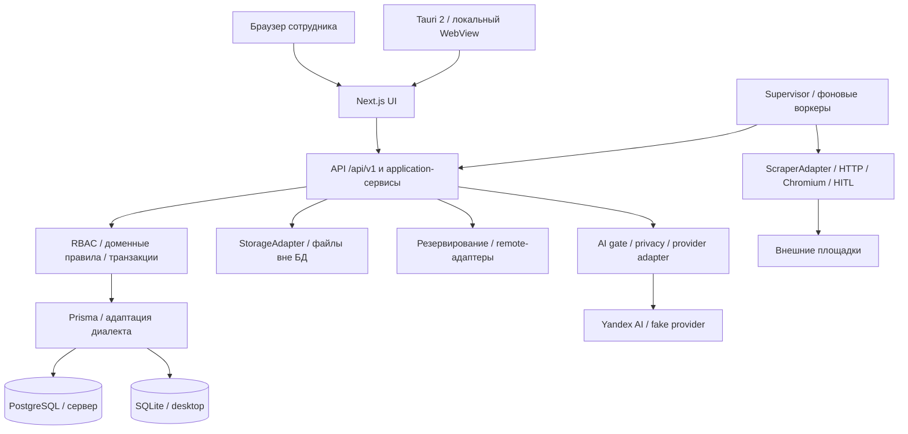

# Комплексный отчёт о тестировании и развитии CRM v3.2.3

Материал для магистерской диссертации. Дата среза: 9 ноября 2026 года. Объект исследования: CRM небольшого агентства недвижимости ООО «Магазин недвижимости». Рассматриваемый период развития: v3.2.2–v3.2.3.

Отчёт обобщает существующие протоколы, а не новый прогон приложения. Проверки приложения, внешних площадок и платного AI при подготовке документа не запускались. Источники обозначены S01–S17 и перечислены в конце. Сведения координатора о текущей интеграционной регрессии выделены отдельно. Исходные исторические неуспешные результаты сохранены в первичных протоколах.

## 1. Цель, предмет и границы исследования

Цель разработки — объединить регистрацию обращений, клиентскую базу, потребности, подбор объектов, показы, задачи, коммерческие предложения, договоры и сделки в единый проверяемый процесс. Центральный принцип — активная потребность должна иметь следующее действие. Для руководителя важны контроль исключений, просрочек и переход от показателя отчёта к первичной записи, для риелтора — быстрый ввод и последовательное сопровождение клиента. Источник: S01, S02, S17.

Система рассчитана на руководителя/администратора и двух риелторов. Руководитель управляет общим контуром, пользователями, настройками и отчётами. Риелтор работает со своими клиентами, потребностями и сделками, доступной объектной базой и разрешёнными контактами собственников. Проверка доступа выполняется на сервере, в том числе для прямого URL, файлов, поиска и AI-контекста. Скрытие кнопок не является механизмом защиты.

Задачи испытаний: подтвердить ключевые бизнес-маршруты на двух СУБД, проверить изоляцию ролей и конкурентные изменения, исследовать качество внешнего поиска, оценить необязательные AI-функции, восстановление данных и производительность. Чистая установка на потребительских Windows 10/11 и апробация реальными сотрудниками AT-18 не подтверждены рассматриваемыми источниками. Статус всего релиза не выводится из суммы отдельных PASS.

## 2. Архитектура и данные

### 2.1. Модульный монолит

Общая кодовая база построена на Next.js 16, React и TypeScript. HTTP API `/api/v1`, application-сервисы, транзакции, доменные инварианты и политики доступа находятся в модульном монолите. Чтение для серверных страниц допускает вызов application-сервисов, изменение из форм проходит через API. Компоненты не обращаются к Prisma напрямую. Baseline предусматривает Node.js 24 LTS, PostgreSQL 18, Prisma 7, Zod, Pino, Vitest и Playwright. Часть узких LIVE-испытаний проведена на имеющемся Node 22.23.4 и сама по себе не подтверждает baseline Node 24. Источник: S03, S07, S10, S17.

Рисунок 1. Логическая архитектура общего приложения. PostgreSQL и SQLite — альтернативные режимы хранения. Supervisor относится к desktop, в серверной модели процессы запускает Docker Compose. Диаграмма показывает зависимости, а не отдельные микросервисы. В PDF приведён графический эквивалент схемы.

### 2.2. Сохранность и переносимость модели

Клиент, потребность, обращение, объект, показ, задача, договор, предложение и сделка связаны нормализованными отношениями. Комиссии являются отдельными DealCommission: QA проверяет две комиссии одной сделки. CommercialOffer хранит позиции и исторические снимки условий объектов, поэтому последующее редактирование каталога не должно переписывать сформированное предложение. Файлы находятся вне БД, метаданные и связи — в БД. Исторический архив отделён от оперативных сделок и ограничен по доступу. Источник: S01, S02, S04.

В desktop используется альтернативный Prisma backend SQLite с совместимостью диалектов. Decimal сохраняется масштабированным INTEGER с преобразованием без промежуточного float, включая отдельную точность тарифов. JSON/list-предикаты адаптируются с сохранением внешних RBAC-условий. Для одного локального файла работа сериализуется, применяются WAL и BEGIN IMMEDIATE. SQLite-файл нельзя размещать в сетевой или облачной синхронизируемой папке. Наличие двух диалектов требует отдельных интеграционных тестов и проверки обновления заполненных БД. Источник: S10.

Защита от потери изменений использует ожидаемое updatedAt: устаревший PATCH получает 409. В QA это моделирует конкуренцию двух редакторов. Архивирование сохраняет бизнес-историю, прямое скачивание документа требует повторной серверной авторизации.

### 2.3. Воркеры и адаптеры

Поисковый worker обрабатывает очередь внешнего поиска, worker уведомлений формирует напоминания, desktop supervisor управляет локальным сервером и фоновыми процессами. Зависимости хранения, резервирования и AI вынесены за адаптеры. Один зашифрованный архив может обслуживать несколько назначений, ошибка одного назначения учитывается отдельно. AI отключается без остановки основного CRM-процесса. Источник: S02, S04, S09, S12, S17.

## 3. Две модели развёртывания

| Характеристика | Клиент-сервер | Десктоп |
|---|---|---|
| Интерфейс | Браузер, общий сервер Next.js | Tauri 2, локальный Next standalone и WebView |
| Хранение | PostgreSQL, отдельный контейнер | SQLite в локальном профиле |
| Запуск | Docker Compose: app, migrate/seed, БД, воркеры | Установщик и supervisor, bundled Node/Chromium |
| Пользователи | Общая база нескольких сотрудников | Локальный профиль с той же моделью ролей |
| Сеть | Доступ к серверу, внешние источники отдельно | Основные локальные операции работают без внешнего AI |
| Файлы | Постоянное хранилище вне БД | Каталог файлов профиля вне SQLite |
| Резервирование | Dump БД, файлы, manifest/checksums | Согласованный SQLite snapshot и файлы, CRMBKP1 |
| Перенос | Администрируемое восстановление | Зашифрованный архив, USB/назначения, контроль конфликта |
| Проверенное восстановление v3.2.3 | crm_qa_restore, 827 файлов, сверка контроля | Профили A/B, verify/restore, сравнение и конфликт |
| Граница текущего QA | Production Next/worker, порт 3390 | Supervisor-only, без окна Tauri |

Основание сравнения: S01, S02, S10, S12, S17. Перенос резервной копией не является распределённой синхронизацией конкурентно изменяемых баз. При расхождении двух профилей требуется явное решение, обе версии сохраняются. Offline fencing нескольких независимо работающих экземпляров не обещается.

CI, сообщённый координатором: [GitHub Actions 42560441228](https://github.com/SergeyTverye/CRM-for-Real-Estate-Agencies/actions/runs/42560441228) для `7e11e90` — build, unit, SQLite и установка/удаление/переустановка на Windows Server 2022 и 2025 SUCCESS. Это результат указанного коммита, а не будущей ревизии и не замена чистой потребительской Windows VM.

## 4. Методика тестирования

### 4.1. Уровни и доказательства

| Уровень | Что устанавливает | Граница интерпретации |
|---|---|---|
| Unit | Инварианты, нормализация, контракты, privacy, бюджет | Не подтверждает доступность реальной площадки |
| Integration | Реальные транзакции, FK, миграции, snapshots и очереди | Отдельно PostgreSQL и SQLite |
| Authorization | Чужие ID, смешанные связи, документы, архив, поиск, AI | Требуется матрица manager/realtor1/realtor2 |
| E2E / browser | Формы, навигация, API, конфликт, обратная связь | Уточняется настоящий backend или перехват fake API |
| LIVE | Внешние площадки или платная модель в момент прогона | Ограниченная глубина и квота, изменяемый внешний мир |
| REPLAY | Сохранённые снимки и воспроизводимые ответы | Не новый внешний сбор и не оценка текущего рынка |
| DEMO / fake | Управляемые ошибки, лимиты, HITL и UI | Не доказательство качества реального провайдера |
| Эксплуатационные | Backup, verify, restore, restart, перенос | PASS только в фактически проверенном контуре |

PASS означает выполнение указанного сценария. «Исправлено» требует связи с коммитом и повторной проверкой. PARTIAL указывает на непроверенную часть критерия, BLOCKED — на недоступность действия, NOT_RUN — на отсутствие запуска. HTTP 200 и success источника не означают соответствие объявления всем условиям.

### 4.2. Реалистичная синтетика и роли

| Стенд | Начальный набор данных | Изоляция |
|---|---|---|
| Сервер, crm_qa | 120 клиентов, 130 потребностей, 150 объектов, 140 обращений, 60 показов, около 270 задач, 12 КП, 8 сделок, 15 договоров, 25 объявлений, 30 архивных записей | Маркер QA-V323, вымышленные контакты, отдельная БД |
| Desktop | 100 клиентов, 110 потребностей, 120 объектов, 110 обращений, 50 показов, около 150 задач, 10 КП, 6 сделок, 12 договоров, 20 объявлений, 24 архивные записи | Маркер QA-D323, data-qa/desktop-profile, отдельные APPDATA/LOCALAPPDATA/TEMP |

На серверном стенде использованы синтетические JPEG и около 430 документов, в desktop-сиде — 240 фото и 278 документов. Числа после QA отличаются из-за созданных сценариями записей: desktop зафиксировал 111 клиентов, 121 потребность, 145 объектов, 247 задач и 7 сделок. Эти значения нельзя смешивать с исходным сидом. Источник: S01, S02.

Проверены руководитель и два риелтора, изоляция чужих карточек и нейтральный ответ при дубликате чужого контакта. Два последовательных PATCH с одним updatedAt воспроизводят потерянное обновление. Независимые AI-repository запросы проверяют конкуренцию бюджета: ADR 0010 описывает 12 запросов по 1 ₽ при бюджете 2,50 ₽, допускаются два. Это не нагрузочное испытание произвольного числа одновременно работающих сотрудников. Во время desktop QA параллельная массовая регрессия вызвала READY_TIMEOUT второго профиля, повтор без фоновой нагрузки прошёл, поэтому эти прогоны разделяют во времени.

## 5. Проверенные бизнес-сценарии

| Сценарий | Сервер | Десктоп | Доказательство и границы |
|---|---|---|---|
| Вход, выход, неверный пароль | PASS QA-01 | PASS D-01 | 401 для неверного пароля |
| Звонок → клиент → потребность → задача | PASS QA-02 | PASS D-02 | Дедупликация чужого телефона без раскрытия |
| Конфликт обновления и чужая потребность | PASS QA-03 | PASS D-03 | 409, чужой ID 403/404 |
| Объект, фото, доступ к контактам, показ | PASS QA-04 | PASS D-04 | Multipart и результат показа |
| Задача, календарь, уведомления | PASS QA-05 | PASS D-05 | Перенос срока 31/27 мс |
| КП, snapshots, отправка, печать A4 | PASS QA-06 | PASS D-06 | Снимки условий заморожены |
| Сделка с двумя сторонами/комиссиями | PASS QA-07 | PASS D-07 | Закрытие и постсделочные задачи |
| Договор, PDF, дополнение, архив | PASS QA-08 | PASS D-08 | Документы связаны с договором |
| Истекающая реклама | PASS QA-09 | PASS D-08 | Контроль срока |
| Отчёты и переход к записям | PASS QA-10 | PASS D-09 | Manager/detail и drill-down |
| Импорт, dry-run, commit, повтор | PASS QA-11 | PASS D-10 | Синтетический workbook, нет дублей при повторе |
| Поиск и AI-разбор | PASS QA-12 | PASS D-11 / OPS-05/06 | QA выдача DEMO, внешний LIVE вынесен отдельно |
| Контекстный AI-помощник | PASS QA-13 | OPS-06 | Сервер два экрана, desktop один чат, полная матрица S09 |
| Админка, чужие файлы, архив, поиск | PASS QA-14/15 | PASS D-12 | Серверная авторизация |
| Сохранение SQLite и рестарт | Не отдельный сценарий QA | PASS D-13 / OPS-09 | 111 клиентов и 247 задач после рестарта |
| Backup → verify → restore | PASS QA-16 | PASS OPS-01 | Серверная БД с файлами, desktop профили |
| USB и конфликт переноса | Не запускался в QA | PASS OPS-02/03 | CRMBKP1, SHA-256, обе версии сохранены |
| Экспорт DOCX/XLSX/PDF/ZIP | Документы в QA-06/08/11 | PASS OPS-04 | Проверены сигнатуры PK/%PDF |
| Воркеры и внешний offline | Воркеры запущены | PASS OPS-07/08 | 50 уведомлений, 5 логов, один supervisor pid |

Источники: S01 и S02. В серверном QA перечислены 16 PASS, в desktop — 13 D-сценариев и 9 OPS-сценариев. Различающиеся сценарии не суммируются в единый процент покрытия требований. Под «offline» desktop понимается испытание с неработающим прокси: локальные login/data вернули 200, AI 422 без утечек, физическое отключение всех сетей этим не доказано.

В серверном QA исправлена потеря исходного имени импортируемого файла, повторная загрузка сохранила file.name. В desktop исправлен неверный recovery key: понятная 400 вместо generic 503. Ошибки формата ключа, роли экспорта и повторного входа после restore в harness отделены от продуктовых дефектов. Файлы с реальными персональными данными при подготовке этого отчёта не читались.

## 6. Поиск недвижимости

### 6.1. Эволюция доступа к площадкам

| Площадка | v3.2.2 | Подтверждение v3.2.3 | Остаточная граница |
|---|---|---|---|
| Мир Квартир | LIVE во всех четырёх базовых запросах | География, жильё и коммерция, по 5 карточек в ограниченных ячейках | Академгородок часто без подтверждённого района |
| OnRealt | LIVE, торговля через ПСН | Советский район, область, склады и жильё | Сетевой отказ Бердск/квартира, неполнота ветвей |
| Юла | Коммерция, жильё unsupported | LIVE квартира/комната/дом, отдельные категории аренды и продажи | Кольцово unsupported, область partial, неизвестный период |
| Яндекс | needs_user_action | Native headless через очередь: 5 за 23,501 с | Не все карточки содержат адрес и период |
| Циан | Ошибка разбора исправлена на needs_user_action | Native headed через очередь: 5 за 16,016 с | Без дисплея автоматический путь недоступен |
| Авито | blocked HTTP 439 | Проба браузера HTTP 403, ручной путь | Блокировка не снята |
| Домклик | blocked HTTP 401 | Браузер HTTP 401, ручной путь | Блокировка не снята |

Источники: S05–S08, S11, S12. В комбинированном LIVE-задании Циан + Яндекс + Мир Квартир + OnRealt сохранено 20 результатов за 48,012 с, по пять от каждого источника, все success. Три задания дали 30 связей результатов, а не 30 уникальных объектов. Первые отдельные браузерные пробы не равны позднему сквозному запуску через очередь. Числа 1042/727 из заголовков внешних сайтов не являются числом импортированных CRM объектов.

### 6.2. Матрица локаций и фактическое покрытие

| Локация / сценарий | Мир Квартир | OnRealt | Юла | Как трактуется |
|---|---|---|---|---|
| Новосибирск, офис rent | 5, success, локация 5/0/0 | 5, success, 5/0/0 | 4, success, 4/0/0 | Подтверждение локации, не всех фильтров |
| Академгородок, офис rent | 5, 0/0/5 | 5, 5/0/0 | Финальный контроль 0 | Советский район, текст запроса не доказательство |
| Кольцово, офис rent | 5, 5/0/0 | 5, 3/0/2 | unsupported_filter | Неизвестный адрес требует проверки |
| Краснообск, офис rent | 5, 5/0/0 | 0, success | 0, success | Корректный ноль только в момент выборки |
| Обь, склад rent | 5, 5/0/0 | 5, 5/0/0 | 0, success | Улица Обь не приравнивается к городу |
| Бердск, квартира sale | 5, 5/0/0 | error FETCH_FAILED | 5, 5/0/0 | Error нельзя интерпретировать как пустой рынок |
| Область, дом sale | 5, 3/0/2 | 5, 5/0/0 | 3, partial, 3/0/0 | Юла покрывает только набор населённых пунктов |

Источник S06, поздний geo2-контроль. Тройки здесь означают «локация да / нет / неизвестно». Основной geo2-прогон: 45 ячеек, 39 success, 3 partial, 2 unsupported_filter, 1 error. Верхняя оценка общего сетевого бюджета с диагностикой и повторными ограниченными проверками — 119/120 попыток. Полного декартова произведения площадка × город × тип × операция не выполнялось. Ранний geo-прогон содержит 79 ячеек и собственные ретесты, это отдельный срез, его нельзя суммировать с geo2 как независимое покрытие.

Для Юлы LIVE подтвердил квартиры/комнаты/дома, а склад в Новосибирске в обеих операциях вернул ноль. Десять диагностических запросов без штатного публичного web-идентификатора исключены как INVALID_SAMPLE: HTTP 200 игнорировал native-фильтры. REPLAY проверяет cursor, но корректная LIVE-вторая страница не подтверждена. Наличие результата только в соседнем городе не считается совпадением. Источник: S08.

### 6.3. Качество до и после

П/ПР/И — подтверждённые совпадения / требуют проверки / исключены. Следующая таблица сопоставляет две ограниченные LIVE-выборки в разное время. Она не является контролируемым причинным экспериментом, не измеряет полноту рынка и не сравнивает одинаковый набор уникальных объявлений. Источник: S07.

| Сценарий | До П/ПР/И | После П/ПР/И | Время до → после, с |
|---|---|---|---|
| a: офис 50–100 м², Академгородок | 0/11/9 | 0/11/9 | 71,0 → 57,4 |
| b: квартира sale до 5 млн, Бердск | 4/6/10 | 5/6/9 | 55,8 → 55,2 |
| c: склад от 300 м², Обь + Новосибирск | 0/13/2 | 3/10/2 | 45,6 → 27,0 |
| d: квартира rent, Кольцово | 0/11/4 | 0/6/9 | 44,1 → 38,8 |
| e: дом/коттедж sale, область | 11/7/1 | 10/7/1 | 77,9 → 61,4 |
| f: апартаменты sale, Новосибирск | 0/2/23 | 0/25/0 | 94,9 → 72,6 |
| g: нежилое до 50 тыс./мес., пригороды | 0/10/5 | 2/5/9 | 124,1 → 74,5 |
| Всего появлений: 129 в каждом срезе | 15/60/54 | 20/70/39 | Время не суммируется в SLA |

В сценарии e после исправлений 18 карточек вместо 19, в g 16 вместо 15. Поэтому даже одинаковый общий итог 129 не означает попарную идентичность. Рост «требуют проверки» у апартаментов отражает отказ считать обычную квартирную категорию доказательством статуса. Ни в одном срезе не подтверждено совпадение апартаментов.

Дополнительный LIVE b с rooms=[2]: 6/7/7, 20 карточек, 42,2 с. В ранней ручной форме фильтра комнат не было, поэтому исходная «двушка» была PARTIAL. После 594f3e5 доступны studio/1/2/3/4+ с ИЛИ и проверкой фактической комнатности. Неизвестная комнатность остаётся unknown.

Для причинно более строгой оценки выполнен REPLAY тех же 129 старых снимков. Неизвестный период уменьшился 57 → 56, одна карточка распознана как посуточная, новых подтверждённых месячных периодов не возникло. В Бердске REPLAY с комнатами дал 2/3/15 вместо 4/6/10. Для фиксированного корпуса v3.2.2 (49 × 4 = 196 проверок) зафиксированы ложные включения 1/150, исключения 0/46 и пять ошибок точного вердикта, по пяти размеченным парам дублей TP=3, FP=0, FN=0, TN=2. Эти знаменатели относятся к разным метрикам и не объединяются. Источник: S05, S07.

### 6.4. Без AI, с AI и этические ограничения

Ручной поиск работает без ключа AI и при исчерпанном AI-бюджете. Восемь поисков quality-этапа не создали AI-вызовов. AI-разбор предлагает условия, человек проверяет и подтверждает черновик. В исходном e2e выполнено семь разборов/подтверждений, два точечных ретеста и одно ранжирование двух выбранных объявлений. Второго независимого рыночного сбора после подтверждения AI не было, поэтому эффект AI на полноту выдачи не заявляется.

Native navigation Циана/Яндекса — обычное выполнение страницы Chromium с ожиданием JavaScript, без решения CAPTCHA. При оставшейся проверке возвращается needs_user_action, пользователь продолжает в разрешённой HITL-сессии. Авито/Домклик сохраняют ручное добавление по ссылке и импорт разрешённой выгрузки. Stealth, подмена отпечатков, прокси-ротация и автоматическое распознавание CAPTCHA отсутствуют. Паузы, deadlines и лимиты карточек сохраняются. Техническая доступность страницы не доказывает договорное право на массовое копирование. Источник: S11, S12.

Native persistent profile и изолированный HITL profile различаются, перенос cookies между ними не реализован. В native-режиме сеть выполняет Chromium, DNS/IP не закрепляется как у Node safeRequest, фиксированные домены и публичный DNS проверяются на границе. Это архитектурный компромисс ADR 0034 и отдельная область последующего аудита.

## 7. AI-модуль и контекстный помощник

### 7.1. Функции и подтверждение

AI поддерживает разбор свободного запроса, анализ объявлений, сравнение, ранжирование выбранных и контекстный помощник. Детерминированная сортировка предпочтений отдельно помечена «без ИИ». Ранжирование допускает 2–10 объявлений, проверяет ID и основания, использует бюджетный gate и кэш с учётом пользователя, роли, потребности, модели, фильтров и фактов. Неизвестный период цены не превращается в месячный и не допускает ценового сравнения. Источник: S05, S07, S13.

| Экран помощника | Разрешённый контекст | Фактическое подтверждение |
|---|---|---|
| Клиент | Статус, этапы потребностей, ограниченная история, открытые задачи | LIVE v1 и DEMO |
| Потребность | Параметры, этапы, показы, задачи | LIVE v1/v2, DEMO |
| Задача | Тип, статус, приоритет, срок, разрешённые связи | LIVE v1/v2, DEMO |
| Сделка | Статус, даты, псевдонимные стороны, checklist, задачи | LIVE v1/v2, DEMO |
| Договор | Тип, статус, сроки, эксклюзивность, разрешённые связи | Автотесты и OFFLINE/DEMO |
| Сегодня | Только свои открытые задачи, максимум 10 ближайших | LIVE v1, автоматические проверки |
| Отчёты | Рассчитанные KPI за последние 30 дней с явным периодом | Автотесты и OFFLINE/DEMO |

Источник S09. Контекст собирается сервером заново при каждом сообщении. Отзываемые права проверяются при создании, чтении, отправке и подтверждении действия. Контекст сделки/договора дополнительно требует доступа ко всем связанным клиентам. Черновик задачи или КП не выполняется до подтверждения человека. Диалоги личные, сообщения другим лицам автоматически не отправляются.

### 7.2. Приватность, бюджет и ограничения модели

Провайдер получает whitelist структурных фактов. Имена, контакты, владельцы, пароли/сессии, реквизиты и содержимое документов не выбираются. Свободный текст задачи изолирован как untrusted_data и фильтруется. Крупные суммы не должны ошибочно распознаваться как телефоны, отрицания в вопросе не должны исчезать. Даты структурированного контекста форматируются в APP_TIMEZONE с явным поясом, API сохраняет ISO-контракт. Источник: S04, S09.

Бюджет резервируется до отправки, фактическое потребление учитывается по usage. Отказ до dispatch не означает платный вызов. Quality-422 был воспроизведён как недостаток свободного бюджета под резерв и возможный старый дневной лимит, после bounded-настроек две фразы получили 200. Одновременно исправлены допустимые пробелы flat-ответа и сохранение района при той же локации. Это разные причины: успешный повтор не позволяет приписать первоначальный отказ только схеме JSON. Источник: S07.

На LIVE v1 помощник показывал имена инструментов, сырые коды и предположения о рисках. Инструкция v2 улучшила русские формулировки и разделение фактов/предположений. В повторе остались уточняющий вопрос вместо немедленного текста и время UTC, после чего введена локальная временная граница с fake-регрессией. Гарантия точности LLM из этих опытов не следует, юридические и документальные рекомендации проверяет сотрудник.

### 7.3. Фактические расходы испытаний

| Прогон | Платные вызовы | Расход, ₽ | Основание учёта |
|---|---|---|---|
| v3.2.2, совокупность прикладных LIVE | 13 | Около 1,07 | Сводка кандидата S05, разные этапы |
| v3.2.2, отдельная диагностика rank | 3 | 0,280000 | Usage и seed-тариф, без записей CRM ledger, S13 |
| v3.2.3, помощник | 8 | 1,417400 | Ledger, максимум 8/3 ₽, S09 |
| v3.2.3, e2e поиск + AI | 10 | 1,044900 | 7 разборов + 2 ретеста + rank, S07 |
| v3.2.3, quality ручной поиск | 0 | 0 | До dispatch, S07 |
| v3.2.3, AIFIX-подтверждение | 2 | 0,228400 | Ledger 7,276400 → 7,504800, S07 |
| Серверный QA | 4 | 1,41 | 2 parse + 2 помощника, округление источника S01 |
| Desktop QA | 3 | 0,33 | 2 parse + 1 чат, дельта committed, S02 |

Расходы указаны в точности источника. Общая сумма по таблице не выводится: срезы различаются, часть сводок включает подэтапы, независимость всех расходов не доказана. Это расчёт CRM или диагностики по usage/тарифу, а не сверенный счёт облачного провайдера. Во время подготовки отчёта новых платных обращений не было.

## 8. Безопасность

Источник S04 — аудит только чтения на af911b8 с последующим разделом статуса исправлений. Он охватывает код и выбранные тесты, не является полным penetration test. Выполнено 64 security-related unit-теста PASS. beam-security первоначально не стартовал из-за отсутствия generated Prisma client, а не из-за доказанного дефекта безопасности. Последующие интеграционные результаты относятся к отдельной регрессии.

| Область | Подтверждённые механизмы | Остаток / оговорка |
|---|---|---|
| Пароли и сессии | Argon2id 19456 KiB / 2 / 1, random token 32 байта, SHA-256 в БД, отзыв, HttpOnly/SameSite=Lax | Secure обязателен в HTTPS-развёртывании |
| Резервные копии | CRMBKP1, chunked AES-256-GCM, уникальные nonce, AAD, final sentinel, checksums | Параметры KDF требуют эксплуатационного обоснования |
| Ключи и secrets | DPAPI CurrentUser desktop, AES-GCM server, encrypted credential store | DPAPI не защищает от кода того же Windows-профиля |
| RBAC / файлы / поиск | Actor-aware services, scopes по связям, download после проверки, поиск без owner contacts | Аудит не перечитал каждый route handler |
| Desktop HTTP | Loopback Host/Origin/Sec-Fetch-Site, restrictive CSP | Политика зависит от корректного локального запуска |
| Upload / storage | Allowlist MIME/расширений, sniff, лимиты, непрозрачные keys | Нужны явная retention-политика и проверка OS ACL |
| AI | Whitelist, privacy, untrusted_data, budget gate, server-side provider | Prompt injection и косвенные утечки не сведены к нулю |
| Браузерные сессии | Owner scope, allowlist, HTTPS, timeout/cleanup | Native Chromium требует учёта границы DNS/IP из ADR 0034 |
| Зависимости | npm audit --omit=dev | 2 moderate, uuid через exceljs, не закрыты |

После аудита убран повторный desktopLoopbackAllowed и добавлен maxChunks при расшифровке с регрессионным тестом. Неверный recovery key переведён в 400 в ходе desktop QA. Открытые действия: контролируемое исправление цепочки exceljs → uuid, отрицательные preflight-тесты паспорта/регистрации во всех AI-функциях, документирование модели угроз DPAPI и хранения архивных документов. Автоматический breaking downgrade exceljs не выполнялся. Недоказанное отсутствие эксплуатируемости не считается устранением уязвимости.

Общий integration/authorization набор запускался после генерации Prisma-клиентов. Однако полученные от координатора 446/447 и последующий целевой 7/7 нельзя называть новым полным зелёным прогоном. Его окончательный результат должен фиксироваться в приёмке v3.2.3, см. раздел 11.

## 9. Производительность и эксплуатационная надёжность

### 9.1. Desktop до и после

| Метрика / изменение | До | После | Способ подтверждения |
|---|---|---|---|
| 2000 вставок задач, локальная БД | 110–114 мс | 57–63 мс, снижение 45–48% | Микробенч S03 |
| 2000 точечных чтений | 72–73 мс | 67–77 мс | Шум, прирост не установлен |
| Доступ к связям календаря | До 4 запросов на событие | До 4 на весь период | Батчинг, сохранение RBAC |
| Контрольные даты Сегодня | Около 7 последовательных RTT | Один пакет Promise.all | Структура запросов, тот же результат |
| FullCalendar | Около 1,8 МБ исходного JS в начальном чанке | Отдельная динамическая загрузка | Это не размер gzip и не замер LCP |
| Опрос READY | 300 мс | 200 мс | Аналитически средняя задержка 150 → 100 мс |
| Холодный старт целиком | До нет собранного standalone | 3,6 с в QA, повтор 3,6 с | Несопоставим с отсутствующим baseline |

Новые PRAGMA: synchronous=NORMAL, cache_size около 64 МБ, temp_store=MEMORY, mmap_size=256 МБ при сохранённом WAL. Backup API проверен на integrity_check=ok. Полный старый холодный старт, FPS календаря, RSS, CPU и замер LCP в источниках отсутствуют. Из изменения polling нельзя выводить измеренное ускорение общего запуска. Режим synchronous=NORMAL следует оценивать вместе с эксплуатационной политикой питания и резервирования, аппаратные отказы этим микробенчем не моделировались.

В исходной таблице S03 label synchronous=FULL(1) внутренне неоднозначен, поэтому числовой старый PRAGMA здесь не используется как доказательство. Сохраняются фактические времена записи и заявленная конфигурация после изменения.

### 9.2. Операции QA и выдача 10 000 объявлений

| Операция | Серверный QA | Desktop QA |
|---|---|---|
| Login | 1,4–1,5 с | 1,2 с |
| Перенос задачи | 31 мс | 27 мс |
| Создание КП | 98 мс | 38 мс |
| Отчёт manager/detail | 146/152 мс | 71/58 мс |
| Dry-run + mapping | Около 1 с | 843 мс |
| Backup/restore | pg_dump 600 мс, restore 800–1000 мс | Создание около 12 с, restore около 31 с |

Источники S01/S02. Это наблюдения разных стендов и наборов, не сравнительный эксперимент PostgreSQL против SQLite и не p95. Desktop-архив около 10,7 МБ, SQLite около 4 МБ. Серверный QA проверил dump и 827 файлов, desktop — мутацию, восстановление, контроль SHA и повторный вход после замены сессий.

На синтетической PostgreSQL-выдаче v3.2.2 из 10 000 объявлений измерены p95 сортировок около 135–249 мс, CSV 2441 мс и XLSX 2641 мс, по 10 000 уникальных строк с проверкой порядка. Для каждой сортировки 20 выборок, проверены страницы и counts. Планер с 3000 задач: p95 14,52 мс, при этом primaryRowsReturned=0, поэтому этот показатель не характеризует рендер заполненного календаря. Источник S14. Повторного полного benchmark 10 000 на v3.2.3/SQLite нет, старые значения не объявляются текущим SLA.

### 9.3. Восстановление и границы отказоустойчивости

Desktop проверил CRMBKP1, verify, восстановление после мутации, USB и профиль B, различение incoming/conflict и сохранение обеих версий. Серверный QA восстановил БД в crm_qa_restore с контрольными данными и файлами. Отдельный compose-project с приложением и login в этом QA не поднимался: результат не закрывает заново полный T08, если он требует такой контур. В прежней desktop-приёмке есть отдельные реальные облачные restore/retry-факты, но они относятся к своим ревизиям. Источник: S01, S02, S15.

Физический обрыв сети, все сценарии IAM и полный native picker/tray/reboot/reminder matrix не подтверждены. Облачные операции из ранних срезов не переобъявляются новой полной v3.2.3-приёмкой.

## 10. Журнал дефектов и развития v3.2.2–v3.2.3

Коммиты проверены по локальной истории. Таблица описывает итог исправлений и доказательства, а не авторство изменений. Пересекающиеся targeted-тесты не суммируются с общей регрессией.

| Версия / дефект | Исправление и коммит | Подтверждение |
|---|---|---|
| v3.2.2: перегруженные формы, длинный путь к истории | Disclosure и быстрые переходы d881253, review 4d78586 | 138 пар кадров, измеренные клики S05/S16 |
| Документ договора, FK при SQLite upgrade | Миграция 4e7f41e, документы 45e291f | PG 10/10, SQLite 10/10, e2e 2/2 S05 |
| Циан ошибочно parse_failed, жилые ветви TIMEOUT | 45c4eec | Мир Квартир 36,68 → 11,43 с, OnRealt 36,69 → 23,18 с S05 |
| Ложный дубль разных домов | d928b8d | Размеченные пары, дома/корпуса, без auto-merge S05 |
| AI-01: потеря верхней цены | 8791d88 | REPLAY и последующий LIVE-разбор S13 |
| AI-02: неизвестный период как total | df2a73e, SQLite upgrade 823744b | NULL, сохранены snapshots/FK/индексы S10/S13 |
| Недоступность AI ломала выбранный сценарий проверки | def271f | Injected reject/timeout, ручной поиск и readiness S13 |
| AI-ранжирование: модель вернула 5 оснований | f079978 | Строгая provider schema, LIVE fixed, 0,101500 ₽ S13 |
| Общий кэш rank, unsaved guards договора | e5131b6 | User/role/need cache key и dirty-state регрессии S13 |
| v3.2.3: жильё Юлы отсутствовало | 2e7803e | LIVE категории, PG/SQLite REPLAY S08 |
| Неверные маршруты/районы, details стирали SERP | 52408a7, 4a1cf0a | Geo2, timeout detail ≤3 с, сохранение SERP S06 |
| Hardcoded Chrome и нечестный blocked UI | 02f16cb, f4e5d54, 277bd7e | HITL/ручной импорт, browser-cycle S07/S11 |
| Успех Chromium не повторялся safeRequest | bf8ba8f | Native page.goto, очередь LIVE S11/S12 |
| AI-контекст неполон / manager связан с чужой областью | 55ab9c6, ab08bc0 | Whitelist и связанные scopes, PG/SQLite S09 |
| Privacy маскировал бюджет и отрицания | 626aa19, 2549991 | Unit и LIVE v2 S09 |
| Времена модели UTC, новые контексты не в CHECK | c5e5845, 475b9cc | Timezone fake, populated upgrade S09 |
| AI терял locations/types и добавлял общий тип | 2c93319, f99f8f2 | Два LIVE-ретеста и confirm S07 |
| Комнаты/посуточность/апартаменты оценивались неточно | 594f3e5 | 764 unit, PG/SQLite по 44, LIVE/REPLAY S07 |
| Desktop N+1, последовательные даты, тяжёлый календарь | 6565e9a | Микробенч и RBAC-регрессия S03 |
| AI 422, районы и допустимые flat-ответы | 957a7fd | 102 AI unit, PG/SQLite по 35, два LIVE S07 |
| Импорт терял имя исходного файла | 3cf325e | Повторная загрузка и integration S01 |
| Неверный recovery key выдавал 503 | fb44a35 | 400 с понятной причиной, SQLite-тест S02 |
| AI-тариф: тестовый parse и исходная диагностика | f1bf02f | Целевой набор 7/7 на обеих БД, сведения координатора |
| Двойной loopback check и нет maxChunks | merge fbecf84, статус S04 | Удалён дубль, добавлен max-chunks.test |

История merge: 92a6df8 — v3.2.2 review, 484eea7 — Юла, 645984d/6331335 — география, 3a85784/963a539/14c9fd4 — помощник/время/миграции, 67b8a58 — native browser, af911b8 — e2e, b70bbcc — качество, 6624c76 — desktop performance, d29f063 — AIFIX, 792473f/8aa63c0 — серверный/десктопный QA, 7e11e90 — тарифный тест. Отдельный cleanup-проход потребовал восстановления повреждённых скриптов 9d410ba/21d1a6b, что подчёркивает необходимость проверять механическую редактуру сборкой и регрессией.

## 11. Итоговая регрессия

Ниже сохранён последний полный интеграционный срез, переданный координатором при постановке задачи. Финальный прогон указан в `docs/acceptance/v323/README.md`: координатор допишет окончательные числа после его завершения. До этого таблица не является заявлением о полном зелёном состоянии последней ревизии.

| Набор | Переданный результат | Интерпретация |
|---|---|---|
| TypeScript | Без ошибок | Успешная статическая проверка интеграционной ветки |
| ESLint | Без ошибок | Успешная проверка интеграционной ветки |
| Unit | 2161 пройдено, 5 пропущено | Последний полный срез, skip не PASS |
| PostgreSQL integration + authorization | 446 из 447 до исправления AI-тарифов | Один тест требовал исправления |
| AI-тарифы после исправления | 7/7 на PostgreSQL и 7/7 на SQLite | Целевой повтор, не новый полный прогон |
| SQLite | 475 пройдено, 2 пропущено до того же исправления | Состояние до targeted-ретеста, не 100% последней версии |
| Desktop-backup | 49 пройдено, 2 пропущено | Самостоятельный набор |
| GitHub Actions 42560441228, 7e11e90 | Build, unit, SQLite, installer 2022/2025 SUCCESS | Только указанный commit и состав CI |

Серверный QA S01 отдельно приводит 2167 unit и SQLite с одним старым падением, desktop QA S02 — 2161 unit и 476 SQLite. Performance-этап S03 содержит ещё более ранние 2123/472 с предсуществующими падениями. Это разные ревизии и моменты, поэтому они не заменяют переданный координатором срез. Числа узких наборов (22/25/35/44/692/764 и другие) также пересекаются и не прибавляются к 2161.

Сопоставление с v3.2.2 по S05: 2023 unit + 5 skip, PG 428/428, SQLite 451 + 2 skip, backup 46 + 2 skip. Рост количества тестов отражает расширение регрессии, сам по себе не измеряет процент покрытия кода или требований. Coverage %, mutation score и статистическая надёжность в источниках не представлены.

## 12. UX и иллюстративные материалы

| Маршрут | Клики до → после | Наблюдение |
|---|---|---|
| История клиента | 3 → 2 | Действие из строки списка |
| Параметры потребности | 5 → 4 | Более короткий вход и раскрытие редких полей |
| Задачи сотрудников из отчёта | 2 → 1 | Прямой переход в общую очередь |
| Звонок → следующее действие | 4 → 4 | Основные обязательные поля сохранены |
| КП из подборки | 2 → 2 при N=1 | Менее перегруженный экран |
| Новая задача / перенос срока | 2 → 2 / 2 → 2 | Выигрыш в композиции, не в кликах |
| Истекающая реклама | 1 → 1 | Сохранён существующий быстрый путь |

Источник S16: по 138 снимков до/после, manager/realtor1, 1366×768, 1920×1080, 390×844, SHA-256 всех 276 PNG совпали с манифестами. Снимки after относятся к d881253 до последующих малых исправлений переноса телефона и hit-target 44 px. Альбом не выдаёт их за новую пересъёмку финального v3.2.3.

PDF-альбом `CRM-screenshots-v3.2.3.pdf` объединяет серверный QA, supervisor-desktop QA, поиск, AI и три пары UX до/после. Каждый кадр имеет номер, подпись, путь источника и маркировку режима. Кадры с REPLAY показывают сохранённые LIVE-результаты, а не новый сетевой сбор. DEMO-помощник явно отделён от LIVE-ответов. Снимки страниц блокировки фиксируют прежнее состояние, для Циана headless они не опровергают поздний успех headed native.

Визуальная сверка обнаружила неточные исходные серверные подписи: login-form показывает «Сегодня», requests-list — карточку клиента, rbac-search — отказ доступа. Подписи альбома исправлены по содержимому, исходные PNG и captions.json сохранены. Эти три кадра не являются визуальными доказательствами формы входа, списка обращений и глобального поиска соответственно. Архивные кадры обеих версий показывают отказ доступа, а не содержимое архива. Результаты QA-сценариев берутся из протоколов, изображения их не заменяют.

## 13. Ограничения и направления развития

1. Завершить единый полный прогон на финальной ревизии и внести числа в приёмку v3.2.3. Повторить release gate без параллельной тяжёлой нагрузки, сохранив commit, команды и логи.
2. Провести AT-18 с руководителем и двумя риелторами: фактическое время операций, ошибки ввода, понимание unknown/partial, работа с конфликтами. Нынешние клики и синтетический QA не доказывают пользовательскую эффективность.
3. Отдельно закрыть clean consumer Windows 10/11 и native Tauri matrix. CI Windows Server и supervisor-only подтверждают свои контуры, но не весь installed-критерий.
4. Проверить новое серверное восстановление в отдельном compose-project с login и контрольным файлом. Периодически выполнять destination-specific restore, физические сбои сети и сценарии IAM, если они входят в release gate.
5. Закрыть открытые рекомендации безопасности: uuid/exceljs, полная preflight-редакция AI, DPAPI threat model, retention и права каталогов. Повторно проверить native Chromium DNS/redirect boundary.
6. Улучшать географию, адреса, явные периоды цены, тип апартаментов и подтверждённую комнатность. Не подменять отсутствующие факты запросом пользователя или ответом AI, не смешивать blocked/unsupported/timeout с пустой рыночной выдачей.
7. Расширять поиск только в пределах разрешённых площадками способов. Текущая малая выборка не доказывает полноту рынка, стабильную доступность, качество пагинации всех источников или отсутствие дублей в масштабе.
8. Повторить производительность на v3.2.3 для обеих СУБД с одинаковыми данными и нагрузкой. Добавить измерения p95 бизнес-операций, памяти, календаря и экспорта, не выводить эти показатели из времени микробенча.
9. Продолжить оценку помощника на русском языке и локальных датах, с отрицаниями, неизвестными данными и отзывом доступа. Договоры/отчёты пока не имеют LIVE-подтверждения в данном срезе, любые изменения выполняются после проверки человеком.

Практический результат периода — расширенный воспроизводимый набор сценариев двух режимов, исправления потери условий и ошибочного подтверждения фактов, проверяемое локальное восстановление и более быстрые локальные операции. Технический кандидат имеет доказанные рабочие сценарии и явно перечисленные незакрытые критерии, полная готовность всего релиза этим отчётом не объявляется.

## 14. Источники и воспроизводимость

Все пути ниже относительны корню репозитория. Это первичные локальные материалы, прочитанные для отчёта. Внешние API и ссылки не проверялись заново, новые юридические или тарифные утверждения из интернета не добавлялись.

| ID | Источник | Назначение |
|---|---|---|
| S01 | docs/qa/v323-server-qa.md | 16 сценариев, серверный стенд, времена, backup, импорт |
| S02 | docs/qa/v323-desktop-qa.md | D-01–13, OPS-01–09, supervisor, restore/USB/offline |
| S03 | docs/operations/desktop-perf-v323.md | PRAGMA, N+1, динамический календарь, микробенч |
| S04 | docs/security/v323-security-audit.md | Аудит, dependency findings, статус рекомендаций |
| S05 | docs/acceptance/v322/README.md, docs/vkr/live-search-v322.md, docs/vkr/live-search-v322-ai.md | Исторический кандидат, LIVE, регрессия v3.2.2 |
| S06 | docs/vkr/live-search-v323-geo.md и geo2 JSON | Географические матрицы, статусы и ограничения |
| S07 | docs/vkr/live-search-v323-e2e.md, live-search-v323-quality.json, replay-search-v323-quality.json | Семь сценариев, quality, AIFIX и расходы |
| S08 | docs/vkr/live-search-v323-youla.md | Жилые категории, INVALID_SAMPLE, ноль склада |
| S09 | docs/vkr/v323-ai-assistant.md | Whitelist, права, 8 LIVE-вызовов, timezone |
| S10 | docs/adr/0001-modular-monolith.md, 0010-sqlite-desktop-backend.md, 0011-unknown-listing-price-period.md | Слои, диалект, Decimal, цена и миграции |
| S11 | docs/vkr/live-search-v323-captcha.md, docs/integrations/captcha-hitl.md | Блокировки, HITL, поздний LIVE через очередь |
| S12 | docs/adr/0034-source-native-browser-navigation.md, docs/integrations/property-search-sources-v322.md | Native Chromium, источники и границы сети |
| S13 | docs/vkr/v322-ai-fixes.md | AI-01–03, rank schema/cache и проверки |
| S14 | docs/operations/perf-v322-results.json | 10 000 объявлений, сортировки и экспорт |
| S15 | docs/acceptance/desktop-v32/README.md | Границы ранней installed/cloud/transfer приёмки |
| S16 | docs/ux/v322-ux-audit.md | Клики, 276 PNG, честная ревизия after |
| S17 | README.md, git log --oneline --merges -60, git log --oneline -100 | Назначение, архитектура, роли, коммиты |

Сведения координатора от 09.11.2026 о регрессии и CI 42560441228 приведены в разделе 11 как предоставленные данные. Путь `docs/acceptance/v323/README.md` является местом последующей финальной фиксации, его будущие значения не предполагаются.

Генератор документов: `scripts/docs/build-thesis-album.py`. Команда: `python scripts/docs/build-thesis-album.py --render`. Нужны reportlab, Pillow, pypdf, pdfplumber, pdftoppm и Arial. Генератор читает только перечисленные документационные PNG/JSON/Markdown, не обращается к БД, секретам или сети. Формирует два PDF, манифест рисунков и техническую статистику. После редактирования раздела регрессии PDF необходимо пересобрать и снова проверить визуально.
