# CRM v3.2.2

Руководство пользователя

Для сотрудников агентства недвижимости · Windows · Редакция 08.11.2026

Практический маршрут: звонок → клиент → потребность → поиск → предложение → договор → сделка.

Все примеры и иллюстрации используют демонстрационные данные. Цветные рамки и номера на рисунках добавлены для пояснения. Риелтор работает со своими клиентами; руководитель дополнительно видит отчёты, импорт и обслуживание.

<!-- toc -->

## 1. Как пользоваться руководством

Начните с разделов 2–4 при первом знакомстве. Для ежедневной работы используйте разделы 5–18. Импорт и резервирование в разделах 19–25 выполняет руководитель. Номера страниц и названия в оглавлении PDF являются ссылками.

**Три разных понятия.** Клиент — человек или организация и контакты. Обращение — отдельный звонок, сообщение или визит. Потребность — конкретная задача клиента: купить, продать, снять или сдать недвижимость. У одного клиента могут быть несколько обращений и потребностей.

**Главное правило.** У потребности в работе всегда должно быть следующее действие с датой. Закончили звонок — назначьте задачу. Поставили работу на паузу — задайте возврат. Закрыли запрос — зафиксируйте причину или результат.

**Права.** Риелтор видит своих клиентов и общий каталог объектов. Контакты собственника чужого объекта могут быть скрыты. Их открытие согласует руководитель. Отсутствие карточки в поиске не означает отсутствия записи в агентстве.

**Два варианта запуска.** Windows-приложение хранит базу на этом компьютере. Серверная CRM открывается по адресу организации и хранит данные на сервере. Локальные копии, выбор файлов восстановления и перенос компьютера зависят от режима. Для серверной установки порядок восстановления определяет ответственный специалист.

**О снимках.** В этой редакции используются сохранённые реальные синтетические снимки UX v3.2.2 и локального режима v3.2. Стенд для новой съёмки не ответил готовностью за 15 минут. Поэтому новые формы и команды описаны по исходникам и проверочным протоколам; исторические иллюстрации не выдаются за новые. Руководство не подтверждает готовность установщика на всех Windows.

## 2. Установка Windows-приложения

1. Получите одобренный организацией CRM-Setup-Windows-x64.exe и его контрольную сумму у ответственного сотрудника. Используйте файл и сумму одного выпуска.
2. Закройте прежнюю CRM. Запустите установщик, выберите каталог программы и нажмите «Установить». Дождитесь завершения. При необходимости создайте ярлык на рабочем столе.
3. Откройте RealEstateCRM из меню «Пуск». Дождитесь проверки локального сервера. Повторный запуск ярлыка открывает уже существующее окно.
4. При новой установке выполните мастер следующего раздела. После входа откроется рабочее пространство, показанное на рисунке.

Требуется 64-разрядная Windows 10 22H2 или Windows 11. Node.js, PostgreSQL и Docker для локального приложения отдельно устанавливать не требуется. Интернет нужен для площадок, облаков и ИИ, но не для работы с уже сохранёнными локальными данными.

**Неизвестный издатель.** Проверьте источник установщика и контрольную сумму с ответственным за установку. Не отключайте защиту Windows ради запуска. При неудачном старте передайте руководителю безопасный код диагностики.

Программа и рабочие данные находятся отдельно. Установка или обновление не означает создание новой пустой базы. На общем ПК учитывайте профиль Windows: локальная защита и настройки привязаны к нему.

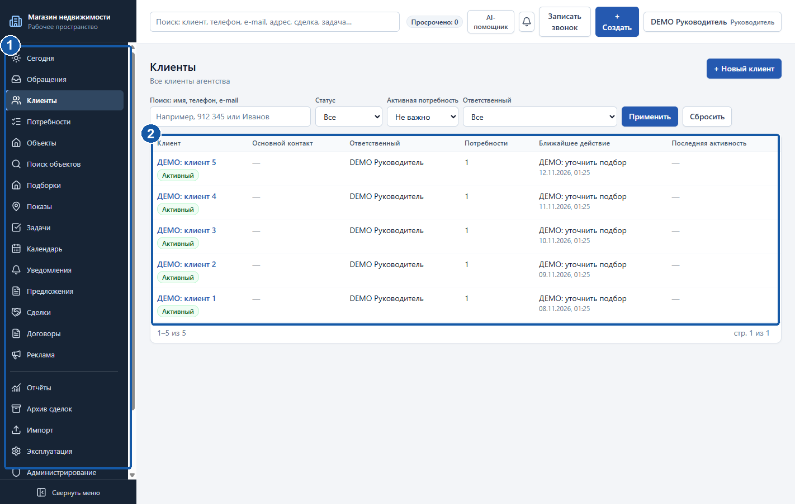

## 3. Первый запуск и каталог данных

1. В мастере заполните «Имя руководителя», «Логин» и «Пароль (от 10 символов, буквы и цифры)». Логин: 3–50 латинских букв, цифр, точек, подчёркиваний или дефисов.
2. В «Начальные данные» выберите «Пустая база» для реальной работы или «Демонстрационные данные» для обучения. Не смешивайте учебную и рабочую базу.
3. Проверьте «Рекомендуемый локальный каталог». Отметьте «Подтверждаю хранение базы на локальном диске».
4. Нажмите «Создать и перейти ко входу». Дождитесь создания базы и войдите новой учётной записью.

Обычный каталог данных — %LOCALAPPDATA%\RealEstateCRM\data. Произвольный выбор каталога SQLite в текущем мастере не предусмотрен. Не переносите рабочую базу в OneDrive, Яндекс.Диск, Облако Mail.ru, сетевую папку или на флешку. Для переноса предназначен проверенный зашифрованный архив.

Руководитель создаёт учётные записи сотрудников и выдаёт временные пароли. При смене ПК облака подключаются повторно: секреты в переносимый архив не включаются.

При закрытии окна выберите сворачивание в трей или завершение. В трее продолжаются напоминания и передача уже созданных архивов. Полный выход останавливает задания до следующего запуска.

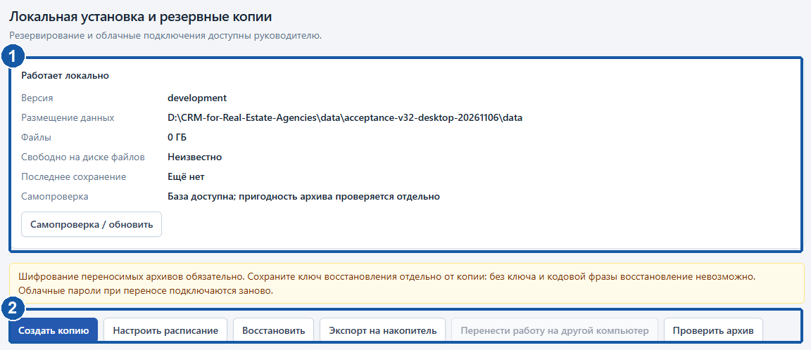

## 4. Вход и восстановление доступа

1. Откройте программу или адрес CRM организации. Введите свой логин и пароль, нажмите «Войти».
2. При требовании смены временного пароля задайте новый личный пароль. До обязательной смены обычная работа может быть недоступна.
3. Проверьте имя и роль в правом верхнем углу. На общем ПК завершайте сеанс через меню пользователя после работы.

**Забыли пароль?** Обратитесь к руководителю: он выдаст временный, после входа смените его. Самостоятельное восстановление письмом на email не предполагается. Не создавайте второй аккаунт вместо восстановления первого.

Если войти не удаётся, проверьте раскладку, Caps Lock и отсутствие пробелов при вставке. Не передавайте пароль вместе со снимком ошибки. Отключённую учётную запись должен проверить руководитель.

Пароль входа и кодовая фраза резервного архива — разные секреты. Смена пароля пользователя не расшифрует старую копию. Для архива нужна его кодовая фраза либо отдельно сохранённый ключ восстановления.

При истечении сеанса войдите снова. До обновления страницы сохраните деловой текст незавершённого комментария в безопасном месте. Выбранные, но ещё не загруженные файлы после закрытия формы потребуется выбрать повторно.

## 5. Главное окно и навигация

Слева находится меню разделов. «Сегодня» показывает ближайшую работу и просрочки. «Обращения», «Клиенты», «Потребности» ведут к истории клиента. «Объекты», «Поиск объектов», «Подборки», «Предложения» обслуживают подбор недвижимости. «Задачи», «Календарь», «Уведомления» помогают контролировать сроки.

Вверху: общий поиск, счётчик просрочек, уведомления, «Записать звонок» и «Создать». Общее поле ищет только доступные записи CRM. Для объявлений площадок используйте отдельный «Поиск объектов».

1. Начинайте день с «Сегодня»: сначала просрочки, затем дела и контрольные даты.
2. Открывайте запись по названию. Возвращайтесь ссылкой над заголовком или меню слева.
3. Проверьте фильтры списка, прежде чем создавать предполагаемо отсутствующую запись.
4. Прокручивайте длинную форму; дополнительные условия могут быть в сворачиваемых блоках.

Руководителю доступны «Отчёты», «Архив сделок», «Импорт», «Эксплуатация», «Администрирование», «Резервные копии», настройки источников и ИИ. Набор меню зависит от роли.

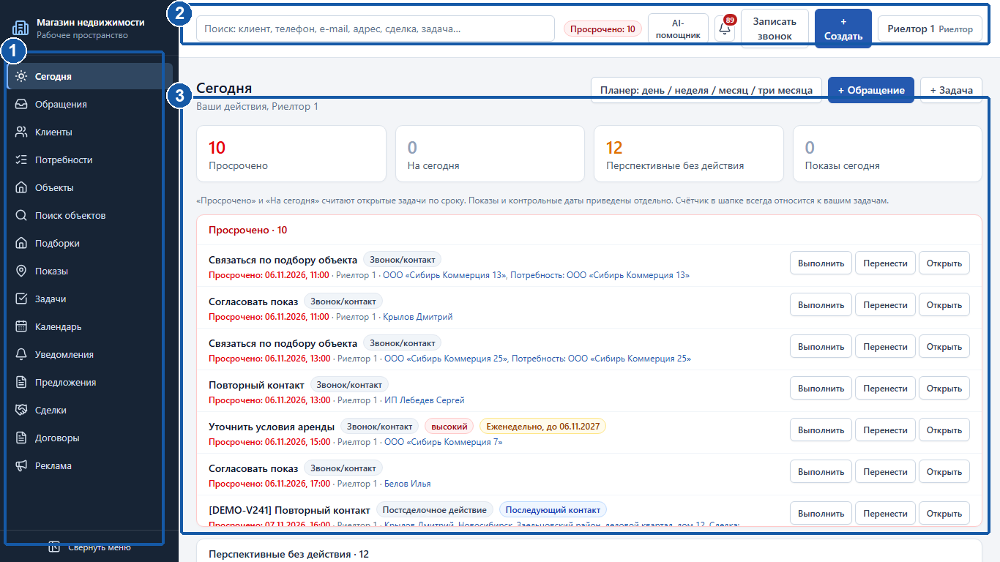

## 6. Регистрация клиента

Перед созданием найдите клиента по телефону или email через общий поиск и «Клиенты». Совпадение ФИО само по себе не доказывает, что это один человек.

1. Откройте «Клиенты» и создание клиента либо выберите клиента в меню «Создать».
2. Укажите вид клиента и имя или наименование. Телефон и email вводите в соответствующие поля, а не только в примечание.
3. Проверьте ответственного. Для организации при необходимости добавьте контактное лицо с его ролью и контактами.
4. Сохраните. Убедитесь, что появился клиент с правильным основным контактом. Затем создайте обращение или потребность.

В учебном примере используйте «Пример Клиент» и синтетические контакты. В рабочей базе проверяйте контакт до сохранения.

Если контакт совпал с чужим клиентом, система не раскрывает чужую карточку. Следуйте нейтральному сообщению и передайте вопрос руководителю. Не меняйте цифру телефона ради обхода проверки и не создавайте дубль под другим именем. Автоматического объединения нет.

В карточке доступны история и потребности. В списке v3.2.2 быстрые ссылки к ним позволяют перейти сразу из строки. Архивного клиента восстанавливает уполномоченный сотрудник.

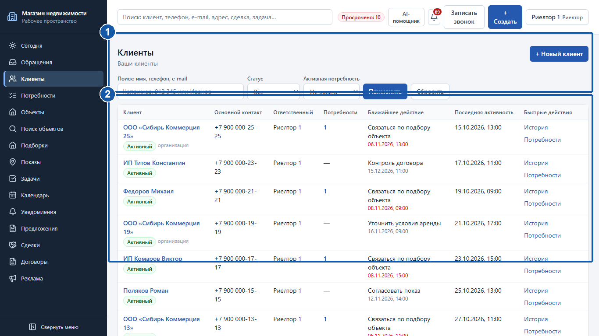

## 7. Записать звонок или обращение

1. Нажмите «Записать звонок» или откройте создание обращения. Выберите клиента либо заполните сведения нового.
2. Укажите канал и источник. Если звонят по объекту или рекламе, выберите соответствующую запись.
3. Запишите суть разговора и результат. Если работа продолжается, заполните параметры потребности и следующее действие с исполнителем и сроком.
4. Сохраните. Проверьте сообщение об успехе и ответственного. Убедитесь, что следующий шаг назначен.

**Пример.** Нужен офис 50–100 м² в аренду. Итог: «Уточнить мощность и подготовить три варианта». Задача: «Позвонить и уточнить мощность», завтра в 11:00.

Правило предприятия — «чей объект, того и клиент». Связь с объектом влияет на назначение ответственного. У существующего клиента ответственный обращения может отличаться от ответственного клиента; это не открывает всю чужую историю. Читайте сообщение о назначении.

Для отказа, спама или разовой услуги укажите причину. Отсутствие подходящих объектов само по себе не закрывает перспективную потребность. Фиксируйте факт разговора и новую задачу: перенос просрочки не заменяет коммуникацию.

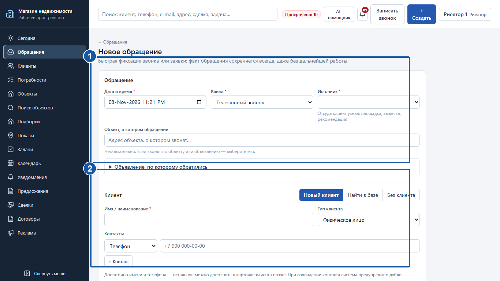

## 8. Потребности и следующее действие

1. Откройте клиента → «Потребности» или создание в общем разделе. Проверьте клиента и операцию.
2. Заполните бюджет, площадь, город, районы, назначение и требования. Разделяйте обязательное условие и предпочтение. Дополнительные блоки раскрывайте по необходимости.
3. Назначьте следующее действие, ответственного и срок. Сохраните и проверьте следующий шаг.
4. Из карточки переходите к подбору, предложениям, показам и истории этапов.

Для «В работе» нужна незавершённая задача следующего действия. Для паузы — «Возврат из паузы» с датой. Обычная задача другого типа не заменяет возврат. Завершая последнюю такую задачу, одновременно назначьте новый возврат или измените состояние запроса.

Закрытие требует причины и даты; успех — зафиксированного результата. Не отмечайте успех ради удаления просрочки. История этапов нужна для понимания хода работы.

После сохранения в карточке видны актуальные условия и следующий шаг. При конфликте изменений сначала обновите данные, затем повторите правку с учётом изменений коллеги.

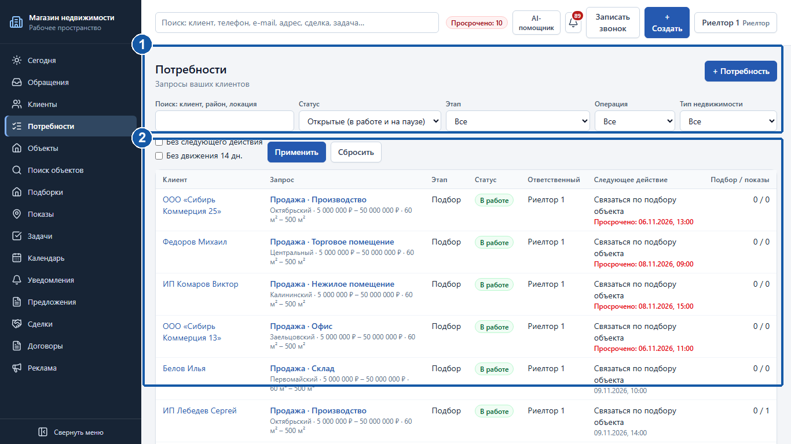

## 9. Поиск недвижимости без ИИ

Откройте «Поиск объектов». Переход из потребности сохраняет контекст. Клиент и потребность необязательны для самого поиска, но нужны для адресной подборки.

1. Проверьте город и операцию: аренда и продажа имеют разные ограничения цены.
2. Заполните цену и площадь. Для аренды явно выберите единицу цены: стоимость объекта и цена за м² не взаимозаменяемы.
3. Выберите назначения и площадки. Несколько значений внутри группы означают ИЛИ; разные группы объединяются по И.
4. Раскройте «Расширенные фильтры»: районы, этаж, коммуникации, свежесть. Сворачивание не сбрасывает выбранное; счётчик показывает активные условия.
5. Проверьте фильтры и запустите поиск. Дождитесь результата и статусов источников.

Скрапер не требует Яндекс AI и не расходует бюджет ИИ. Ручные фильтры работают без ИИ. В иллюстрациях используются сохранённые результаты: они не подтверждают доступность площадки сейчас.

«Жилая» и коммерческие назначения внутри выбора объединяются по ИЛИ. Поддержка фильтров зависит от источника. Неизвестный обязательный признак направляет объявление на проверку, а не подтверждает соответствие.

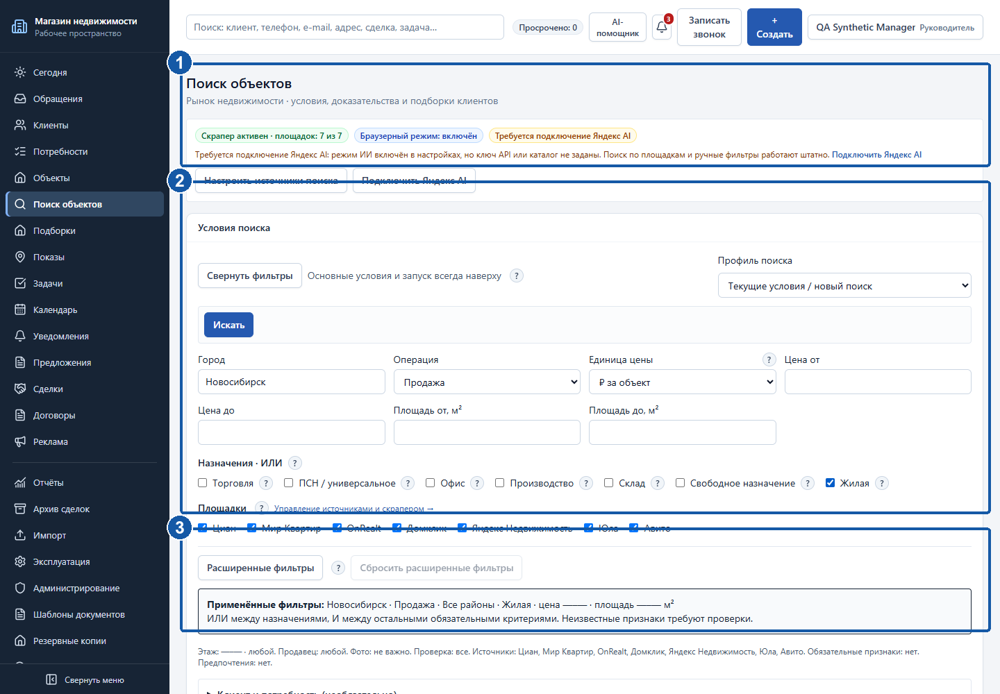

## 10. Источники, результаты и проверка

Руководитель включает площадки в «Источники поиска». Предусмотрены Циан, Мир Квартир, OnRealt, Домклик, Яндекс Недвижимость, Юла, Авито. Полнота рынка и одинаковая поддержка условий не гарантируются.

Раскройте состояние источников. Успешный ноль — площадка ответила без подходящих карточек. Блокировка, тайм-аут, ошибка и требование действия пользователя — технический отказ, а не снятие объекта. При частичном отказе используйте результаты других источников.

1. Разделите выдачу на совпадения, требующие проверки и исключённые. Читайте объяснение решения.
2. Проверьте цену и период, площадь, адрес, этаж, дату и ссылку. Неизвестная дата не означает свежую публикацию.
3. Отметьте варианты для сравнения. Проверяйте неизвестные поля отдельно; похожие объявления могут оказаться дублями.
4. При CAPTCHA откройте первоисточник вручную. «Частное лицо» не подтверждает собственника.

«Уточнить» создаёт задачу. В проверке сотрудника фиксируйте актуальность, подтверждение цены и собственника, дату следующей проверки. Эта оценка отделена от сведений площадки.

Не повторяйте все источники из-за одного отказа. Уточните фильтры, уменьшите глубину или используйте другую площадку. Сохранённые закладки и подборки остаются при сетевой ошибке.

## 11. Поиск с ИИ и бюджет

ИИ помогает разобрать запрос и проанализировать описания, но не подтверждает свойства объекта. CRM и ручной поиск работают без него.

1. Введите условия без ФИО, телефонов и закрытых контактов. Например: «Офис 50–100 м², аренда до 80 000 рублей в месяц за объект».
2. Выберите разбор с ИИ, если доступен. До подтверждения прочитайте оценку расходов и лимиты.
3. Проверьте предложенные фильтры: верхнюю цену, период цены, назначение и обязательные ограничения. Исправьте их до поиска. Ответ ИИ — черновик.
4. Отметьте полученные объявления. Если сборка показывает «Ранжировать выбранные с ИИ», прочитайте причины порядка и исходные сведения. В проверенных исходниках этой копии отдельной кнопки с такой надписью нет: доступен блок «Анализ выбранных объявлений» с командами «Проверить неизвестные признаки», «Сравнить объекты», «Текст для подборки», «Предложить задачи уточнения». Не путайте сравнение с подтверждением условий или автоматическим изменением порядка.

Бюджет показывает лимит месяца, учтённый расход, резерв текущих операций и остаток. Резерв ещё не является окончательным списанием. Расчёт CRM по её тарифам не заменяет счёт облака. Неизвестный расход не считайте нулевым.

При исчерпанном бюджете продолжайте ручную работу. Не повторяйте платную команду из-за ожидания. Отказ от применения полученного черновика не возвращает стоимость вызова.

Ручной веб-поиск — отдельная AI-операция. Автоматический веб-резерв допускается настройками при техническом отказе; исправная пустая выдача не повод автоматически тратить бюджет. Подключение и тарифы проверяет руководитель.

## 12. Мои поиски и повторное использование

«Мои поиски» хранит название, город, фильтры и источники. Конфигурация и прошлый результат не являются постоянным мониторингом рынка.

1. Во вкладке «Мои поиски» введите «Название поиска» и нажмите «Сохранить условия». Пример: «Пример — офис 50–100 м²».
2. Откройте «Мои поиски» и нужную запись. Проверьте условия и дату успешного результата.
3. «Открыть / запустить» загружает условия в форму: проверьте их и отдельно нажмите «Искать». Для старой выдачи используйте сохранённую ссылку результата. Новый запуск снова обращается к источникам; делайте его только для обновления сведений.
4. Сравните изменения цены и новые объявления с предыдущим успешным результатом. При сбое нового запуска прежний результат не становится актуальным автоматически.

Для Excel используйте экспорт CSV результатов с источниками. Он удобен для сравнения, но не переносит все связи, документы и историю и не заменяет резервную копию.

При подготовке руководства внешние поиски и AI-вызовы не запускались. Обучайтесь на сохранённой синтетической выдаче. Метка DEMO или записанный демонстрационный режим означает учебные данные, а не новую проверку площадки.

Снимок вкладки «Мои поиски» в доступном комплекте отсутствует. Команды выше проверены по текущей форме; иллюстрация другого экрана вместо неё не используется.

## 13. Закладки, подборки и каталог

«В закладки» сохраняет личную заметку. «В подборку клиента» связывает кандидата с потребностью. «В каталог CRM» создаёт внутренний объект после подтверждения. «Предложить клиенту» фиксирует отдельный факт предложения.

1. Добавьте вариант в закладки, если клиент ещё не выбран.
2. Для конкретного запроса добавьте его в подборку и выберите нужную потребность. Проверьте заметку.
3. Уточните критичные сведения и источник. Для работы в CRM явно перенесите объект в каталог. При неполной идентичности проверьте дубль вручную.
4. Фиксируйте предложение после фактического предложения клиенту. Кандидат или скачивание файла не заменяет этот факт.

В подборке открываются объект и связанный запрос. Подготовьте состав и порядок списка к обсуждению. Для КП нужен объект каталога: внешняя ссылка не равна внутренней карточке.

Повторный перенос связанного объявления возвращает существующий объект. Не создавайте ещё одну карточку вручную. Возможные дубли требуют решения сотрудника; автоматического слияния по одному адресу нет.

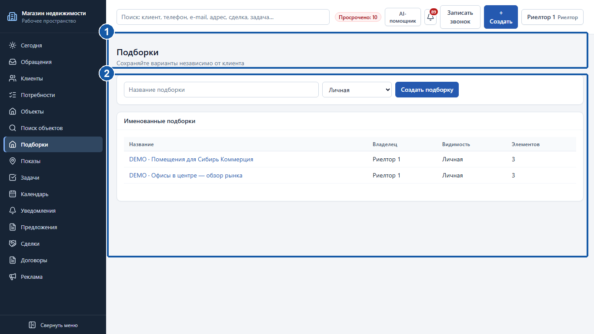

## 14. Коммерческое предложение

1. Отметьте объекты в подборе → создание КП либо откройте «Предложения» → создание. Укажите потребность и ИП/ООО.
2. Проверьте позиции, порядок, введение, условия и примечания. Исключите лишнее.
3. Сохраните черновик и откройте предпросмотр. Проверьте адреса, цену, площадь, единицы цены, ссылки и реквизиты.
4. Выгрузите DOCX или «Скачать PDF». Для печати в предпросмотре нажмите «Печать A4».
5. После отправки отдельно отметьте «Отправлено». Выгрузка статус не меняет.

КП хранит снимок характеристик. Последующее изменение цены объекта не переписывает старое предложение. «Новая редакция» создаёт черновик с исходными снимками: проверьте их перед новой отправкой.

Фото и реквизиты используются на момент выгрузки. В документ включаются доступные фото каталога; закрытые сканы и архивные фото не становятся иллюстрациями. Фото площадок автоматически не загружаются. Внутренние заметки в клиентский документ не включаются.

Если в старой позиции нет единицы цены, не делайте вывод о цене за м². Уточните условия новой редакции. DOCX предложения не заменяет утверждённый юридический договор.

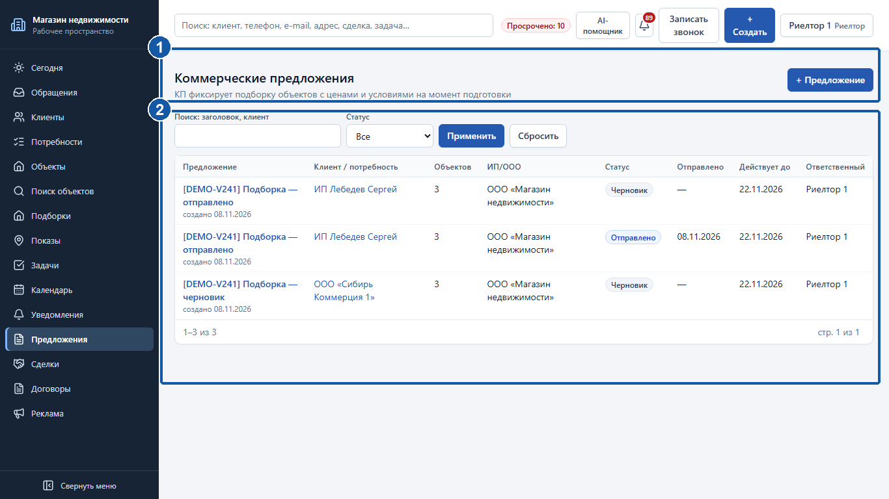

## 15. Задачи и завершение работы

1. Откройте «Задачи» или создайте задачу из карточки. Заполните понятное название, исполнителя, тип и срок.
2. По необходимости раскройте связи, шаблоны и повторения. Проверьте клиента и запрос.
3. Сохраните и убедитесь, что дело появилось в списке и на нужной дате.
4. После выполнения запишите итог и следующий шаг. При переносе задайте новый срок и содержательную причину.

Вместо «Позвонить» лучше «Позвонить клиенту: согласовать показ». Срок задачи — дедлайн, а не длительность занятости. Для встречи с началом и концом используйте календарь.

Сначала проверьте просрочки на «Сегодня». Выполнение последней задачи не должно оставлять активную потребность без следующего шага: потребуется продолжение или корректное изменение состояния.

Постсделочные дела также ведутся задачами: декларация, пересмотр аренды, допсоглашение, счёт, акт, возврат помещения, последующий контакт. При закрытии сделки выбирайте нужные задачи, сроки и исполнителей, а не все шаблоны подряд.

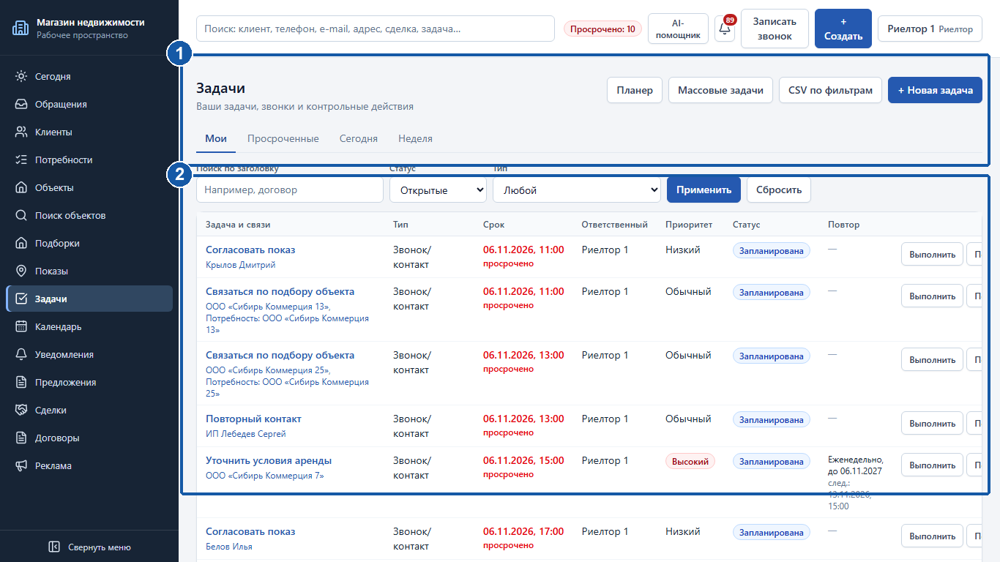

## 16. Календарь, показы и напоминания

В «Календарь» выберите день, неделю, месяц или «Три месяца»; проверьте фильтры сотрудника, типа и статуса. Повестка ближайших дел также есть на «Сегодня». Даты показаны в часовом поясе CRM, а не обязательно текущего местонахождения.

1. Создайте встречу с началом и концом и нужными связями.
2. Для серии задайте будни, дни недели или ежемесячное правило. Ограничьте датой включительно либо количеством повторений.
3. Проверьте пересечения. Редактирование повторяющейся встречи меняет серию; перечитайте правило.
4. После показа зафиксируйте результат и дальнейшее действие: задача, пауза с возвратом, закрытие с причиной или успех.

Личная встреча другим видна как «Занято». Срок задачи не означает занятость на целый час. Месяц без указанного числа повторения пропускается.

Колокольчик и «Уведомления» показывают ваши напоминания. Откройте источник, отметьте прочтение или «Напомнить позже». Отложенное уведомление не переносит задачу. Группу можно раскрыть для работы с каждой записью.

Локальным фоновым напоминаниям требуется работающее приложение или трей. После полного выхода доставка возобновляется при запуске. Не полагайтесь на email/SMS/push, если они отдельно не настроены организацией.

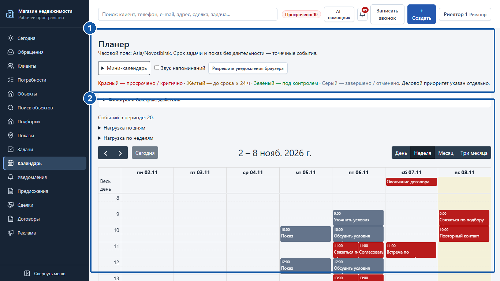

## 17. Договор и файлы при создании

1. Откройте создание договора. В «Новый договор / соглашение» проверьте клиента, объект и сделку.
2. Заполните «Тип договора», «Статус», «Номер», даты и «ИП/ООО». Для подписанного договора заполните дату подписания и обязательные поля.
3. Задайте «Действует до» и «Напомнить о сроке». При отсутствии договора укажите причину и «Что требуется сделать».
4. В «Документы договора» нажмите «Выбрать файлы договора». Выберите несколько файлов и тип каждого: договор, дополнительное соглашение или приложение. Уберите случайные файлы до сохранения.
5. Нажмите «Создать договор». Сначала сохраняется запись, затем файлы. Дождитесь результата и перехода к документам карточки.

Форма показывает расширения и предел размера каждого файла. Пустой, большой или неподходящий файл исправьте до отправки. Переименование EXE в PDF не делает документ допустимым: содержимое проверяется.

**Проверьте результат.** В документах карточки должны быть нужные имена, типы, дата и автор. Скачайте один файл для контроля. Сохранённый договор не означает, что все вложения уже загружены.

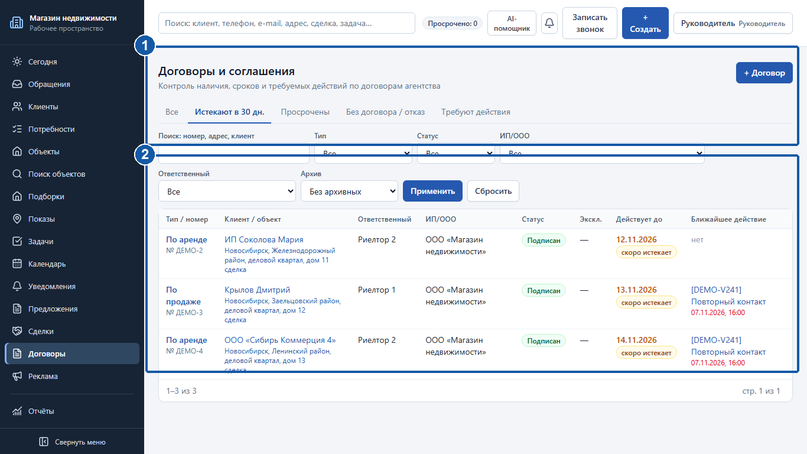

## 18. Повтор незагруженных документов

Если договор сохранён, а файл не загрузился, не создавайте договор повторно. Продолжайте работу с той же записью.

1. Прочитайте итог каждого файла. Успехи остаются в карточке; ошибка одного не отменяет остальные.
2. Проверьте сеть, размер и формат. Оставьте форму открытой для сохранения очереди.
3. Нажмите «Повторить загрузку»: повторяются только неудачные файлы, а не договор и принятые документы.
4. Для выхода выберите «Открыть сохранённый договор». Подтвердите предупреждение: незагруженные файлы останутся только на ПК. Выберите их заново в карточке.

Очередь живёт в открытой форме. Обновление страницы и закрытие после предупреждения сбрасывает незагруженные файлы. Запись договора и принятые документы остаются.

В карточке можно догрузить, скачать и архивировать документы при наличии прав. Архивирование скрывает из обычного списка, но сохраняет историю и файл. Это не физическое удаление. Архивный договор не принимает новые загрузки.

Чтение договора через клиента не обязательно даёт право прикреплять файлы. При отказе обратитесь к ответственному или руководителю. Прямая ссылка на файл не отменяет ограничения доступа.

## 19. Импорт Excel

Импорт выполняет руководитель. Подготовьте копию исходного файла и определите нужные сведения; не экспериментируйте с единственным оригиналом.

1. Откройте «Импорт». Для полного переноса используйте мастер; для исторического файла — загрузку и поддерживаемый профиль.
2. Выберите .xlsx. Листы и логические секции определяются по маркерам и заголовкам: на одном листе может быть несколько таблиц.
3. Проверьте профиль и сопоставление колонок. Дождитесь предварительной проверки без изменения рабочих записей.
4. Прочитайте ошибки, предупреждения и дубли. Исправьте копию или исключите секции. Одно ФИО не является основанием слияния.
5. Подтвердите выбранные данные. Дождитесь завершения и откройте итог задания.

Предварительная проверка не создаёт рабочие записи. «Допустимо» и «Загружено» — разные результаты. После подтверждения смотрите числа загруженных, пропущенных строк и ошибок.

Паспорт, кем выдан, регистрация и дата рождения исключаются политикой исторического импорта. Не переносите их под видом комментария. Исторический архив отделён от текущих сделок.

Проверьте контрольные записи: контакты, ответственных, числа и связи. Повторную загрузку того же файла согласуйте, чтобы избежать дублей.

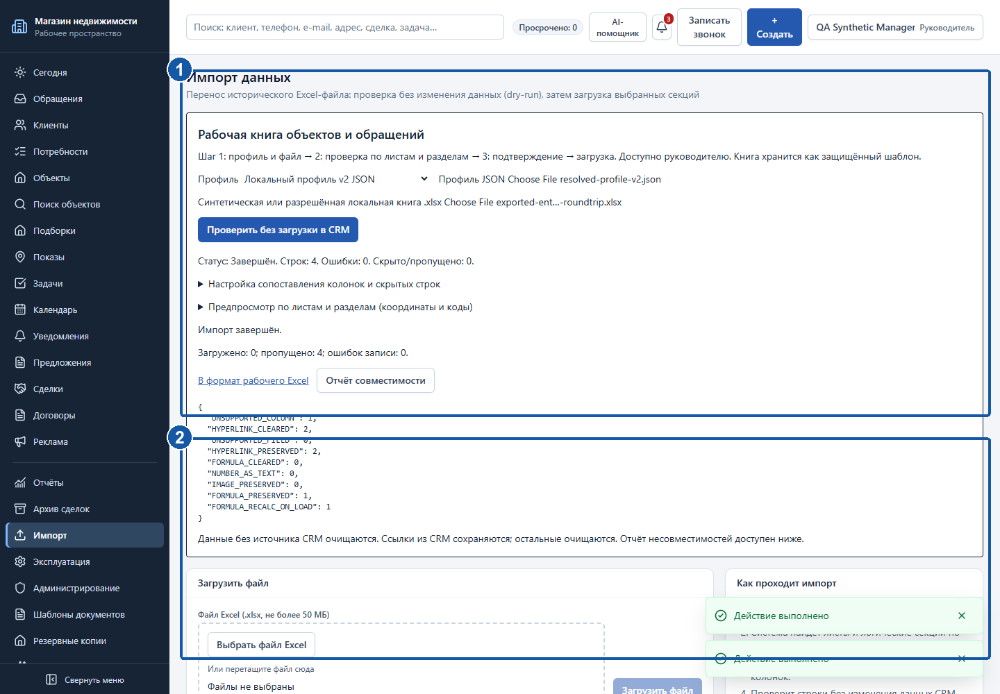

## 20. Экспорт в Excel

Экспорт нужен для сверки и передачи согласованного набора данных. Он не заменяет архив: таблица может не содержать файлы, историю и все связи.

1. Откройте список, задайте фильтры и доступную команду экспорта. Для полного Excel-переноса руководитель использует мастер в «Импорт».
2. Дождитесь подготовки и сохраните файл в рабочую папку. Не закрывайте программу во время операции.
3. В Excel проверьте листы, заголовки, число строк, даты, суммы и телефоны. Телефонам и идентификаторам может требоваться текстовый формат.
4. Для обратной загрузки используйте предварительную проверку и совместимый профиль. CSV поиска не является полным файлом переноса CRM.

Поиск объектов выгружает CSV с источниками. Если всё открылось одним столбцом, импортируйте текстовый файл с UTF-8 и подходящим разделителем вместо ручного разбиения.

Храните выгрузки в разрешённом месте. Не передавайте полный список клиентов для обсуждения одного объекта. На рисунке показан исторический синтетический цикл Windows, а не гарантия совместимости любого Excel-файла.

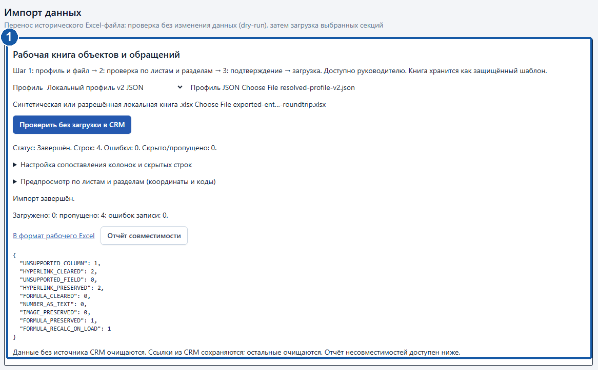

## 21. Создание резервной копии

Руководитель открывает «Резервные копии» в меню; заголовок страницы — «Локальная установка и резервные копии». В серверном режиме полный порядок восстановления согласуйте с ответственным за сервер.

1. Проверьте место и завершите ввод важных записей. Нажмите «Создать копию».
2. Введите кодовую фразу, нажмите «Сформировать ключ». Используйте «Экспорт ключа на носитель», сохраните его отдельно от архива.
3. Только после этого отметьте «Я сохранил ключ отдельно от архива». Выполните операцию, дождитесь конца.
4. Проверьте готовность и выполните «Проверить архив». Отдельно проверьте передачу каждого внешнего направления.

Зашифрованный .crmbackup включает согласованное состояние базы, документов, фото и шаблонов. Облачные пароли и локальные секреты при переносе подключаются заново.

**Храните ключ отдельно.** Потеря и кодовой фразы, и ключа делает восстановление невозможным. Пароль входа не заменяет их. Не фотографируйте ключ и не отправляйте его вместе с копией.

Проверка целостности не заменяет пробного восстановления на отдельной установке. Проверьте вход, контрольного клиента и документ, а не только открытие окна.

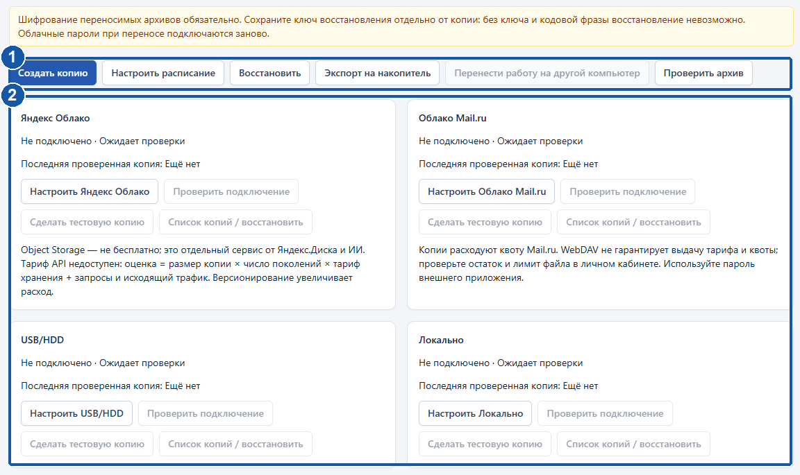

## 22. Расписание и контроль копий

1. Откройте «Настроить расписание». Выберите ежедневное или еженедельное выполнение, время и часовой пояс. При необходимости — копии при закрытии и перед обновлением.
2. Настройте поколения с учётом размера базы и места. Сохраните.
3. После нужного времени проверьте дату последней готовой копии и журнал. Сохранение расписания не подтверждает создание архива.
4. Проверяйте каждое облако и носитель отдельно. Успех одного не отменяет ошибку другого.

Приложение должно работать или оставаться в трее. Полный выход останавливает фоновые задания. При возвращении сети очередь повторяет передачу с увеличением интервалов. Не создавайте десятки одинаковых архивов из-за задержки.

При полном диске или лимите новая копия может не создаться, а прежние сохранятся. Освободите место и повторите. Не удаляйте единственную проверенную копию ради следующей.

Команда копирования в трее создаёт защитный снимок текущего профиля Windows. Для другого ПК нужен переносимый архив с отдельным ключом. Защитный снимок не отправляется в облака автоматически.

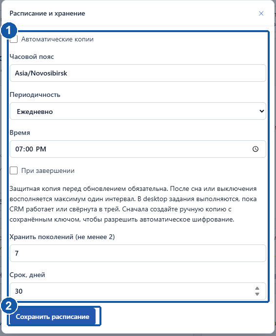

## 23. Восстановление базы и файлов

Восстановление заменяет состояние. Согласуйте момент с коллегами, сохраните работу и определите, какие новые записи отсутствуют в выбранной копии.

1. Откройте «Восстановить» или список копий направления. При наличии «Восстановить из файла…» выберите .crmbackup системным диалогом.
2. Проверьте дату и источник. Выбор файла действует ограниченное время; после ошибки закройте форму и выберите заново.
3. Введите кодовую фразу либо ключ. Прочитайте подтверждение замены: автоматического объединения баз нет.
4. Подтвердите и нажмите «Выполнить». Дождитесь проверки, защитной копии и переключения. Не выключайте ПК.
5. Войдите. Проверьте клиента, задачу и документ. На новом ПК подключите облака заново.

Неверная фраза, повреждение, несовместимая новая версия и нехватка места останавливают процедуру. Не извлекайте отдельные файлы базы вручную. Передайте безопасное сообщение руководителю.

Если установки работали независимо, сравните версии и сохраните обе ветви. Явный перенос и режим просмотра не дают автоматического слияния. Не продолжайте параллельный ввод на старом ПК после передачи.

Команды выбора и проверки показаны на рисунке 15. Полный цикл восстановления установленного EXE ограниченно подтверждён в материалах версии; до рабочего применения выполните пробу на отдельной установке с ответственным специалистом.

## 24. Яндекс Облако и Облако Mail.ru

Подключения выполняет руководитель. Откройте карточку направления → «Настроить …». Получите параметры у владельца аккаунта; не включайте секреты в снимки или экспорт.

**Яндекс Облако.** Это Object Storage, отдельный от Яндекс.Диска и ИИ. Заполните предоставленные параметры доступа, bucket, префикс и адрес сервиса. Сохраните → «Проверить подключение» → «Сделать тестовую копию».

**Облако Mail.ru.** Укажите аккаунт, каталог и пароль внешнего приложения для WebDAV. Сохраните, проверьте подключение и тестовую копию. Квоту и размер файла проверяйте в личном кабинете.

Откройте «Список копий / получить» и проверьте архив, дату и результат. На старом снимке команда называется «Список копий / восстановить». Ошибка одного облака не отменяет удачную копию другого.

Object Storage может тарифицировать хранение, запросы и трафик. Поколения увеличивают объём. Mail.ru расходует квоту аккаунта. Стоимость и лимиты проверяет владелец облака. Подключение не означает, что копия уже передана и проверена.

Секреты повторно не показываются; для замены введите новые. На другом ПК подключите облака заново.

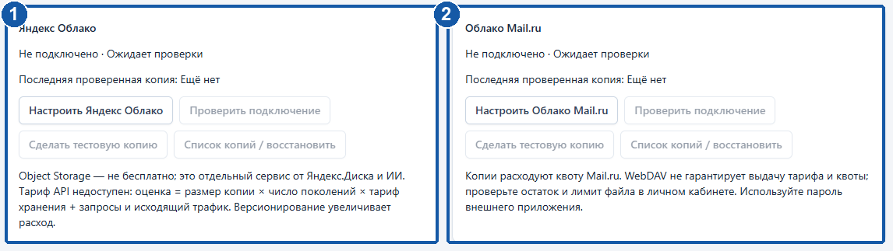

## 25. USB/HDD и перенос компьютера

1. Подключите накопитель с достаточным местом. «Настроить USB/HDD» → каталог, доступный программе.
2. Проверьте подключение и тестовую копию либо «Экспорт на накопитель» для готового архива.
3. Дождитесь сообщения о проверке и сохранении. Безопасно извлеките носитель средствами Windows.
4. Recovery key храните отдельно. Архив и ключ на одной флешке не обеспечивают разделение.

Для смены ПК используйте «Перенести работу на другой компьютер», если доступно. На принимающей стороне явно получите состояние и подтвердите. Если команды нет, согласуйте восстановление переносимого архива.

Режим просмотра старой установки ограничивает изменения. Полностью выключенный или изолированный ПК нельзя считать навсегда технически заблокированным: определите, где ведётся актуальная работа. Не создавайте две независимые базы.

Папка USB в серверной CRM относится к носителю сервера, а не обязательно вашей флешке. Системный диалог есть только в соответствующем режиме. Не размещайте открытую рабочую базу на внешнем диске; переносите архивы.

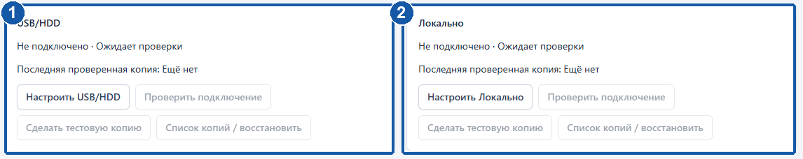

## 26. Обновление и удаление программы

**Обновление.** Получите одобренный установщик и сохраните предыдущий. Создайте переносимую копию, проверьте её и отдельный ключ. Завершите работу и установите новую версию поверх прежней. Не удаляйте данные вручную.

CRM создаёт защитный снимок, обновляет структуру базы и проверяет запуск. При сбое обновления базы защитный механизм восстанавливает базу и отметку версии. Возврат прежнего EXE не автоматизирован. При ошибке передайте диагностику ответственному.

После обновления проверьте вход, клиента, задачу, документ, версию, расписание и направления копий. Не удаляйте прежний установщик и проверенный архив сразу после открытия окна.

**Удаление.** «Параметры Windows → Приложения → Установленные приложения → RealEstateCRM → Удалить». Обычно данные, документы, настройки и копии остаются. Повторная установка может их открыть.

Полное удаление данных требует отдельного флажка и подтверждения. Делайте это по решению организации после проверки внешнего архива. Локальное удаление не убирает облачные копии и общий WebView2. Для закрытия мешающего окна достаточно выхода через трей.

Результат запуска показан на рисунке 1. Снимков мастера установки/удаления в комплекте нет; шаги приведены по документации Windows-сборки без подмены макетами.

## 27. Типичные проблемы и решения

**Запись не найдена.** Проверьте фильтры, архив и область списка. Общий поиск учитывает права. До создания дубля проверьте контакт.

**Запись изменена коллегой.** «Обновить данные» → сравнить → повторить свою правку. Не сохраняйте старую форму вслепую. Сохраните незавершённый комментарий в разрешённом месте.

**Нет доступа или файл не скачивается.** Проверьте свою учётную запись. Обратитесь к ответственному или руководителю. Прямая ссылка не расширяет права.

**Источник не дал результат.** Успешный ноль требует пересмотра фильтров, CAPTCHA — ручного действия, частичная ошибка — просмотра остальных источников. Неизвестное условие нужно уточнить.

**ИИ недоступен.** Работайте вручную. Руководитель проверяет подключение, тариф и бюджет. Повтор платной команды без диагностики может увеличить расход.

**Файл договора не загружен.** В открытой форме — «Повторить загрузку». После закрытия — добавить отсутствующий файл в сохранённый договор. Не создавайте второй договор.

**Копия не создаётся.** Проверьте место, носитель и направление. Сохраните последнюю пригодную копию. Исправьте ключ или несовместимость версии; простой повтор не поможет.

**Внутренняя ошибка.** Передайте руководителю безопасный код запроса, время, раздел и шаги. Не публикуйте полные журналы, пароли, ключи и документы. При сбое старта используйте код из диагностики.

## 28. Памятка на каждый день

1. Войдите под своим именем. Просмотрите «Сегодня», просрочки и контрольные даты.
2. Запишите значимый контакт и проверьте связь с клиентом и объектом.
3. Оставьте активной потребности следующее действие, паузе — возврат с датой.
4. До предложения проверьте цену, период, актуальность, источник и неизвестные условия.
5. Проверьте предпросмотр КП, после отправки отдельно отметьте результат.
6. Убедитесь, что документы договора загрузились. Повторяйте только ошибки файлов.
7. Проверьте задачи и уведомления. На общем ПК завершите сеанс. Для локальных фоновых заданий оставьте программу в трее по правилам организации.

Руководителю: контролируйте последнюю проверенную копию и каждое направление. Периодически восстанавливайте отдельно от рабочей базы. В отчётах переходите к первичным записям; проверяйте период и сотрудника.

**Кому передавать вопрос.** Клиент, договор, доступ — ответственному и руководителю. Установка, запуск, восстановление — сотруднику по программе. Тарифы облака — владельцу аккаунта. Запишите, что произошло и какие действия уже выполнены.
