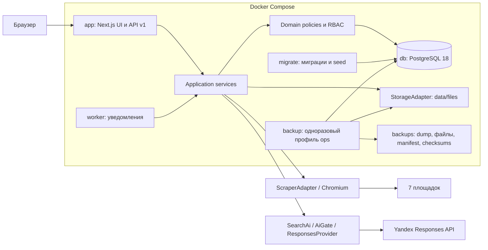
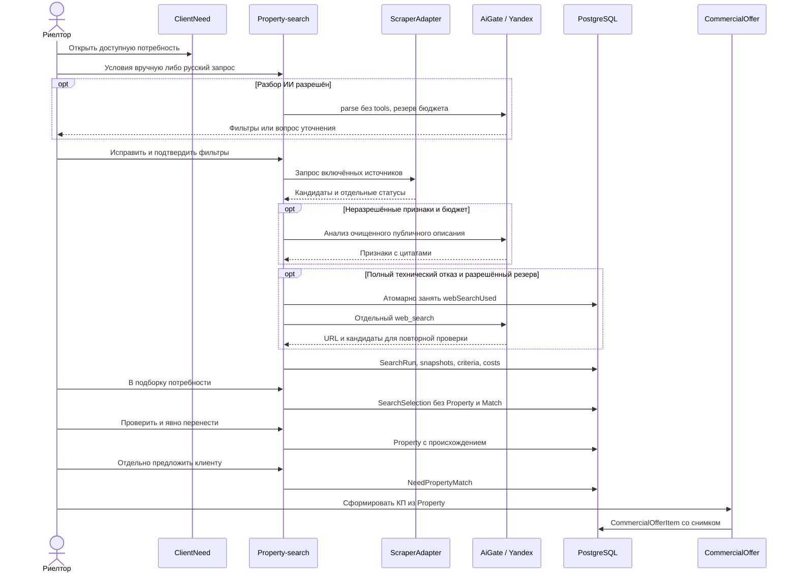

# Архитектура v2.4.1

Срез: 05.11.2026, feature/tz-v2.4.1, история от ba7e6fa. Итоговый SHA: **заполняет координатор**. Модульный монолит: один код приложения и application/domain слой, одна PostgreSQL. Worker уведомлений использует тот же образ, поиск выполняется синхронно в app.

Слои: src/app и src/ui → API → modules/*/application → domain/policy → Prisma/StorageAdapter. Серверные страницы получают DTO через application queries. React не импортирует Prisma. Cookie-сессия, Origin, validation и standby guard — в src/server/api-handler.ts; права на связанные сущности проверяются сервисами.

Бюджет резервируется до платного вызова. ENV ограничивает разрешения UI. Файлы вне public; PostgreSQL содержит метаданные. Backup восстанавливает БД и файлы совместно. Напоминания создаёт только active instance.

Источники: [поиск](../integrations/property-search-application.md), [AI](../integrations/yandex-ai.md), [календарь](../calendar-notifications.md), [Docker/restore](../operations/docker-v241-verification.md), [compose.yaml](../../compose.yaml). Живой сбор семи площадок не подтверждён; smoke проверяет запуск и закрытие Chromium. Полная egress/sandbox-изоляция браузера этим протоколом не подтверждена.
