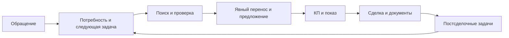

# AS-IS → TO-BE

AS-IS — модель исходного процесса по ТЗ, не отдельный хронометраж сотрудников. TO-BE описывает сервисы; полнота приёмки — в [матрице](../requirements-traceability.md#v241).

| Процесс | AS-IS по ТЗ | TO-BE v2.4.1 | Проверка / ограничение |
|---|---|---|---|
| Обращение | Разрозненные записи, риск потери контакта | История ClientNeed и обязательная следующая Task | LEAD; замеров времени нет |
| Подбор | Ручные переходы, неодинаковые фильтры | Каталог и внешний поиск, доказательства, ручная проверка | SEARCH/SCRAPER; живые площадки не приняты |
| Актуальность | Данные площадки смешиваются с итогом звонка | Snapshot отдельно от Verification сотрудника | LINK; актуальность рынка не гарантируется |
| КП | Ручное копирование характеристик | Снимки, редакции, DOCX/HTML | OFFER-DOC; Word/печать требуют визуальной проверки |
| Планирование | Раздельные списки и напоминания | Task/Showing/CalendarEvent и worker | CAL-NOTIF; [проверки этапа 2](../acceptance/stage2-live-ai-ux.md) |
| Документы | Комплектность проверяется вручную | Файлы с RBAC и чек-лист | MEDIA/OFFER-DOC; достаточность определяет сотрудник |
| Контроль | Ручной подсчёт | KPI по событиям, единые фильтры и drill-down | REPORT-PAUSE |
| Расходы поиска | Труд сотрудников, неучтённые сервисы | Бюджетный gate, токены, тарифы и журнал | AI; счёт провайдера отдельно |
| Восстановление | Ручные копии | Dump + файлы + checksums + restore-test | Протокол Docker, отдельный project |

Меньше повторного ввода и пропущенных действий — гипотеза для пилота. Методика и прогноз — [экономика](economics.md). Реальный Excel, NFR-14 и три одновременных пользователя пока не измерены.
