# Ключевые связи данных v2.4.1

Имена — Prisma models из [schema.prisma](../../prisma/schema.prisma); таблицы и ограничения — [mapping](../data-model-mapping.md). Показаны ключевые связи, не все поля и join-таблицы.

```mermaid
erDiagram
  User ||--o{ UserSession : sessions
  User ||--o{ Client : responsible
  Client ||--o{ ClientContact : contacts
  Client ||--o{ ClientNeed : needs
  Client o|--o{ LeadRequest : requests
  ClientNeed o|--o{ LeadRequest : context
  ClientNeed ||--o{ NeedStageHistory : history
  ClientNeed ||--o{ TaskNeed : actions
  Task ||--o{ TaskNeed : links
  Task ||--o{ TaskDeal : links
  Deal ||--o{ TaskDeal : postdeal
  ClientNeed ||--o{ NeedPropertyMatch : proposed
  Property ||--o{ NeedPropertyMatch : proposals
  ClientNeed ||--o{ Showing : visits
  Property ||--o{ Showing : visits
  Property ||--o{ PropertyOwner : ownership
  Client ||--o{ PropertyOwner : owner
  Property ||--o{ PropertyContactGrant : grants
  User ||--o{ PropertyContactGrant : recipient
  User ||--o{ SearchBookmark : private
  ExternalListing ||--o{ SearchBookmark : bookmarked
  ClientNeed ||--o{ SearchSelection : candidates
  ExternalListing ||--o{ SearchSelection : selected
  Property o|--o{ SearchSelection : transferred
  NeedPropertyMatch o|--o{ SearchSelection : proposed
  Property o|--o{ ExternalListing : origin
  ExternalListing ||--o{ ExternalListingSnapshot : snapshots
  ExternalListing ||--o{ ExternalListingVerification : checks
  User ||--o{ ExternalListingVerification : verifier
  User ||--o{ SavedSearch : owner
  ClientNeed o|--o{ SavedSearch : context
  SavedSearch o|--o{ SearchRun : runs
  SearchRun o|--o{ SavedSearch : last_successful
  User ||--o{ SearchRun : runs
  ClientNeed o|--o{ SearchRun : context
  SearchRun ||--o{ SearchRunSource : source_status
  SearchRun ||--o{ SearchRunResult : results
  ExternalListing ||--o{ SearchRunResult : evaluated
  SearchRun o|--o{ ExternalListingSnapshot : fetched_in
  User ||--o{ AiUsageLog : calls
  SearchRun o|--o{ AiUsageLog : job
  AiUsageLog o|--o{ AiBudgetReservation : reservations
  User o|--o{ AiSetting : updated_by
  User ||--o{ CalendarEvent : responsible
  Client o|--o{ CalendarEvent : context
  ClientNeed o|--o{ CalendarEvent : context
  Property o|--o{ CalendarEvent : context
  Deal o|--o{ CalendarEvent : context
  User ||--o{ Notification : recipient
  User ||--o| NotificationPreference : reminder
  ClientNeed ||--o{ CommercialOffer : offers
  CommercialOffer ||--o{ CommercialOfferItem : snapshot_items
  Property ||--o{ CommercialOfferItem : source
  LegalEntity o|--o{ CommercialOffer : issuer
  Property ||--o{ Deal : deals
  LegalEntity ||--o{ Deal : issuer
  Deal ||--o{ DealParty : parties
  Client o|--o{ DealParty : participant
  Deal ||--o{ DealCommission : commissions
  DealParty o|--o{ DealCommission : payer
  Deal ||--o{ DealChecklistItem : checklist
  Document o|--o{ DealChecklistItem : evidence
  Deal o|--o{ Agreement : agreements
  LegalEntity o|--o{ Agreement : issuer
  LegalEntity o|--o{ Document : issuer
  Document ||--o{ DocumentProperty : media_links
  Property ||--o{ DocumentProperty : gallery
  Document ||--o{ DocumentDeal : links
  Deal ||--o{ DocumentDeal : files
  ImportJob ||--o{ ImportRowResult : rows
  BackupRun ||--o{ BackupTargetRun : copies
  BackupRemote ||--o{ BackupTargetRun : target
  AiTariff {
    uuid id PK
    string model
    string callType
    string unit
    decimal priceRub
    timestamptz effectiveFrom
  }
```

AiTariff выбирается ledger по модели/единице/дате; snapshot тарифа хранится в журнале, FK на тариф нет. Notification.sourceType/sourceId — ссылка без FK, источник перепроверяется сервисом. AuditLog хранит ID и безопасный diff, без FK на каждую бизнес-таблицу. Task и Document связаны с CRM нормализованными join-таблицами; остальные связи опущены ради читаемости.

Время событий — timestamptz(3), деньги — Decimal, FK RESTRICT. Главное фото, composite identity и codebook дополнительно защищены SQL миграции 20261105120000_v241_extensions. Кандидат не равен предложению; комиссии хранятся отдельно от Deal.
