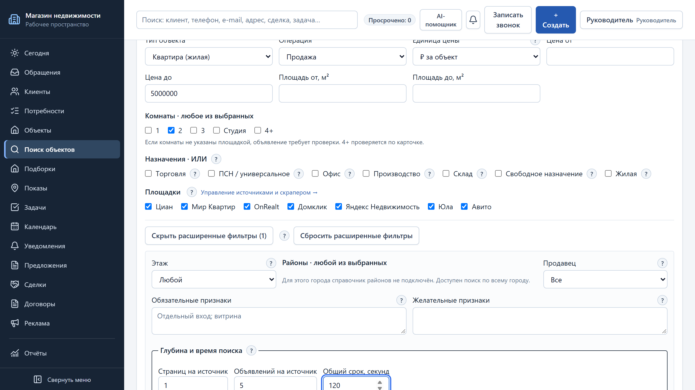
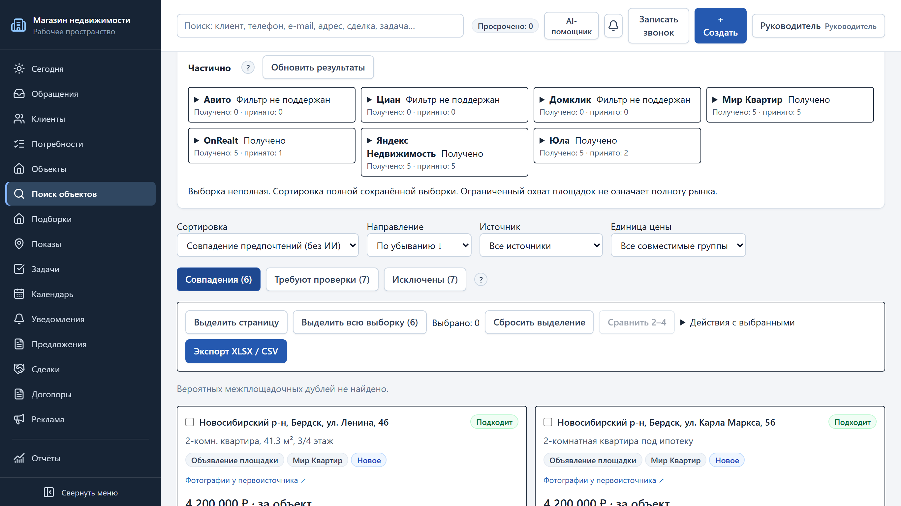

# Сквозная проверка поиска v3.2.3 + AI

Дата: 09.11.2026. Рабочая копия `.worktrees/e2e`, ветка `feature/search-v3.2.3-e2e`. Продуктовые изменения: `2c93319`, `277bd7e`, `f99f8f2`. Машиночитаемый протокол: [JSON](live-search-v323-e2e.json).

## Методика и границы

Production-сборка `npm run build -- --webpack`, `NEXT_DIST_DIR=.next-v323-e2e`; миграции crm_demo применены до запуска. Стенд 127.0.0.1:3385, настоящий поисковый worker, все 7 площадок, AI и обычный браузер Chromium включены; Циан — видимый браузер, Яндекс — автоматическая браузерная навигация. maxPages=1, limit=5 на источник, общий срок 120 с. Несколько типов/локаций могут порождать внутренние ветви: это лимит ограниченной выборки, не полнота рынка. Вежливые штатные ограничители транспорта; обход защиты не выполнялся. Excel не читался и не изменялся.

**LIVE** — семь реальных запусков площадок, семь разборов, два точечных ретеста и одно ранжирование. **REPLAY** — повторное открытие тех же сохранённых результатов и синтетические регрессионные ответы. **DEMO** — только переиспользованные иллюстрации помощника. **BLOCKED / unsupported_filter** не считаются успешным нулём. Второй внешний сбор после AI-подтверждения не проводился: таблица сравнивает ручную выдачу с разбором условий, а не две независимые рыночные выборки.

Основная матрица пройдена manager. Отдельно realtor1: вход 200, LIVE-разбор и подтверждение нескольких локаций 200, прямой URL выдачи manager — 404. Новые скриншоты 1366×768, deviceScaleFactor=2 (PNG 2732×1536), без контактов продавцов.

## Сценарии без AI и AI-разбор

Время поиска включает ввод формы и ожидание очереди. Колонки П/ПР/И — совпадения / требуют проверки / исключены по фактически выбранным ручным фильтрам. Число комнат в ручной форме отсутствует.

| ID | Сценарий | Без AI, с | Карточек | П/ПР/И | AI-разбор + подтверждение |
|---|---|---:|---:|---|---|
| a | Офис 50–100 м² аренда, Академгородок | 71.0 | 20 | 0/11/9 | HTTP 200, 2.37 с; подтверждение 200 |
| b | Двухкомнатная квартира продажа до 5 млн, Бердск | 55.8 | 20 | 4/6/10 | HTTP 200, 4.09 с; подтверждение 200 |
| c | Склад от 300 м² аренда, Обь + Новосибирск | 45.6 | 15 | 0/13/2 | HTTP 200, 2.81 с; подтверждение 200 |
| d | Квартира аренда, Кольцово | 44.1 | 15 | 0/11/4 | HTTP 200, 2.53 с; подтверждение 200 |
| e | Дом/коттедж продажа, Новосибирская область | 77.9 | 19 | 11/7/1 | HTTP 200, 2.28 с; подтверждение 200 |
| f | Апартаменты продажа, Новосибирск | 94.9 | 25 | 0/2/23 | HTTP 200, 2.95 с; подтверждение 200 |
| g | Любое нежилое до 50 000/мес, Новосибирск и пригороды | 124.1 | 15 | 0/10/5 | HTTP 200, 1.99 с; подтверждение 200 |

Итого **129 появлений** в 7 выборках: 15 совпадений, 60 требуют проверки, 54 исключены. Это не 129 уникальных объектов и не оценка количества на рынке.

## Результаты по площадкам

Формат ячейки: получено / статус. `success` означает обработку источника, а не пригодность всех карточек. «Принято» в UI включает кандидатов на проверку.

| Сценарий | Циан | Мир Квартир | OnRealt | Домклик | Яндекс | Юла | Авито |
|---|---|---|---|---|---|---|
| a | 5 / success | 5 / success | 5 / success | 0 / blocked | 5 / success | 0 / success | 0 / needs_user_action |
| b | 0 / unsupported_filter | 5 / success | 5 / success | 0 / unsupported_filter | 5 / success | 5 / success | 0 / unsupported_filter |
| c | 0 / unsupported_filter | 5 / success | 5 / success | 0 / unsupported_filter | 5 / success | 0 / success | 0 / unsupported_filter |
| d | 0 / unsupported_filter | 5 / success | 5 / success | 0 / unsupported_filter | 5 / success | 0 / unsupported_filter | 0 / unsupported_filter |
| e | 0 / unsupported_filter | 5 / success | 5 / success | 0 / unsupported_filter | 5 / success | 4 / partial | 0 / unsupported_filter |
| f | 5 / success | 5 / success | 5 / success | 0 / unsupported_filter | 5 / success | 5 / success | 0 / unsupported_filter |
| g | 0 / unsupported_filter | 5 / success | 5 / partial | 0 / unsupported_filter | 5 / partial | 0 / cancelled | 0 / cancelled |

Циан автоматически получил по 5 карточек в (a) и (f); Яндекс получил по 5 во всех семи сценариях, в (g) — частично до дедлайна. Для части населённых пунктов/типов Циан, Авито, Домклик явно вернули unsupported_filter. В (a) Домклик: HTTP 401, Авито: ручная проверка. Путь «Добавить объявление по ссылке» проверен открытием диалога без добавления вымышленных объявлений и без доступа к запрещённой площадке.

## Выборочная визуальная проверка и удобство

- **Офис:** Карточка OnRealt: офис 69,6 м², Мусы Джалиля 3/1, Советский район; цена 55 000 ₽, период неизвестен. Карточки Циана из Центрального/Заельцовского района исключены. Яндекс без адреса остаётся на проверке. [Снимок](../screenshots/vkr/v323-search/e2e-scenario-a-cards.png).
- **Квартира в Бердске:** Мир Квартир: двухкомнатная, Бердск, Карла Маркса 39, 4,7 млн ₽. Рядом есть студия Юлы за 3,05 млн и однокомнатная: ручная форма фильтрует квартиру, но не комнаты. Точный сценарий «двушка» — PARTIAL. [Снимок](../screenshots/vkr/v323-search/e2e-scenario-b-cards.png).
- **Склад:** Склад 900 м², Большая ул., Новосибирск; 315 000 ₽, период неизвестен. OnRealt также показывает склад 300 м². Для Яндекса 2540 м² адрес неизвестен. Площадь проверяется, доступность и месячная цена не утверждаются. [Снимок](../screenshots/vkr/v323-search/e2e-scenario-c-cards.png).
- **Кольцово:** OnRealt: квартиры 46/28 м², Кольцово, Молодёжная 4 / Никольский 11. Цены 4290/3200 ₽ могут быть посуточными: период неизвестен, поэтому нет подтверждённых совпадений аренды за месяц. [Снимок](../screenshots/vkr/v323-search/e2e-scenario-d-cards.png).
- **Дом/коттедж:** OnRealt: дом 84 м² в ДНТ Царская Усадьба Новосибирской области и коттедж 451 м² в Новосибирске. Юла показывает дома/коттеджи. Область шире пригородного пресета. [Снимок](../screenshots/vkr/v323-search/e2e-scenario-e-cards.png).
- **Апартаменты:** Из 25 карточек нет подтверждённых апартаментов: 23 исключены, у двух тип неизвестен. Поиск через широкие маршруты квартир — только получение кандидатов, не доказательство юридического статуса. [Снимок](../screenshots/vkr/v323-search/e2e-scenario-f-cards.png).
- **Любое нежилое:** ПСН 35 м² на Комсомольском 24, Новосибирск, 35 900 ₽ с неизвестным периодом. ПСН в Бердске за 140 000 ₽ также требует проверки периода, а не выдаётся как соответствие ≤50 000/мес. Общий поиск достигает дедлайна. [Снимок](../screenshots/vkr/v323-search/e2e-scenario-g-cards.png).

Выбор нескольких локаций и сохранение условий удобны; Академгородок честно обозначен как Советский район. Для точного населённого пункта нужно снять исходный Новосибирск. Неизвестный период цены и адрес требуют проверки. В узких комбинациях нет готовых совпадений; это ограничивает полезность поиска и не объявляется PASS качества всех источников.

## AI: схема, подтверждение, нормализация, ранжирование

Схема провайдера, промпт и Zod-проверка поддерживают locations/propertyKinds, устойчивые ID, несколько локаций и пресет suburbs, flat/house/apartments/non_residential. AI-предложение отображает русские подписи и применяется только после подтверждения. REPLAY покрывает семь фраз, невалидные ID, сохранение посторонних условий и устаревших районов. Интеграционный тест проверяет подтверждение владельцем и запрет чужого черновика на обеих БД.

LIVE: все 7 разборов и 7 подтверждений HTTP 200. Двушка хранит обязательный, пока не проверенный признак «2 комнаты». Первоначально модель добавляла non_residential к офису/складу и сохраняла city=Новосибирск для locations=[ob]. `f99f8f2` нормализует единственную локацию и убирает избыточный общий тип при конкретном коммерческом назначении. Два последующих LIVE-ретеста с чистой формы: Обь + склад ≥300 м²; realtor1 — Обь и Новосибирск вместе. Оба подтверждены; фотографии и факты не выдумываются.

Ранжирование: 2 выбранных объявления (OnRealt/Яндекс), HTTP 200, 3,399 с, один платный вызов, не кеш. Первый объект выше благодаря установленной локации/операции/назначению; второй имеет неизвестные данные. Цены разных/неизвестных периодов не сравниваются. [Ранжирование](../screenshots/vkr/v323-search/e2e-ranking.png), [несколько локаций](../screenshots/vkr/v323-search/e2e-ai-multiple-locations.png).

## Бюджет и настройки

Учтённый расход до: **6.231500 ₽**; после: **7.276400 ₽**. Разница: **1.044900 ₽**. Новых записей журнала и платных вызовов: **10** = 7 разборов + 2 ретеста + 1 ранжирование. Лимиты пользователя ≤3 ₽ и ≤12 соблюдены. Это расчёт CRM по provider usage/каталогу, не банковское списание или счёт Яндекса.

На стенде перед dispatch установлен месячный потолок 9,23 ₽ (исходный расход + не более 3 ₽ с округлением вниз) и дневной потолок 37 (25 исходных записей + максимум 12). Веб-резерв/ручной AI-веб-поиск выключены. Повтор после прерывания сохранил исходный бюджет и счётчик; уже оплаченные 7 разборов не повторялись. 2 дополнительных вызова нужны для проверки исправления.

Первый служебный запуск до поиска выявил неверный подсчёт legacy-расходов и ошибку асинхронного ожидания harness: исправлены до платных вызовов; настройки восстановлены по последнему аудиту. В последующих сеансах — точное восстановление снимка. Независимая проверка сравнила все 12 изменявшихся полей: **PASS**. Сервер, worker, браузеры и оставшиеся readline-процессы остановлены; 3385 закрыт.

## Исправления и остаточные ограничения

| Дефект | Результат |
|---|---|
| D01 — AI provider schema omitted locations/propertyKinds; preservation discarded settlement/type changes | FIXED 2c93319 |
| D02 — needs_user_action exposed only CRM browser; add-by-link/import actions now visible and diagnostics translated | FIXED 277bd7e |
| D03 — LIVE model retained broad Novosibirsk city for Ob location and added redundant non_residential to warehouse/office | FIXED f99f8f2 |
| D04 — No exact room-count filter. Manual flat search includes studios/one-room; AI carries 2 rooms as unverified requiredFeature; manual review required. | PARTIAL  |
| D05 — Some sources omit address, operation or price period; retained in needs_review, never asserted as matching monthly budget. | PARTIAL  |
| D06 — Marketplace routing supports only part of location/type combinations; unsupported_filter is explicit; g reaches 120s deadline. | PARTIAL  |

Не дорабатывались заново чужие парсеры Юлы и browser-continuation/CAPTCHA. Не реализован обход защиты. Недостающий точный фильтр комнат, неполные адреса/периоды цены и unsupported-комбинации зафиксированы как PARTIAL.

## Регрессия и документация

- Unit: **35 PASS**, 5 файлов; PG crm_test_f: **39 PASS**, 2 файла; SQLite: **39 PASS**, 2 файла. Только синтетические тестовые данные, реальные AI API в регрессии не используются.
- `npx tsc --noEmit`: PASS; eslint изменённых TS/TSX/CJS с `--max-warnings=0`: PASS; финальная production webpack build: PASS. Turbopack в worktree не разрешает внешние зависимости; выбран штатный webpack.
- Host Node v22.23.4, существующий toolchain. Этот прогон не подтверждает перенос на Node 24; окружение не обновлялось.
- `docs/user-guide/v3.2.3/`: исходник скопирован из v3.2.2, обновлены 9–11, добавлены 33–34; версия генератора/проверки параметризована. PDF **36 страниц**, **34** ссылки оглавления, закладки и встроенные кириллические шрифты — PASS. `pdftoppm`: страницы 1–2, 11–13, 32, 35–36 проверены визуально; обрезаний/перекрытий текста нет.
- Два снимка помощника переиспользованы из v323-assistant как DEMO; новых LIVE-вызовов нет. В PDF использован только правый блок помощника, без клиентских контактов.
- `docs/user-guide-property-search.md` обновлён. `tsconfig.json` и `prisma/sqlite/schema.prisma` возвращены через git checkout и не включены в коммиты.

## Воспроизведение

Локальный harness: `scripts/perf/live-search-v323-e2e.cjs` (использовать с интерактивным stdin/PTY). Секреты только в окружении, auth-state не сохраняется. `V323_RESUME=true` продолжает JSON и исходный бюджет. Подготовка: миграции crm_demo, сборка с NEXT_DIST_DIR, затем harness; функции form/run/parse и api доступны оператору. `EXIT` закрывает readline, браузер, дочерние процессы и восстанавливает настройки. Логи проверок находятся в игнорируемом `data/`; секреты и снимок настроек в Git не передаются.

## После улучшений качества

Дата: 09.11.2026. Ветка feature/search-v3.2.3-quality, порт 3386, crm_demo, NEXT_DIST_DIR=.next-v323-quality. Webpack production build, prisma migrate deploy, настоящий worker; страницы/карточки на источник 1/5, общий срок 120 с. Node 22.23.4 — существующее окружение. Новых миграций нет. [LIVE JSON](live-search-v323-quality.json), [REPLAY JSON](replay-search-v323-quality.json). Excel не читался. Защита площадок не обходилась.

П/ПР/И = совпадения / требуют проверки / исключены. Это две ограниченные LIVE-выборки в разное время, не доказательство полноты рынка или строго причинного прироста совпадений. Все восемь ручных поисков: **0 AI-вызовов** по журналу.

| ID | До: П/ПР/И | До, с | После: П/ПР/И | После, с |
|---|---|---:|---|---:|
| a | 0/11/9 | 71.0 | 0/11/9 | 57.4 |
| b | 4/6/10 | 55.8 | 5/6/9 | 55.2 |
| c | 0/13/2 | 45.6 | 3/10/2 | 27.0 |
| d | 0/11/4 | 44.1 | 0/6/9 | 38.8 |
| e | 11/7/1 | 77.9 | 10/7/1 | 61.4 |
| f | 0/2/23 | 94.9 | 0/25/0 | 72.6 |
| g | 0/10/5 | 124.1 | 2/5/9 | 74.5 |

Основные семь сценариев: **129 появлений, 20/70/39**. Дополнительно b с rooms=[2]: **6/7/7**, 42.2 с, 20 карточек. Площадки без проверенного региона/маршрута или с проверкой браузера остаются unsupported/partial/needs_user_action; это не успешный пустой рынок. Статусы и фактические фильтры всех площадок — в JSON.

Старый harness после изменения поведения неявного города сначала выбрал для c только Обь. Этот запуск вынесен в discardedScenarios и не включён в таблицу; c повторён с явными Обью и Новосибирском. Дополнительного AI-вызова это не потребовало.

Комнаты: JSON-условия studio/1/2/3/4+ поддерживают ИЛИ. Циан/Яндекс/Юла получают нативный набор, Мир Квартир/OnRealt — отдельные точные ветви. 4+ проверяется локально по всему диапазону ≥4; неизвестное остаётся на проверке. Распознаются числовые поля, «2-к.», «двухкомнатная», «студия». Неизвестные комнаты не подтверждаются AI.

Период берётся только из явного текста/поля конкретной карточки. Посуточность — отдельный JSON-признак rentalPeriod=day, цена не переводится в месяцы, карточка исключается из длительной аренды с объяснением. ADR 0011 обновлён. **REPLAY тех же 129 старых снимков:** неизвестный период 57 → 56, одна запись выявлена как посуточная; новых подтверждённых месячных периодов из старых снимков не появилось. Основная причина — отсутствие самого текста периода в сохранённых нормализованных данных. В Бердске REPLAY с комнатами даёт 2/3/15 вместо 4/6/10. Апартаменты подтверждаются по явному слову/флагу источника; обычная квартирная категория без этих признаков теперь остаётся unknown, поэтому рост числа проверок в f ожидаем и не объявляется ухудшением точности.

Производительность: внутренние коммерческие OR-ветви Мир Квартир/OnRealt раскрыты в общую очередь максимум из двух работников. Транспорт сохраняет интервал ≥1 с; завершённые ветви переживают тайм-аут соседних. Быстрые HTTP-площадки приоритетны; оставшееся время делится между источниками. UI показывает число завершённых площадок и сохранение частичного результата. Дедлайн не означает полный охват всех типов/локаций.

AI-фраза «Двушка в Бердске до 5 млн»: **HTTP 422, LIVE-подтверждение не выполнено (PARTIAL)**. Платных вызовов по журналу: **0**, расход CRM **0 ₽**; лимиты ≤3 и ≤1 ₽ соблюдены. Отказ произошёл до платного dispatch, семантика ответа провайдера этим прогоном не проверена. Код API-ошибки прежняя версия harness не сохранила; причина 422 не объявляется установленной. Схема, промпт, нормализация и подтверждение комнат проверены REPLAY/fake на обеих БД. Новый вызов после запроса координатора не выполнялся.
Автоматические проверки: unit/REPLAY **764/764**, PG crm_test_a **44/44**, SQLite **44/44**; tsc, eslint изменённых файлов, production build — PASS. UI-проверки нового/явного города: PASS. Независимая сверка 12 настроек: PASS; процессы остановлены, порт 3386 закрыт: PASS. Руководство v3.2.3 обновлено, PDF пересобран: 36 страниц, 34 закладки; страницы 11–13 проверены визуально, обрезаний и перекрытий нет. Реализация: 594f3e5.

